# 네트워크관리사 2급 필기 핵심 개념 정리 (기출 11회차 분석)

> 2024년 2월 ~ 2026년 8월 기출 11개 회차를 분석해, **자주 나오는 개념**만 입문자 기준으로 정리했습니다.
> 각 개념 아래의 `출제:` 표시는 해당 개념이 나온 시험 회차입니다.

---

## 0. 먼저 읽기

### 회차 표기법

| 표기 | 시험일 |
|---|---|
| `24.02` | 2024년 2월 25일 |
| `24.05` | 2024년 5월 19일 |
| `24.08` | 2024년 8월 25일 |
| `24.11` | 2024년 11월 3일 |
| `25.02` | 2025년 2월 23일 |
| `25.05` | 2025년 5월 25일 |
| `25.08` | 2025년 8월 24일 |
| `25.11` | 2025년 11월 2일 |
| `26.02` | 2026년 2월 1일 |
| `26.05` | 2026년 5월 17일 |
| `26.08` | 2026년 8월 2일 |

### 시험 구조

- 총 50문항, 4과목
- 1과목 TCP/IP (1~17번) · 2과목 네트워크 일반 (18~27번) · 3과목 NOS (28~45번) · 4과목 네트워크 운용기기 (46~50번)
- 같은 개념이 보기만 바꿔서 반복 출제됩니다. 개념 하나를 정확히 이해하면 여러 회차 문제를 풀 수 있습니다.

### 출제 빈도 TOP (확인된 횟수 기준)

| 순위 | 주제 | 출제 횟수 |
|---|---|---|
| 1 | 서브넷 마스크 계산 | 11/11회 |
| 1 | Linux `chmod` 권한 | 11/11회 |
| 1 | IPv6 주소 표기·특징 | 11/11회 |
| 4 | Active Directory(트러스트, OU, 그룹 등) | 10회 |
| 5 | `netstat` 명령 | 9회 |
| 5 | 로드밸런서·L4 스위치 | 9회 |
| 5 | ICMP | 9회 |
| 8 | RAID | 8회 |
| 8 | Hyper-V | 8회 |
| 10 | ARQ(재전송 방식) | 7회 |
| 10 | OSPF·라우팅 프로토콜 | 7회 |
| 12 | TCP 3-Way Handshake·플래그 | 6회 |
| 12 | SNMP | 6회 |
| 12 | NAT | 6회 |

---

# 1과목. TCP/IP

## 1-1. 계층 구조와 데이터 단위(PDU)

**PDU(Protocol Data Unit)** 는 각 계층에서 데이터를 부르는 이름입니다. 계층이 바뀔 때마다 헤더(앞부분 제어 정보)가 붙습니다.

### OSI 7계층

| 계층 | 이름 | 데이터 단위 | 핵심 기능 | 대표 프로토콜·장비 |
|---|---|---|---|---|
| 7 | 응용 | 메시지(데이터) | 사용자 응용 프로그램에 네트워크 서비스 제공 | HTTP, FTP, SMTP, DNS, SNMP |
| 6 | 표현 | 메시지(데이터) | 암호화/복호화, 압축, 데이터 형식 변환 | SSL/TLS(개념상) |
| 5 | 세션 | 메시지(데이터) | 대화 제어, 동기화, 연결 설정·종료 | |
| 4 | 전송 | 세그먼트(TCP) / 데이터그램(UDP) | 종단 간(End-to-End) 신뢰성, 흐름 제어, 오류 제어 | TCP, UDP |
| 3 | 네트워크 | 패킷 | 경로 설정(라우팅), 논리 주소(IP) | IP, ICMP, 라우터 |
| 2 | 데이터 링크 | 프레임 | 프레임 구성, 물리 주소(MAC), 오류 검출(FCS/CRC), 흐름 제어 | 이더넷, L2 스위치 |
| 1 | 물리 | 비트 | 전기·광 신호 전송 | 리피터, 허브, 케이블 |

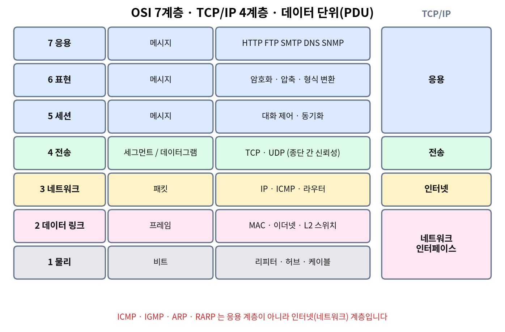

### TCP/IP 4계층

아래에서 위로 **네트워크 인터페이스 → 인터넷 → 전송 → 응용** 순서입니다.

| TCP/IP 계층 | 대응하는 OSI 계층 | 대표 프로토콜 |
|---|---|---|
| 응용 | 5~7 | HTTP, FTP, TFTP, SMTP, POP3, IMAP, DNS, DHCP, SNMP, Telnet, SSH |
| 전송 | 4 | TCP, UDP |
| 인터넷 | 3 | IP, ICMP, IGMP, ARP, RARP |
| 네트워크 인터페이스 | 1~2 | 이더넷, PPP |

### 시험 포인트

- **ICMP, IGMP, ARP, RARP는 응용 계층이 아닙니다.** 인터넷(네트워크) 계층입니다. SMTP·SNMP·TFTP는 응용 계층입니다.
- 암호화·압축은 **표현 계층**, 오류 제어·프레이밍은 **데이터 링크 계층**, 종단 간 신뢰성은 **전송 계층**입니다.
- 데이터 링크 계층의 기능이 아닌 것으로 "텍스트 압축·암호화"(표현 계층), "응용 프로그램 인터페이스"(응용 계층)가 자주 보기로 나옵니다.
- **캡슐화(Encapsulation)**: 송신 측에서 사용자 데이터 앞(헤더)·뒤(트레일러)에 제어 정보를 덧붙이는 과정. 수신 측에서 이를 제거하는 과정은 **역캡슐화**입니다.
- 프로토콜의 3요소: **구문(Syntax)**=데이터 형식·부호화, **의미(Semantics)**=제어 정보·오류 처리, **타이밍(Timing)**=통신 속도·메시지 순서.

출제:
- 데이터 단위(PDU): `26.08` `26.05` `25.11` `25.02` `24.11` `24.02`
- OSI 계층별 기능: `26.08` `26.05` `26.02` `25.11` `25.05` `25.02` `24.11` `24.08` `24.05`
- 캡슐화: `26.08` `25.05` `25.02`
- 프로토콜 3요소(타이밍): `25.02` `24.08`
- TCP/IP 4계층 순서: `26.08`
- 같은 계층/다른 계층 판별: `25.08` `24.08`

---

## 1-2. IP 주소와 클래스

IPv4 주소는 32비트이며 8비트씩 4덩어리(옥텟)로 나눠 10진수로 씁니다. 각 옥텟은 **0~255** 범위입니다. (256이 들어간 주소는 유효하지 않습니다.)

### 클래스 구분 (첫 번째 옥텟 기준)

| 클래스 | 첫 옥텟 범위 | 기본 서브넷 마스크 | 용도 |
|---|---|---|---|
| A | 1 ~ 126 | 255.0.0.0 | 대규모 네트워크 |
| B | 128 ~ 191 | 255.255.0.0 | 중규모 |
| C | 192 ~ 223 | 255.255.255.0 | 소규모 |
| D | 224 ~ 239 | 없음 | 멀티캐스트 |
| E | 240 ~ 255 | 없음 | 연구용 예약 |

- 이진수 주소로 주는 문제는 **앞자리 비트**로 구분합니다. A는 `0`, B는 `10`, C는 `110`, D는 `1110`으로 시작합니다.
  - 예: `11101011.…`은 `1110`으로 시작하므로 D 클래스입니다.
- Class A의 기본 서브넷 마스크는 `255.0.0.0`입니다. (`254.0.0.0`은 오답 보기)

### 사설 IP 주소 (인터넷에서 쓰지 않는 내부용)

| 범위 | 클래스 |
|---|---|
| 10.0.0.0 ~ 10.255.255.255 | A |
| 172.16.0.0 ~ 172.31.255.255 | B |
| 192.168.0.0 ~ 192.168.255.255 | C |

- 사설 IP를 그대로 인터넷(공중망)에 설정하면 통신이 되지 않습니다. 사설 IP를 공인 IP로 바꿔주는 기술이 **NAT**입니다.
- `128.52.10.6`, `182.0.2.1`처럼 사설 범위 밖의 주소가 "사설 IP가 아닌 것"으로 출제됩니다.

### 특수 주소

| 주소 | 의미 |
|---|---|
| 127.0.0.1 (127.x.x.x) | **루프백(Loopback)**. 자기 자신에게 보내는 테스트용 |
| 호스트 부분이 모두 0 | 네트워크 주소 |
| 호스트 부분이 모두 1 | 브로드캐스트 주소 |
| 255.255.255.255 | 제한적 브로드캐스트 |

출제:
- 클래스 판별(다른 클래스 찾기·유효 주소): `26.08` `26.05` `25.02` `24.11`
- 사설 IP: `26.02` `25.05` `24.08` `24.02`
- 루프백 127.0.0.1: `26.02` `25.11` `25.02` `24.11`

---

## 1-3. 서브넷 마스크와 서브네팅 (가장 중요)

**서브넷 마스크**는 IP 주소에서 **네트워크 부분과 호스트 부분을 구분**하는 값입니다. 네트워크 부분은 이진수 `1`, 호스트 부분은 `0`으로 채웁니다.

- 목적지 호스트가 같은 네트워크에 있는지 판단할 때 사용합니다.
- 하나의 네트워크를 여러 개로 나눠 IP를 효율적으로 쓰고 트래픽을 관리하게 해 줍니다.
- **A, B, C 클래스가 모두 같은 서브넷 마스크를 쓰는 것이 아닙니다.** (이 문장이 틀린 보기로 `26.08` `24.02`에 출제)
- 라우터 간 경로 거리 지표, 포트 번호 결정, 프레임 오류 검출용 값이 **아닙니다**. (오답 보기)

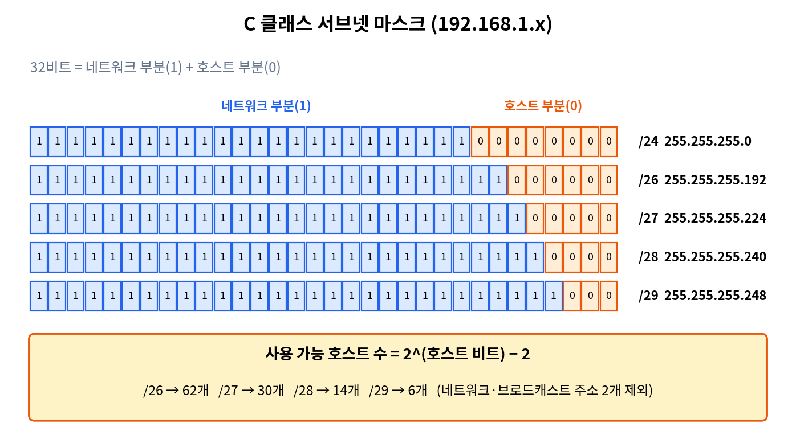

### C 클래스 서브넷 마스크 표 (꼭 암기)

| 마스크 | 표기 | 호스트 비트 | 서브넷 개수 | 서브넷당 사용 가능 호스트 수 |
|---|---|---|---|---|
| 255.255.255.0 | /24 | 8 | 1 | 254 |
| 255.255.255.128 | /25 | 7 | 2 | 126 |
| 255.255.255.192 | /26 | 6 | 4 | 62 |
| 255.255.255.224 | /27 | 5 | 8 | 30 |
| 255.255.255.240 | /28 | 4 | 16 | 14 |
| 255.255.255.248 | /29 | 3 | 32 | 6 |
| 255.255.255.252 | /30 | 2 | 64 | 2 |

### 계산 공식

- **사용 가능 호스트 수 = 2^(호스트 비트 수) − 2** (네트워크 주소와 브로드캐스트 주소 2개 제외)
- **서브넷 개수 = 2^(빌려온 비트 수)**
- 서브넷 하나의 크기(블록 크기) = 256 − 마스크의 마지막 옥텟 값
  - 예: 마스크 `…224` → 블록 크기 32 → 서브넷이 0, 32, 64, 96 … 으로 나뉩니다.

### 기출 유형별 풀이

| 문제 유형 | 풀이 | 답 | 출제 |
|---|---|---|---|
| 호스트 60개가 필요한 C 클래스 | 2^6−2=62 ≥ 60 → 호스트 비트 6 | 255.255.255.192 | `26.02` `24.11` |
| 서브넷당 PC 4~5대 | 2^3−2=6 ≥ 5 → 호스트 비트 3 | 255.255.255.248 | `26.05` |
| C 클래스 6개 서브넷 | 2^3=8 ≥ 6 → 3비트 빌림 | 255.255.255.224 | `25.02` |
| B 클래스 6개 네트워크 | 2^3=8 ≥ 6 → 3비트 빌림(3번째 옥텟) | 255.255.224.0 | `26.08` `24.08` |
| /26의 서브넷 개수 | 2^2 | 4개 | `25.05` |
| 255.255.255.240의 최대 호스트 | 2^4−2 | 14개 | `25.08` |
| 255.255.255.224의 최대 호스트 | 2^5−2 | 30개 | `24.02` |

### 사용 가능 마지막 IP / 브로드캐스트 구하기

- 예: 네트워크 `192.168.100.128`, 마스크 `255.255.255.192`(블록 크기 64)
  - 네트워크 주소 `.128` → 사용 가능 `.129 ~ .190` → 브로드캐스트 `.191`
  - **사용 가능한 마지막 IP = .190** (`24.05`)
- 예: 네트워크 `210.212.100.0`, 마스크 `255.255.255.224`(블록 크기 32)
  - 브로드캐스트는 `.31` → 방화벽에서 브로드캐스트 차단 대상은 `210.212.100.31` (`25.11`)

---

## 1-4. IPv4 헤더 · TTL · MTU · 단편화

### IPv4 헤더 주요 필드

| 필드 | 역할 |
|---|---|
| Version | IP 버전 (4) |
| Header Length(IHL) | 헤더 길이 |
| Type of Service | 서비스 품질(우선순위) |
| Total Length | 패킷 전체 길이 |
| Identification / Flags(DF, MF) / **Offset** | 단편화(분할) 관련. **분할된 데이터 조각의 순서·위치는 Offset으로 구별** |
| **TTL** | 패킷의 생존 시간 |
| Protocol | 상위 프로토콜 번호(TCP, UDP 등) |
| Header Checksum | **헤더**의 오류 검사 (데이터는 검사하지 않음) |
| Source / Destination Address | 출발지·목적지 IP |

- **ACK 필드는 IP 헤더에 없습니다.** ACK는 TCP 헤더의 플래그입니다. (`25.11` `24.02`)

### TTL (Time To Live)

- 패킷이 네트워크에서 무한히 돌지 않도록 **라우터를 지날 때마다 1씩 감소**합니다. 0이 되면 패킷을 버립니다.
- 단위는 "초"가 아니라 **남은 홉(Hop) 수**입니다. (`ping` 결과의 TTL=55를 "55초"로 해석하면 오답, `26.05`)
- TTL 값이 0이 되어 패킷이 폐기될 때 ICMP "시간 초과(Time Exceeded)" 메시지가 발생합니다.
- `ping`과 `tracert`는 TTL을 이용해 경로를 추적합니다.
- IP 패킷이 네트워크에서 영원히 존재한다는 설명은 틀립니다. (`25.02`)
- IPv6에서 TTL과 같은 역할을 하는 필드는 **Hop Limit**입니다.

### MTU (Maximum Transmission Unit)

- 한 번에 보낼 수 있는 **최대 패킷(프레임 데이터) 크기**입니다. 네트워크 종류마다 다르므로, IP 패킷이 MTU보다 크면 **단편화(분할)** 합니다.
- 이더넷(Ethernet V2)의 MTU는 **1500바이트**입니다. 고정값은 아닙니다.
- IPv6의 최소 MTU는 1280바이트입니다. (IPv4 기준 68바이트, IPv6 기준 68바이트라는 보기는 오답)
- IPv4는 라우터와 송신 호스트가 단편화할 수 있고, IPv6는 **송신 호스트만** 단편화합니다. IPv6에서 6000바이트 패킷을 이더넷으로 보내려면 **Fragmentation 확장 헤더**를 사용합니다. (`25.08`)

출제:
- IP 헤더 필드·ACK 없음: `25.11` `24.02`
- TTL: `25.02`
- Offset(분할 데이터 구별): `24.05` / 단편화: `25.05`
- Checksum(헤더만 검사): `24.05`
- MTU: `26.08` `24.11` `24.08`

---

## 1-5. IPv6

### 기본 특징

| 항목 | IPv4 | IPv6 |
|---|---|---|
| 주소 길이 | 32비트 | **128비트** |
| 표기 | 10진수 4덩어리 | **16진수 8덩어리**(각 16비트, 콜론으로 구분) |
| 주소 유형 | 유니캐스트·멀티캐스트·**브로드캐스트** | 유니캐스트·멀티캐스트·**애니캐스트** (**브로드캐스트 없음**) |
| 헤더 | 가변(옵션 포함), 체크섬 있음 | 고정 40바이트로 단순화, **체크섬 없음** |
| 주소 설정 | 수동 또는 DHCP | **자동 설정(Autoconfiguration, SLAAC)** 지원 |
| 보안 | IPsec 선택 | IPsec 지원이 설계에 포함 |
| 단편화 | 라우터·호스트 | 송신 호스트만 |

- IPv4에 비해 **새로 도입된 기능**은 "자동 설정(Autoconfiguration, SLAAC)"입니다. 체크섬, 복잡한 헤더, 선택적 IPsec은 IPv4 쪽 특징이거나 IPv6의 장점이 아닙니다. (`26.02` `25.11` `24.08`)
- 네트워크 혼잡 시 폐기 우선순위와 관련된 필드는 **Priority(Traffic Class)**, 패킷의 생존 기간과 관련된 필드는 **Hop Limit**입니다.
- IPv6는 IETF가 IPv4 주소 부족 문제의 해결 방안으로 만들었습니다.
- IPv6 이웃 탐색(ARP의 역할)은 ICMPv6의 **이웃 요청·광고 메시지(Neighbor Solicitation/Advertisement)** 가 수행합니다. (`25.08`)

### 주소 표기 규칙 (RFC 5952)

1. 각 16비트 필드의 **앞쪽 0은 생략**할 수 있습니다. (`00ff` → `ff`, `0a01` → `a01`)
2. **연속된 0 필드는 `::`로 한 번만** 줄일 수 있습니다. (두 번 이상 쓰면 어디가 몇 개씩 생략됐는지 알 수 없음)
3. 0이 연속되는 구간이 여러 개이면 **가장 긴 구간**을 줄이고, 길이가 같으면 **가장 왼쪽** 구간을 줄입니다.
4. 0 필드가 **하나뿐이면 `::`로 줄이지 않고 `0`으로 표기**합니다.
5. 영문자는 소문자로 표기합니다.

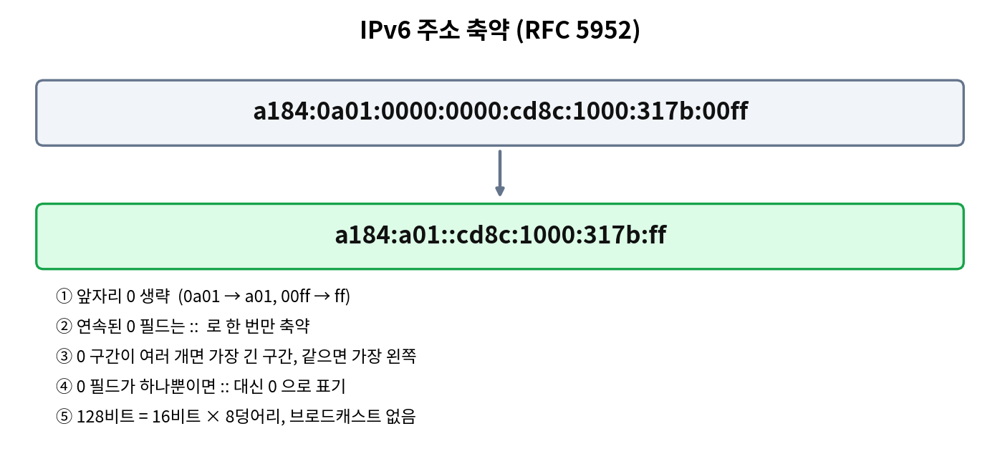

### 표기 변환 예제 (기출)

| 원래 주소 | 축약 결과 |
|---|---|
| `a184:0a01:0000:0000:cd8c:1000:317b:00ff` | `a184:a01::cd8c:1000:317b:ff` (`25.11` `24.02`) |
| `2000:AB:1::1:2` 의 복원 | `2000:00AB:0001:0000:0000:0000:0001:0002` (`25.08`) |

- 올바른 IPv6 주소 예: `3ffe:1900:4545:0003:0200:f8ff:ffff:1105` (8덩어리). `0000:002A:0080:c703:3c75`는 5덩어리이므로 틀립니다. `00:A0:C3:4B:21:33`은 MAC 주소 형식입니다. (`26.05` `25.02` `24.08`)

### IPv4 → IPv6 전환 기술

- **듀얼 스택(Dual Stack)**: 한 장비가 IPv4와 IPv6를 모두 사용
- **터널링(Tunneling)**: IPv6 패킷을 IPv4 패킷 안에 넣어 전송
- **프로토콜 변환(Protocol Translation)**: IPv4와 IPv6 간 변환
- **NAT44는 전환 기술이 아닙니다.** (IPv4 사설↔공인 주소 변환) (`26.08`)

출제: `26.08` `26.05` `26.02` `25.11` `25.08` `25.05` `25.02` `24.11` `24.08` `24.05` `24.02` (11회 모두)

---

## 1-6. TCP와 UDP

### 비교

| 구분 | TCP | UDP |
|---|---|---|
| 연결 방식 | **연결형**(연결 설정 후 전송) | **비연결형** |
| 신뢰성 | 높음 (오류 제어, 재전송, 순서 보장) | 낮음 (확인·재전송 없음) |
| 흐름 제어 | 있음 (**슬라이딩 윈도우**) | 없음 |
| 속도 | 상대적으로 느림 | 빠름 |
| 용도 | 파일 전송, 웹, 메일 등 정확성이 중요한 서비스 | DNS, TFTP, SNMP, DHCP, 실시간 스트리밍 |

- "TCP가 대량 데이터 전송에 유리해서 화상 통신 같은 **실시간 통신에 사용된다**"는 설명은 틀립니다. (`26.08` `25.02`)
- "TCP는 일부 데이터가 손실돼도 치명적이지 않은 프로그램에 적합하다"는 설명도 틀립니다. 이 설명은 UDP에 해당합니다. (`25.08`)
- TCP 흐름 제어 방식은 **슬라이딩 윈도우(Sliding Window)** 입니다. Go-Back-N, 선택적 재전송, Idle-RQ(Stop-and-Wait)는 ARQ 오류 제어 방식입니다. (`25.11` `24.02`)

### TCP 헤더 필드와 길이

| 필드 | 길이 |
|---|---|
| Source Port | 16비트 |
| Destination Port | 16비트 |
| Sequence Number | 32비트 |
| Acknowledgment Number | 32비트 |
| Flags | 9비트 (URG, ACK, PSH, RST, SYN, FIN 등) |
| Window | 16비트 |
| Checksum | **16비트** (32비트는 오답, `26.05` `25.08`) |

### TCP 플래그

| 플래그 | 의미 |
|---|---|
| SYN | 연결 요청(세션 성립 요청) |
| ACK | 확인 응답 |
| FIN | **연결을 정상적으로 종료** (`26.02` `25.08` `24.08`) |
| RST | 연결 강제 초기화(비정상 종료) |
| URG | 긴급 데이터 |
| PSH | 즉시 전달 요청 |

- **`UTC`는 TCP 플래그가 아닙니다.** (`26.05` `24.05`)
- TCP 오류 제어에 쓰이는 헤더 필드는 **Checksum**입니다. (`24.11`)

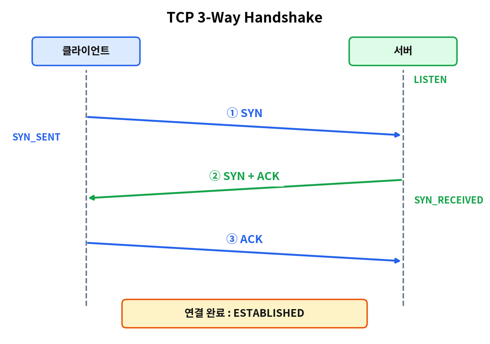

### TCP 3-Way Handshake (연결 수립)

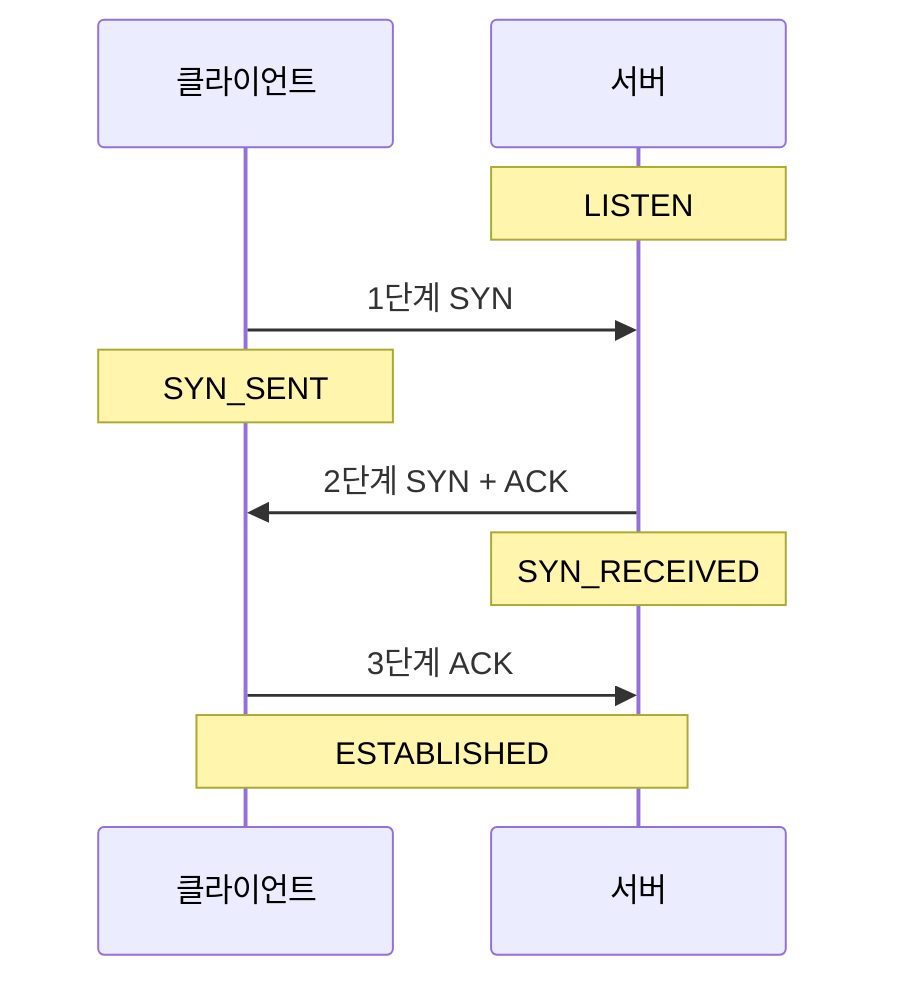

| 단계 | 방향 | 사용 플래그 |
|---|---|---|
| 1단계 | 클라이언트 → 서버 | **SYN** (세션 성립 요청, `25.11`) |
| 2단계 | 서버 → 클라이언트 | **SYN + ACK** |
| 3단계 | 클라이언트 → 서버 | **ACK** (`26.08` `24.11`) |

- 서버는 처음에 **LISTEN** 상태에서 대기하다가, 클라이언트의 SYN을 받으면 **SYN_RECEIVED** 상태로 바뀝니다. (`26.05` `25.02` `24.02`)
- 클라이언트는 SYN을 보낸 뒤 SYN_SENT, 최종 연결이 완료되면 양쪽 모두 ESTABLISHED가 됩니다.

### UDP 헤더

- 구성 필드: **출발지 포트, 목적지 포트, 길이, 체크섬** (각 16비트)
- **확인 응답 번호(Acknowledgment Number)와 Window 필드는 UDP 헤더에 없습니다.** (`26.08` `25.05` `25.02` `24.08`)
- UDP가 제공하는 오류 검사는 체크섬이며, 홀수·짝수 패리티는 제공하지 않습니다. (`25.11`)
- UDP는 메시지를 패킷으로 나누고 재조립하는 서비스, 도착 순서를 보장하는 서비스를 제공하지 않습니다. (`26.02`)

### TCP를 쓰는지 UDP를 쓰는지

| 구분 | 프로토콜 |
|---|---|
| TCP | FTP, Telnet, SSH, SMTP, HTTP, HTTPS, POP3, IMAP |
| UDP | **TFTP**, SNMP, DHCP, BOOTP |
| TCP·UDP 모두 사용 | **DNS** (`26.05` `26.02`) |

- "TCP를 사용하는 프로토콜이 아닌 것"으로 **TFTP**가 반복 출제됩니다. (`25.05` `24.05` `24.02`)

출제:
- TCP/UDP 특징: `26.08` `25.08` `25.02`
- UDP 헤더·특징: `26.08` `26.02` `25.11` `25.05` `25.02` `24.08` `24.05`
- TCP 헤더 길이: `26.05` `25.08`
- 3-Way Handshake·상태: `26.08` `26.05` `25.11` `25.02` `24.11` `24.02`
- TCP 플래그(UTC, FIN): `26.05` `26.02` `25.08` `24.08` `24.05`
- TCP/UDP 구분: `26.05` `26.02` `25.05` `24.05` `24.02`

---

## 1-7. ICMP · ping · tracert

### ICMP (Internet Control Message Protocol)

- 인터넷(네트워크) 계층 프로토콜로, **IP 패킷 처리 중 발생하는 오류 보고와 네트워크 상태 질의**에 사용합니다.
- 오류를 **보고**할 뿐 **정정해 주지는 않습니다.**
- TTL은 IP 헤더의 필드이며, "ICMP가 TTL을 제공한다"는 설명은 오답 보기로 출제됩니다. (`26.02` `24.02`)
- 호스트의 물리적 주소를 제공하는 것은 ARP입니다.

### ICMP 메시지 타입 (암기)

| 타입 | 이름 | 용도 |
|---|---|---|
| **0** | Echo Reply | 에코 응답 |
| **3** | Destination Unreachable | 목적지 도달 불가 |
| **4** | Source Quench | 흐름 제어·폭주 제어 |
| **5** | Redirect | 라우터가 호스트에게 대체 경로를 알림 |
| **8** | **Echo Request** | 에코 요청(ping) |
| **11** | Time Exceeded | TTL이 0이 되어 패킷 삭제 |
| **12** | Parameter Problem | 헤더 값 오류 발견 |
| **13** | Timestamp Request | 시간 정보 요청 |
| **17** | Address Mask Request | 서브넷 마스크 요청 |

- 기출에서 틀린 보기로 자주 나온 것: "3 – Echo Request"(`26.08` `25.02`), "5 – Echo Request"(`25.05` `24.05`), "0 – Echo Request"(`24.08`). Echo Request는 **8번**, Echo Reply는 **0번**입니다.
- ICMP 메시지로 옳지 않은 것으로 "호스트의 IP 주소가 중복된 경우"가 출제됩니다. (`24.11`)

### ping

- ICMP **Echo Request**를 보내고 **Echo Reply**를 기다려 연결 상태와 **왕복 시간(RTT)** 을 확인하는 진단 도구입니다.
- 오류를 정정해 주지는 않습니다. (`25.11`)
- TCP/IP 구성 파라미터(IP, 게이트웨이 등)를 확인하는 도구는 ping이 아니라 `ipconfig`입니다. (`25.05`)
- Windows에서 `ping -t 주소`는 **중단하기 전까지 계속** 에코 요청을 보냅니다. (`25.08`)

### ping 결과 읽는 방법 (반복 출제)

```
64 bytes from 210.103.175.224: icmp_seq=1 ttl=54 time=7.45 ms
64 bytes from 210.103.175.224: icmp_seq=2 ttl=54 time=7.17 ms
64 bytes from 210.103.175.224: icmp_seq=3 ttl=54 time=7.08 ms
3 packets transmitted, 3 received, 0% packet loss
rtt min/avg/max/mdev = 7.085/7.237/7.450/0.155 ms
```

- 대상(host)은 ping 뒤에 적은 주소/도메인입니다.
- `min/avg/max/mdev` 순서입니다. **최소 7.085ms, 평균 7.237ms, 최대 7.450ms**이므로 "평균이 7.450ms"는 틀린 설명입니다. (`26.02` `25.08` `24.05`)
- `TTL`은 초가 아니라 남은 홉 수입니다. (`26.05`)
- 응답 데이터 크기는 "32바이트"처럼 `바이트=` 항목에 표시됩니다.

### tracert / pathping (Windows)

| 명령 | 기능 |
|---|---|
| `tracert` | 목적지까지 거치는 **경로(홉)** 확인 |
| `pathping` | tracert와 같은 정보 + **홉 사이의 시간·손실 통계를 출력이 끝날 때까지 수집** (`26.05` `25.11` `24.05`) |
| `nslookup` | DNS 조회 |
| `nbtstat` | NetBIOS 정보 |

출제:
- ICMP: `26.08` `26.02` `25.11` `25.05` `25.02` `24.11` `24.08` `24.05` `24.02`
- ping 개념·결과 해석: `26.05` `26.02` `25.11` `25.08` `25.05` `24.05`
- pathping: `26.05` `25.11` `24.05`

---

## 1-8. 캐스트(전송 방식)와 IGMP

### 전송 방식

| 방식 | 의미 |
|---|---|
| **유니캐스트(Unicast)** | 한 호스트 → **다른 한 호스트** |
| **브로드캐스트(Broadcast)** | 한 호스트 → **같은 네트워크의 모든 호스트** |
| **멀티캐스트(Multicast)** | 한 호스트 → **특정 그룹에 속한 호스트들** |
| 애니캐스트(Anycast) | 그룹 중 **가장 가까운** 한 호스트 (IPv6) |

출제: `26.08`(브로드캐스트) `26.05`(유니캐스트) `25.11`(브로드캐스트) `25.08`(유니캐스트) `24.11`(유니캐스트)

### IGMP (Internet Group Management Protocol)

- **멀티캐스트 그룹에 가입한 호스트를 관리**하는 프로토콜입니다. 호스트가 그룹 가입·탈퇴 신호를 라우터·스위치에 전달하면 트래픽이 조정됩니다.
- 호스트와 인접 라우터 사이에서 동작하는 비대칭 구조입니다.
- 유니캐스트 통신용이 아닙니다. (`25.05`)
- IGMPv1에서는 첫 보고 메시지가 손실되어도 재전송하지 않습니다. (`25.05`)
- OSI 4계층(전송) 프로토콜이 아니라 인터넷 계층 프로토콜입니다. (`24.05`)

출제: `26.05` `26.02` `25.11` `25.05` `24.11` `24.05`

---

## 1-9. ARP · RARP · DHCP

### ARP (Address Resolution Protocol)

- **IP 주소를 이용해 물리 주소(MAC)를 알아내는** 프로토콜입니다.
- 목적지의 MAC을 모를 때 **ARP 요청을 브로드캐스트**로 보내고, 해당 호스트가 **응답**합니다.
- **ARP 캐시**에 IP–MAC 매핑을 일정 시간 보관합니다. 캐시를 쓰므로 통신할 때마다 매번 MAC을 다시 요청하지는 않습니다. (`25.05`) 캐시 항목은 생존 시간(TTL)이 있으며 사용되지 않으면 삭제될 수 있습니다.
- ARP 캐시는 IP를 **도메인 주소**로 매핑하는 것이 아닙니다. (IP ↔ MAC) (`25.08`)
- `ping`을 실행했을 때의 순서: **ARP 캐시 확인 → ARP 브로드캐스트 → (대상이) 자신의 IP와 일치하는지 확인 → ARP 응답** (`24.08`)

### RARP (Reverse ARP)

- **물리 주소(MAC)로 IP 주소를 알아내는** 프로토콜입니다. (ARP의 반대)
- 디스크가 없는 장비 등이 부팅할 때 사용했으며, **BOOTP, DHCP로 대체**되고 있습니다.
- "RARP는 IP 주소를 하드웨어 주소로 변환한다"는 설명은 틀립니다. (`24.02`)
- 부팅 시 IP가 없는 단말에 MAC 기반으로 IP를 자동 부여하는 데 주로 쓰이는 현재 기술은 **DHCP**입니다. (`25.11`)

### DHCP (Dynamic Host Configuration Protocol)

- 클라이언트에 **IP 주소와 네트워크 설정(서브넷 마스크, 게이트웨이, DNS)을 자동으로 할당**하는 프로토콜입니다. IP 충돌 감소, IP 관리 용이, 사용자가 자주 바뀌는 환경에 유리합니다.
- UDP 67(서버), 68(클라이언트) 포트를 사용합니다. 포트 53은 DNS입니다. (`25.11`)

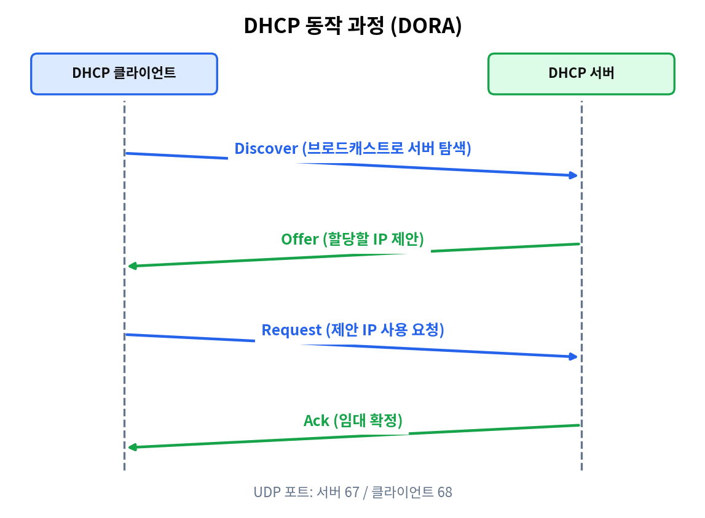

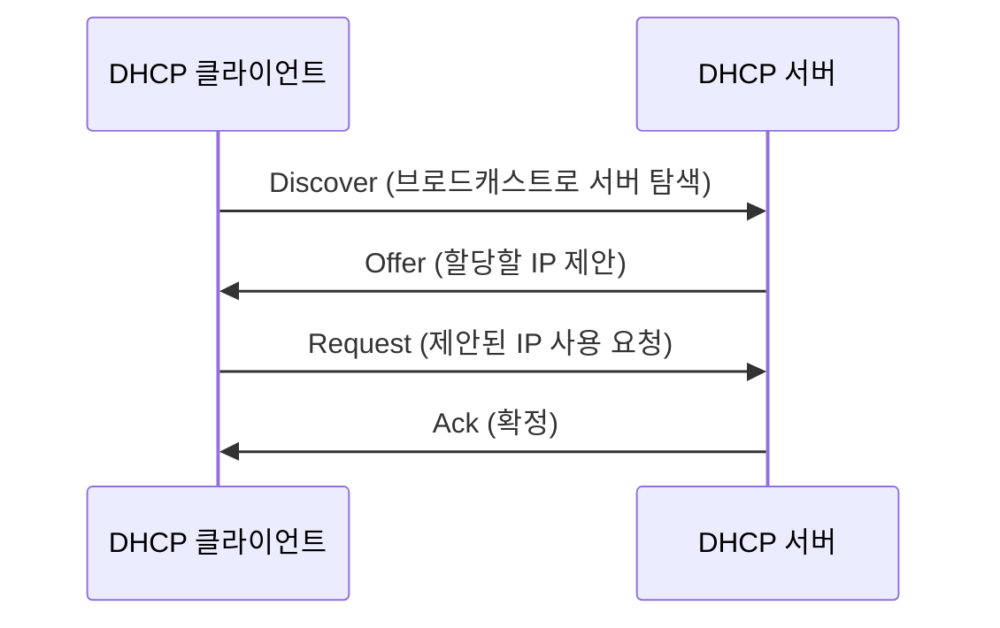

| 할당 방식 | 설명 |
|---|---|
| 수동 할당(Manual) | 관리자가 MAC별로 고정 IP 지정 |
| 자동 할당(Automatic) | 처음 받은 주소를 계속 사용 |
| 동적 할당(Dynamic) | 임대 기간 동안만 사용하고 반납 |

- **"우선순위 할당(Priority Allocation)"은 DHCP 방식이 아닙니다.** (`26.08`)
- 고정 IP가 필요한 **웹 서버·프린터·AP**에는 DHCP를 쓰기보다 고정 IP가 적합하고, **교육장용 PC**처럼 자주 바뀌는 단말에 DHCP가 적합합니다. (`25.08` `24.05`)
- IP 충돌이 잦으면 DHCP를 도입합니다.

### Windows Server의 DHCP 설정 포인트

- 새 범위의 **임대 기간은 일·시간·분 단위**로 설정합니다. (초 단위 아님)
- 주소를 분배할 때 적용하는 **지연 시간은 밀리초(ms)** 단위로 지정합니다. (`26.08` `25.02`)
- DHCP 서버는 Active Directory 환경이 아니어도 구성할 수 있으며, 클라이언트는 부팅 시 DHCP 서버를 찾기 위해 **브로드캐스트**를 보냅니다. (`25.11`)
- **MCLT(Maximum Client Lead Time)**: DHCP Failover에서 **파트너 서버가 기존 임대를 임시로 갱신할 수 있는 최대 시간** (`26.05`)

출제:
- ARP/RARP: `26.05` `26.02` `25.08` `25.05` `25.02` `24.08` `24.02`
- DHCP 개념·적용 장비: `26.08` `25.11` `25.08` `24.05`
- Windows DHCP: `26.08` `26.05` `25.02`

---

## 1-10. 주요 응용 프로토콜과 포트 번호

### 포트 번호 표 (암기)

| 포트 | 프로토콜 | 전송 계층 |
|---|---|---|
| 20 | FTP 데이터 | TCP |
| **21** | FTP **제어(명령·사용자 인증)** | TCP |
| **22** | SSH | TCP |
| 23 | Telnet | TCP |
| **25** | SMTP | TCP |
| **53** | DNS | UDP/TCP |
| 67 / 68 | DHCP | UDP |
| 69 | TFTP | UDP |
| **80** | HTTP | TCP |
| 110 | POP3 | TCP |
| **123** | NTP / SNTP(시간 동기화) | UDP |
| 143 | IMAP | TCP |
| **161 / 162** | SNMP | UDP |
| **443** | HTTPS | TCP |

- **Well-known 포트**는 **1~1023번**입니다. 이 포트로 서버를 실행하려면 **관리자(root) 권한**이 필요합니다. 일반 사용자가 `su`를 앞에 붙여 실행한다는 설명은 틀립니다. (`25.11` `24.05`)
- SNMP 포트를 143(IMAP), 181로 쓴 보기는 오답입니다. (`26.08` `25.08`)
- 시간 동기화 프로토콜은 **SNTP(123번)** 입니다. (`25.08` `24.05`)

### HTTP / HTTPS

- **HTTPS**는 HTTP에 **SSL/TLS 암호화**를 더한 것으로 TCP 443번을 사용합니다. 인증서를 통한 서버 신원 확인이 있습니다. (`26.02` `25.11` `24.11` `24.08` `24.05`)
- HTTPS가 UDP 443번을 쓰거나 인증이 필요 없다는 보기는 오답입니다.
- HTTP/2는 SPDY 기반으로 TCP 연결을 사용하며, **HTTP/3은 QUIC 기반으로 UDP를 사용**합니다. ("HTTP/3은 TCP 사용"은 오답, `25.08`)

### SMTP · POP3 · IMAP (메일)

| 프로토콜 | 역할 |
|---|---|
| **SMTP** | 메일 **송신(전송)** 프로토콜 (포트 25) |
| **POP3** | 서버에서 메일을 **내려받아** 확인 (기본적으로 내려받은 뒤 서버에서 삭제) |
| **IMAP** | 메일을 **서버에 둔 채** 여러 기기에서 접근·검색·동기화 |

- "POP3는 서버에 보관하면서 여러 기기에서 동기화하고, IMAP은 내려받은 뒤 삭제한다"는 설명은 **둘이 뒤바뀐 틀린 설명**입니다. (`26.05`)
- SMTP와 POP3가 모두 메일을 실시간 동기화한다는 설명도 틀립니다. (`25.05`)

### SSH

- Telnet과 달리 **데이터를 암호화**하여 전송하고, 무결성을 제공하며, **공개키 암호화**를 사용합니다. 포트는 **TCP 22**입니다.
- 리눅스·유닉스에서만 사용 가능한 것이 아닙니다. (`26.02` `24.08`)
- Telnet은 평문 전송, 포트 23입니다. SSH가 TCP 23번을 쓴다는 보기는 오답입니다. (`24.11`)

### FTP / TFTP

| 구분 | FTP | TFTP |
|---|---|---|
| 전송 계층 | **TCP** | **UDP** |
| 포트 | 제어 21, 데이터 20 | 69 |
| 인증 | 계정(로그인) 필요 (익명 접속도 가능) | 인증 없음, 단순 파일 전송 |
| 특징 | 대용량 신뢰성 전송 | 간단·빠르지만 **데이터 손실 가능성** |

- "TFTP의 기본 포트는 25번"은 오답이고, "FTP는 대량 데이터를 고속 전송하기 위해 UDP를 사용"도 오답입니다. (`26.02` `24.08`)
- **FTP 두 가지 모드**
  - **Active 모드**: 서버가 클라이언트의 지정 포트로 데이터 연결을 생성
  - **Passive 모드**: 서버가 데이터 포트를 열고 **그 포트 정보를 클라이언트에 알려주면 클라이언트가 접속** (`26.08`)
- FTP처럼 **연결 제어용 포트와 정보 전송용 포트를 구분**하여 사용하는 프로토콜은 FTP입니다. (`25.05`)

출제:
- HTTPS/포트: `26.02` `25.11` `25.08` `24.11` `24.08` `24.05`
- 메일(SMTP·POP3·IMAP): `26.08` `26.05` `25.05` `25.02` `24.08` `24.02`
- SSH: `26.02` `24.11` `24.08`
- FTP/TFTP: `26.08` `26.02` `25.11` `25.05` `25.02` `24.08` `24.02`
- SNTP: `25.08` `24.05`

---

## 1-11. SNMP (네트워크 관리 프로토콜)

- **네트워크 장비를 원격에서 관리·감시**하기 위한 응용 계층 표준 프로토콜입니다. (RFC 1157)
- **SNMP Manager**(관리 시스템)가 장비의 **SNMP Agent**와 통신하여 상태 정보를 조회하거나 설정을 변경합니다.
- Agent는 **MIB(관리 정보 데이터베이스)** 에 관리 정보를 저장합니다. (Agent가 정보를 저장하지 않는다는 보기는 오답, `26.08`)
- **UDP 161/162**를 사용합니다. **TCP를 이용한다는 설명은 오답입니다.** (`25.02` `24.05`)
- Manager가 주기적으로 **폴링(Polling)** 하여 정보를 수집하는 방식이라 트래픽이 많이 발생할 수 있는 단점이 있습니다. 네트워크 확장이 용이합니다.
- SNMPv2c는 암호화·인증을 기본 제공하지 않아 보안이 약합니다. (`25.08`)

출제: `26.08` `25.11` `25.08` `25.02` `24.11` `24.05`

---

## 1-12. DNS (도메인 네임 시스템)

- **도메인 이름 ↔ IP 주소**를 변환해 주는 **계층적·분산 데이터베이스** 서비스입니다. 방화벽 같은 보안 장비가 아닙니다. (`25.02`)
- 다음 접근에 쓰는 이름은 영문자, 숫자, 하이픈 중심이며 `@`, `#` 같은 특수문자로 구성되지 않습니다. (`25.05`)
- DNS 서버 없이 이름을 쓰려면 **`/etc/hosts` 파일**에 이름과 IP를 직접 적어 로컬 DNS처럼 사용합니다. (Windows는 `hosts` 파일) (`26.02` `24.11` `24.05`)
- 리눅스에서 DNS 서버 주소가 적힌 파일은 **`/etc/resolv.conf`** 입니다. (`24.05`)

### DNS TTL

- **DNS 레코드를 캐시 서버에 저장해 두는 시간**, 즉 **캐시에서 만료되기까지 남은 시간**입니다. IP 패킷의 TTL(홉 수)과 다릅니다. (`26.05` `25.11` `24.02`)
- TTL을 **짧게** 설정하면 변경이 빨리 반영되지만 DNS 쿼리가 늘어 서버 부하가 커질 수 있습니다.
- TTL을 **길게** 설정하면 부하는 줄지만 IP 변경 시 갱신이 늦어 서비스에 불편이 생길 수 있습니다. (`26.02`)
- TTL을 설정하지 않으면 정방향 조회가 불가능하다는 설명은 오답입니다. (`26.02`)
- TTL이 길면 DNS 부하가 늘어난다는 설명도 오답입니다. (`25.05` `24.11`)

### DNS 레코드 종류

| 레코드 | 용도 |
|---|---|
| **A** | 호스트 이름 → **IPv4** 주소 |
| **AAAA** | 호스트 이름 → **IPv6** 주소 |
| **CNAME** | **별칭(가상 도메인)** → 실제 도메인 이름 |
| **MX** | **메일 서버** 지정 |
| **NS** | 해당 영역의 **네임서버** 지정 |
| **PTR** | **IP → 도메인(역방향 조회)** (`26.08` `25.11`) |
| **SOA** | 영역(Zone) 관리 정보. Zone 파일의 **첫 번째 레코드** (`26.02`) |

- "NS 레코드는 사서함에 도달할 수 있는 라우팅 정보를 제공한다"는 설명은 **MX의 설명**이므로 오답입니다. (`25.02`)
- **정방향 조회**: 이름 → IP, **역방향 조회**: IP → 이름. 역방향에는 PTR 레코드를 씁니다.

### SOA 레코드 필드

- **일련번호**: 영역 파일의 개정 번호(변경 여부 확인에 사용)
- **주 서버**: 영역을 처음 설정한 서버
- **책임자**: 영역 관리자의 이메일(`@` 대신 `.`으로 표기)
- **새로 고침 간격(Refresh)**: 보조 서버가 주 서버의 변경을 확인하기 전에 대기하는 시간(주·보조 서버의 동기 주기)
- 이 외에 재시도 간격, 만료 시간, 최소 TTL이 있습니다. (`25.08` `25.05` `24.11`)

### 질의 방식과 기타

- **재귀적 질의**: 리졸버(Resolver)가 최종 결과를 받을 때까지 대신 조회
- **반복적 질의**: 네임서버가 다음에 물어볼 서버를 알려주는 방식 (`24.02`)
- **라운드 로빈 DNS**: 하나의 도메인에 여러 IP를 등록하고 질의 순서대로 IP를 번갈아 응답하여 서버 간 부하 분산 (`26.05` `25.08`)
- **DNSSEC**: DNS 응답의 **무결성과 출처 인증**을 제공하는 보안 확장입니다. 모든 쿼리를 자동 암호화하는 것은 아닙니다. (`25.11`)
- 클라이언트의 DNS 캐시 초기화: `ipconfig /flushdns` (`25.02`)

---

## 1-13. 라우팅 프로토콜

### 분류

| 구분 | 설명 | 프로토콜 |
|---|---|---|
| **거리 벡터(Distance Vector)** | 인접 라우터에게 **주기적으로** 라우팅 정보를 전달, 벨만-포드 알고리즘 | **RIP**, IGRP |
| **링크 상태(Link State)** | 각 라우터가 **자신의 링크 상태를 서로에게 알리고** 전체 지도를 만든 뒤 최단 경로 계산, **다익스트라** 알고리즘 | **OSPF** |
| **경로 벡터(Path Vector)** | **AS(자율 시스템) 간** 경로 정보 교환, 정책 기반 필터링 가능 | **BGP** |

- 거리 벡터 방식 설명(벨만-포드)에 **해당하지 않는 프로토콜은 OSPF**입니다. (`26.08` `24.11`)

### RIP

- 거리 벡터 방식, 메트릭은 **홉 수(Hop Count)** 하나뿐입니다. (`24.02`)
- 최대 15홉까지, 소규모 네트워크에 적합합니다. 기본 업데이트 주기는 30초입니다. ("대규모 네트워크용·업데이트 1초"는 오답)

### OSPF

- **AS 내부**에서 쓰는 링크 상태 라우팅 프로토콜
- **Hello 패킷**으로 이웃 라우터의 정상 동작을 확인
- 비용(Cost)이 가장 낮은 경로를 선택하지만, **동일 비용의 다중 경로도 사용 가능**합니다. "비용이 가장 낮은 단일 경로만 사용하고 다른 경로는 배제한다"는 설명은 오답입니다. (`26.05` `25.11`)
- IP 버전에 따라 OSPF 버전이 다릅니다(IPv4: OSPFv2, IPv6: OSPFv3).
- 서로의 현재 상태를 알려주는 **링크 상태 알고리즘**을 쓰는 프로토콜을 묻는 문제의 답이 OSPF입니다. (`25.08` `24.02`) 최단 경로 탐색의 기본 알고리즘은 **다익스트라**입니다. (`24.05`)

### BGP

- **경로 벡터** 방식으로 AS 간에 경로를 교환하며 정책 기반 경로 선택이 가능합니다. (`26.05`) 동일 AS 내부 최단 경로 계산용이 아닙니다.

### 정적 라우팅 vs 동적 라우팅

- **정적 라우팅**: 관리자가 경로를 직접 설정, 라우터 부하가 적고 메모리 관리에 유리, 우선순위가 높음 (`24.08`)
- **동적 라우팅**: 라우팅 프로토콜이 자동으로 경로를 설정하며 네트워크 변화에 능동적으로 대처

출제: `26.08` `26.05` `25.11` `25.08` `24.11` `24.08` `24.05` `24.02`

---

# 2과목. 네트워크 일반

## 2-1. 오류 제어와 흐름 제어

### ARQ (Automatic Repeat reQuest, 자동 재전송 요구)

오류가 발생하면 수신 측이 재전송을 요구하는 방식입니다.

| 방식 | 동작 |
|---|---|
| **Stop-and-Wait ARQ** | 프레임 1개를 보내고 ACK를 받은 뒤 다음 프레임 전송 |
| **Go-Back-N ARQ** | 오류가 발생한 프레임**부터 이후 모든 프레임을 재전송** (`26.08` `25.08` `24.02`) |
| **Selective Repeat ARQ** | 오류가 발생한 프레임**만** 재전송 |
| **Adaptive ARQ** | 채널 상태에 따라 **프레임 길이를 동적으로 변경**하여 전송 효율 극대화 (`26.02` `25.05` `24.08`) |

- **FEC(Forward Error Correction)** 는 수신 측이 스스로 오류를 정정하는 방식으로, 재전송 방식인 ARQ가 아닙니다. (`25.11`)
- 데이터를 보낸 뒤 ACK를 정해진 시간 안에 받지 못하면 재전송하는 기능은 **오류 제어(Error Control)** 입니다. (`26.05` `24.02`)

### 흐름 제어 (Flow Control)

- **수신 측이 처리할 수 있는 양·속도로 송신 측 전송량을 제한**하는 기능입니다. (`25.08`)
- 기법: **Stop-and-Wait, Sliding Window, XON/XOFF**
- **Loop/Echo는 흐름 제어와 관련이 없습니다.** (`26.02` `25.02` `24.05`)

### 채널 부호화

- 원래 정보에 오류 검출·정정용 비트를 추가해 전송하는 기술입니다. 예: **컨볼루션 코드(Convolutional Code)** (`24.02`)
- ADPCM, ADM, PCM은 **원천 부호화(아날로그→디지털 변환)** 에 해당합니다.

---

## 2-2. 네트워크 토폴로지(구성 형태)

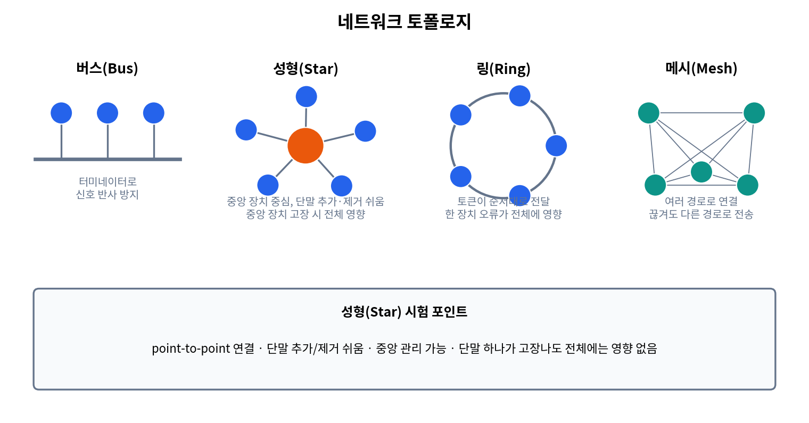


| 형태 | 특징 |
|---|---|
| **버스(Bus)** | 하나의 공통 회선에 연결. 끝에 **터미네이터(Terminator)** 를 달아 신호 반사를 방지 (`24.08`) |
| **성형(Star)** | **중앙 장치(스위치·중앙 컴퓨터)** 에 각 단말이 **point-to-point**로 연결. 단말 추가·제거가 쉽고 **중앙 관리가 가능**(`26.02` `25.08` `25.05`). 한 **단말**이 고장 나도 전체 통신망에 영향을 주지 않음(이 부분이 "영향을 준다"로 바뀐 보기가 오답, `26.08` `25.02` `24.05`). 단, 중앙 장치가 고장 나면 전체가 영향을 받음 |
| **링(Ring)** | 원형 연결, 토큰 전달. **한 장치 오류가 전체에 영향**. 확장성이 뛰어나다는 설명은 오답 (`24.02`) |
| **메시(Mesh)** | 노드들이 서로 여러 경로로 연결. 한 연결이 끊어져도 **자동으로 다른 경로로 전송**. **중앙 제어 없이도 망을 구성**할 수 있음 ("구성할 수 없다"는 오답, `25.08` `24.11`) |

### 무선 메시 네트워크(WMN)

- 고전적 네트워크의 기지국 중심 구조가 블루투스와 같은 유연한 **애드 혹(Ad hoc) 네트워크**로 변화한 형태입니다. 구성 장치가 데이터 통신 주체가 되어 **다른 장치의 트래픽을 릴레이·라우팅**합니다. 미국 군사 기술에서 출발했으며, AP를 전원만 연결하면 네트워킹이 가능해 설치가 편리합니다. (`26.05` `25.02`)

---

## 2-3. 매체 접근 제어(MAC) 방식

| 방식 | 설명 |
|---|---|
| **CSMA/CD** | 유선 이더넷. 채널이 사용 중인지 검사 후 전송, **충돌이 나면 데이터를 폐기하고 일정 시간 대기 후 재전송**. 충돌 도메인이 작을수록 좋음. 토큰 불필요 (`25.02` `24.08` `24.05` `24.02`) |
| **CSMA/CA** | **무선 LAN(Wi-Fi)**. 전송 전 채널 탐색, 랜덤 백오프, **RTS/CTS(옵션)** 로 충돌 회피 (`26.02`) |
| **토큰 패싱(Token Ring/Bus)** | **전송 권한(토큰)을 순차적으로** 부여하여 모든 노드가 공평하게 전송 (`25.05`) |
| TDMA | 시간 분할 |

- "CSMA/CD에서 데이터를 전송하려면 토큰이라는 권한이 필요하다"는 설명은 틀립니다. (`24.02`)

---

## 2-4. 이더넷과 IEEE 802 표준

### IEEE 802 표준 번호

| 표준 | 내용 |
|---|---|
| 802.3 | 이더넷 (CSMA/CD) |
| 802.4 | 토큰 버스 |
| 802.5 | 토큰 링 |
| **802.11** | **무선 LAN** |
| 802.15.1 | 블루투스 |
| 802.15.3 | UWB |
| 802.15.4 | **ZigBee** |
| 802.16 | WiMAX |

- WPAN(무선 개인 영역 네트워크) 표준 순서: **802.15.1 – 802.15.3 – 802.15.4** (`24.08`)
- 홈 오토메이션·센서 네트워크용 저전력 근거리 무선 기술로 IEEE 802.15.4 기반인 것은 **Zigbee**입니다. (`26.02`)
- 스마트홈에서 10m 이내의 짧은 거리의 기기를 연결하는 네트워크 영역은 **WPAN**(UWB, ZigBee, RFID, 블루투스)입니다. (`25.05` `24.11`)

### 이더넷 속도별 규격

| 규격 | 속도 | 매체 |
|---|---|---|
| 10BASE-T | 10Mbps | UTP |
| **100BASE-T (Fast Ethernet)** | 100Mbps, CSMA/CD | UTP (`25.08` `25.05` `24.05`) |
| **1000BASE-T** | **1Gbps**(1000Mb/s), IEEE 802.3ab | **UTP** (`25.11`: "1000Kb/s"는 오답) |
| **1000BASE-SX / LX** | 1Gbps | **광케이블** (`26.08` `26.02`) |
| 10GBASE-SR / LRM | 10Gbps | 광케이블 |

### Wi-Fi(IEEE 802.11) 세대

| 표준 | 별칭 | 특징 |
|---|---|---|
| 802.11b | | 2.4GHz, 11Mbps |
| 802.11a | | 5GHz, OFDM, 최대 54Mbps |
| 802.11g | | 2.4GHz, OFDM, 54Mbps (11b와 호환) |
| 802.11n | Wi-Fi 4 | MIMO |
| 802.11ac | Wi-Fi 5 | 5GHz |
| **802.11ax** | **Wi-Fi 6** | **OFDMA, MU-MIMO, 최대 1024QAM**, 고밀도 환경에 강함 (`25.11` `25.02`) |
| 802.11ad | | **60GHz** 밀리미터파 (`24.05`: 802.11ac가 60GHz라는 설명은 오답) |
| 802.11be | Wi-Fi 7 | |

- **MIMO**: **다수의 안테나**로 데이터를 송수신하는 다중 안테나 신호 처리 기술(고속·대용량 전송) (`25.02` `24.08`)

---

## 2-5. 전송 매체와 전송 장애

### 광케이블(Optical Fiber)

- **빛**으로 데이터를 전송하며 **중심부의 코어(Core)와 이를 둘러싼 클래딩(Cladding)** 으로 구성됩니다. (`26.08` `25.08` `24.05` `24.02`)
- 신호 손실이 적고 **전자기 간섭이 없으며** 보안·잡음에 강해 **대역폭이 가장 넓습니다.** (`24.11` `24.08`)
- 싱글 모드형과 멀티 모드형이 있습니다.
- 단선되었을 때 동축케이블처럼 별도 장비 없이 선을 이어 쓸 수 없습니다. (`24.02`)
- 고속 대용량 SAN 구축에서 구리 기반 기가비트 이더넷의 대역폭이 부족할 때 업그레이드하는 매체는 **광케이블**입니다. (`26.05` `25.02`)

### 전송 손실·왜곡

| 현상 | 설명 |
|---|---|
| **감쇠(Attenuation)** | 전기 신호가 구리선을 따라 멀리 이동하면서 **크기가 약해지는 현상** (`24.08`) |
| **위상 왜곡(Phase Distortion)** | 여러 주파수 성분이 **서로 다른 지연 시간으로 도달**하여 생기는 왜곡 (`26.02` `25.08`) |
| 누화(Crosstalk) | 인접 회선 간 신호 간섭 |
| 충격성 잡음 | 순간적으로 발생하는 큰 잡음 |

### 다중화 방식

| 방식 | 설명 |
|---|---|
| **FDM** | 주파수 분할 |
| **TDM** | 시간 분할. **전송할 데이터가 없어도 타임 슬롯이 할당되어 대역폭 낭비** (`25.05` `24.11`) |
| **STDM(통계적 TDM)** | 데이터가 있는 단말에만 슬롯 할당 |
| **WDM** | **파장 분할**. 광케이블에서 파장별로 채널 다중화. **광증폭기로 무중계 장거리 전송 가능.** 광학적 방법으로 신호를 주파수(파장) 축에서 다중화하며, 시간축 다중화가 아님. 채널마다 전송 형식·속도·프로토콜이 달라도 됨 (`26.05` `25.05`) |
| 다중화(Multiplexing) | 여러 터미널이 하나의 회선을 공유하고 수신 측에서 다시 분리 (`25.08`) |

---

## 2-6. 교환 방식

| 방식 | 설명 |
|---|---|
| **회선 교환** | 통신 전 전용 회선을 설정 |
| **패킷 교환** | 메시지를 짧은 패킷으로 나눠 전송. **가상회선**과 **데이터그램**으로 분류 |
| **가상회선 방식** | 데이터 전송 전 목적지까지 **경로를 설정**하고 정해진 단위로 전송, 규정 시간 안에 전송할 데이터가 없으면 **경로를 해제** (`25.08` `24.08`) |
| 메시지 교환 | 메시지 전체 단위 저장 후 전달 |

- 패킷 교환망에서 "망에 유입되는 데이터가 많아질수록 **전송 속도가 빨라진다**"는 설명은 틀립니다. (`25.11` `24.11` `24.05`) 패킷 교환은 호 차단(블로킹) 현상이 없습니다.

---

## 2-7. VPN

- **인터넷 같은 공중망을 사설망처럼** 쓰는 기술로, 전용선 구축보다 훨씬 적은 비용으로 본사·지사 간 네트워크를 유지할 수 있습니다. (`26.05`)
- 구현 기술
  - **터널링(Tunneling)**: 두 호스트 간에 외부의 영향 없이 **가상 경로**를 설정 (`26.02` `24.11` `24.05`)
  - 암호화, 인증, 접근 통제
- 터널링 프로토콜

| 프로토콜 | 계층 | 특징 |
|---|---|---|
| PPTP, L2TP | 2계층 | |
| **IPsec** | **3계층** | **전송(Transport) 모드**: IP 페이로드만 암호화/캡슐화. **터널(Tunnel) 모드**: 원본 IP 패킷 전체를 새 IP 헤더로 캡슐화 (`26.08` `25.11`) |
| SSL/TLS | 전송~응용 | |

---

## 2-8. 클라우드·SDN·NFV

### 클라우드 배포 모델

- **public(공용), private(사설), hybrid(혼합)** 입니다. **on-premises(온프레미스)는 클라우드 환경 모델이 아닙니다.** (`26.08` `25.08`)
- 클라우드 컴퓨팅은 자원을 다수 사용자가 공유하는 **멀티 테넌트(multi-tenant)** 방식입니다. **단일 임차인(single-tenant)** 모델이라는 설명은 틀립니다. (`26.02` `24.11`)
- 사설 클라우드(private cloud)를 "회사 내·외부의 **모든 이용자**가 공유한다"고 설명하면 틀립니다. (`25.05` `25.02`)
- **서버리스 컴퓨팅**: 클라우드 제공자가 인프라를 관리하고, 사용한 자원량에 따라 요금을 계산하며, 자동으로 확장·축소됩니다. 사용자가 서버 인스턴스 프로비저닝과 OS 패치를 직접 관리해야 한다는 설명은 틀립니다. (`25.11`)

### SDN (Software Defined Networking)

- **제어 평면과 데이터 평면을 분리**하고 **소프트웨어로 중앙에서 네트워크를 프로그래밍·제어**하는 기술입니다. 모바일 멀티미디어 트래픽 급증과 동적 변화에 대응합니다. (`26.08` `25.05` `24.11`)
- SDS는 스토리지, SNMP는 관리 프로토콜, CLI는 명령행 인터페이스입니다.

### NFV (Network Functions Virtualization)

- **방화벽, 라우터, 로드밸런서 등 네트워크 기능을 소프트웨어(VNF)로 구현**해 유연하게 배포·확장하는 기술입니다. (`26.08` `25.08` `24.11` `24.05`)
- NFV를 **"하드웨어로 제어되는 네트워킹 기술"** 이라고 하면 틀립니다.
- **NFVI**는 물리 H/W 자원, 가상화 지원 기능, VNF 실행 지원 기능 등을 제공합니다.

### 기타 컴퓨팅 용어

- **포그 컴퓨팅(Fog Computing)**: 데이터를 먼 데이터센터로 보내지 않고 **발생 지점 주변에서 분석·활용**하는 아키텍처 (`24.05`)
- **CDN(Content Delivery Network)**: 콘텐츠 전송 최적화 네트워크

---

## 2-9. VLAN · 트렁크 · STP

### VLAN (Virtual LAN)

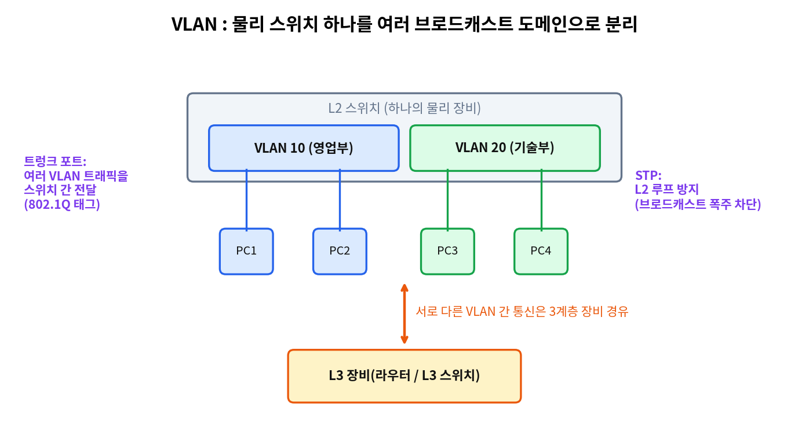


- **하나의 물리적 스위치를 논리적으로 분리하여 여러 개의 브로드캐스트 도메인**으로 나눕니다. (`26.08` `25.11` `24.11`)
- 데이터 링크 계층(2계층)에서 브로드캐스트 도메인을 나누는 기술입니다.
- **VLAN마다 서로 다른 보안 정책을 적용할 수 있습니다.** ("적용할 수 없다"는 오답, `24.08`)
- **서로 다른 VLAN 간 통신은 3계층 장비(라우터, L3 스위치)를 거쳐야** 합니다. (`24.11`)

### 트렁크와 태그

- 스위치끼리 연결해 여러 VLAN의 트래픽을 전달하는 인터페이스가 **트렁크(Trunk)** 입니다. (`26.08` `25.05`)
- 이더넷 프레임에 **VLAN 식별 태그(IEEE 802.1Q)** 를 추가해 스위치 간 VLAN 트래픽을 전달하는 방식은 **태그(Tagged) 포트**입니다. (`25.08`)

### VTP (VLAN Trunking Protocol)

- 3가지 모드: **server, client, transparent**. `interface mode`는 없습니다. (`26.02`)

### STP (Spanning Tree Protocol)

- L2 스위치 네트워크에서 **다중 루프로 인한 브로드캐스트 폭주를 방지**하는 기술입니다. (`24.11`)
- **LACP**는 링크 결합 프로토콜입니다. (`26.08`)

---

## 2-10. NAT

- **사설 IP 주소를 공인 IP 주소로 변환**하여 공인 IP 사용을 절약하고, 내부 주소 구조를 외부에 노출하지 않아 **보안상 이점**이 있습니다. (`26.05` `26.02` `25.11` `25.08` `25.05` `24.05`)
- 3계층(네트워크 계층) 주소 변환입니다. **2계층(프레임 단위) 기술이 아닙니다.** (`25.11`)
- **정적 NAT**: 내부 사설 IP를 공인 IP와 **1:1**로 매핑
- **PAT(포트 주소 변환)**: 여러 사설 IP가 **하나의 공인 IP의 서로 다른 포트**로 매핑되어 인터넷 접속을 공유
- 포트 포워딩은 외부 요청을 내부 서버로 전달하는 것이며 부하 분산 기능이 아닙니다. VPN 터널 생성, MAC 기반 접속 허용·차단은 NAT의 역할이 아닙니다. (`26.05`)

---

## 2-11. 무선 LAN 채널

- 무선 채널은 **번호로 구분**되며, 두 채널이 사용하는 **주파수 대역이 겹치면 간섭**이 생길 수 있습니다.
- 채널은 장비가 자동 선택하거나 관리자가 수동으로 지정할 수 있습니다.
- **무선 호스트는 AP와 통신할 때 채널을 이용합니다.** ("이용할 수 없다"는 오답, `26.05`)

---

# 3과목. NOS (네트워크 운영체제)

## 3-1. Linux 기본 개념

### 디렉터리 구조

| 디렉터리 | 용도 |
|---|---|
| `/` | 최상위(루트) 디렉터리 |
| `/bin` | 기본 명령어 |
| `/boot` | **부팅 가능한 커널 이미지** 파일 |
| `/dev` | 장치 파일 |
| **`/etc`** | **환경 설정 파일, 사용자 정보 파일** (`25.08` `24.08`) |
| **`/home`** | **일반 사용자 계정의 홈 디렉터리** |
| **`/proc`** | **동작 중인 프로세스·하드웨어·시스템 정보**를 확인하는 가상 파일시스템 (`25.11` `24.05`) |
| `/root` | root 사용자 홈 |
| `/tmp` | 임시 파일 |
| **`/usr`** | 응용 프로그램·라이브러리 (**사용자 계정이 위치하는 곳이 아님**, `26.08` `25.05` `24.11`) |
| **`/var`** | **로그 파일, 메일** 등 가변 데이터 |

### Shell과 Kernel

- **Shell**: 사용자가 입력한 **명령어를 해석해 Kernel에 전달**하는 명령어 해석기 (`26.05` `26.02` `25.05` `24.02`)
- **Kernel**: 운영체제의 핵심, 하드웨어 제어

### 부트 로더

- **GRUB**: Linux는 물론 **다른 운영체제와의 멀티부팅도 지원**하는 부트 로더 (`26.02` `24.02`)

### 파일 경로·이동 명령

| 명령 | 기능 |
|---|---|
| **`pwd`** | **현재 작업 디렉터리를 절대 경로로** 표시 (`26.02` `25.02`) |
| `cd ~` | 현재 위치와 관계없이 **자신의 홈 디렉터리로 이동** (`25.11`) |
| `mv -i file1 file2` | `file2`가 존재하면 **덮어쓸지 물어봄** (`24.08`) |
| `cat 파일 \| more` | 내용이 많을 때 **한 페이지씩** 보기 (`26.02`) |

### 출력 방향 변경 (리다이렉션)

| 기호 | 의미 |
|---|---|
| `>` | 파일에 **새로 쓰기(덮어쓰기, overwrite)** |
| `>>` | 파일 끝에 **추가(append)** |
| `<` | 파일 내용을 **입력으로** 사용 |

- 예: `ls -al > output.txt` → 결과를 `output.txt`에 저장, 기존 내용은 덮어씀 (`26.05` `25.08` `24.05`)

### 사용자 계정 파일 `/etc/passwd`

```
user1:x:500:500::/home/user1:/bin/bash
```

| 순서 | 필드 | 값 |
|---|---|---|
| 1 | 로그인 ID | user1 |
| 2 | 패스워드 | `x` (실제 암호는 `/etc/shadow`에 저장) |
| 3 | UID | 500 |
| 4 | GID | 500 |
| 5 | 설명(주석) | (비어 있음) |
| 6 | 홈 디렉터리 | /home/user1 |
| 7 | 기본 Shell | /bin/bash |

출제: `26.08` `25.02` `24.08`

### 사용자 추가·권한 있는 명령

- `useradd -g icqa network` → 사용자 **network**를 **기본 그룹 icqa**로 생성 (`25.05`)
- **`root`만 사용 가능한 명령**: `chown` (`26.05` `24.02`). `pwd`, `ls`, `rm`(자기 파일 대상)은 일반 사용자도 가능합니다.
- `chown`은 파일·디렉터리의 **소유자와 소유 그룹을 변경**합니다. (`chmod`는 권한 변경) (`25.08` `24.05`)

---

## 3-2. Linux 파일 권한 `chmod` (11회 모두 출제)

### 권한 구조

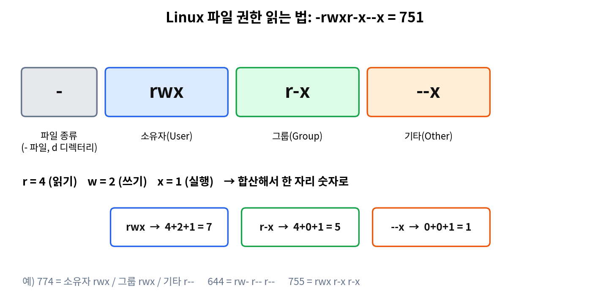


`-rwxr-x--x` 는 다음과 같이 읽습니다.

| 위치 | 의미 | 예시 |
|---|---|---|
| 1번째 글자 | 파일 종류 (`-`=**일반 파일**, `d`=디렉터리, `l`=링크) | `-` |
| 2~4번째 | **소유자(User)** 권한 | `rwx` |
| 5~7번째 | **그룹(Group)** 권한 | `r-x` |
| 8~10번째 | **기타 사용자(Other)** 권한 | `--x` |

### 숫자(8진수) 계산

- **읽기(r)=4, 쓰기(w)=2, 실행(x)=1** 을 더해서 한 자리 숫자를 만듭니다.

| 권한 | 숫자 |
|---|---|
| `rwx` | 7 |
| `rw-` | 6 |
| `r-x` | 5 |
| `r--` | 4 |
| `--x` | 1 |
| `---` | 0 |

- `-rwxr-x--x` = 7(rwx) 5(r-x) 1(--x) = **751** (`26.05` `24.02`)
  - 소유자: 읽기·쓰기·실행 / 그룹: **읽기·실행** (실행만 아님) / 기타: **실행만**

### 기출 유형

| 요구사항 | 답 | 출제 |
|---|---|---|
| 소유자·소유 그룹이 아닌 사람은 **볼 수만 있고 수정·실행 불가** | `chmod 774 sample` (기타 = `r--` = 4) | `26.08` `25.11` `24.11` |
| 소유자가 아닌 사람은 **볼 수는 있지만 수정은 불가** | `chmod 644 manager` (`rw-r--r--`) | `25.02` |
| **모든 사용자의 쓰기 권한 금지** | `chmod a-w sample` | `25.05` |
| 디렉터리와 **하위 전체**에 소유자 `rwx`, 그룹·기타 `r-x` | `chmod -R 755 /var/www/upload` (**-R**은 하위 항목까지 재귀 적용) | `26.02` `24.08` |
| 기존 권한 `-rw-r--r--` 유지한 채 **모든 사용자에게 쓰기 추가** | `chmod 666 file`, `chmod a+w file`, `chmod ugo+w file` 은 모두 동일한 결과. **`chmod go=w file`은 다른 결과** (`go=w`는 그룹·기타를 `w`만으로 *설정*하여 읽기 권한이 사라짐) | `25.08` `24.05` |

### 기호 방식

- 대상: `u`(소유자), `g`(그룹), `o`(기타), `a`(전체)
- 연산: `+`(추가), `-`(제거), `=`(그 권한으로 지정)

출제: `26.08` `26.05` `26.02` `25.11` `25.08` `25.05` `25.02` `24.11` `24.08` `24.05` `24.02`

---

## 3-3. Linux 프로세스·시스템 관리 명령

| 명령 | 기능 |
|---|---|
| `ps` | 현재 프로세스 확인. `ps -ef \| grep 이름`으로 특정 프로세스 검색. **Daemon이 살아 있는지 확인** (`26.05` `25.08` `24.05`) |
| `ps afx`, `pstree` | 프로세스를 트리 형태로 확인 |
| **`top`** | **프로세스 상태를 실시간으로 모니터링**, 시스템 사용량 확인 (`26.08`) |
| `kill PID` | 프로세스 종료 |
| `nice` | 프로세스 우선순위 변경 |
| `free` | **사용 중·사용 가능한 메모리 용량** 확인 (`25.05` `24.02`) |
| `du` | 디렉터리(디스크) 사용량 |
| `df` | 파일시스템 사용량 |
| `pgrep` | 이름으로 프로세스 ID 검색 |

- **`top`은 "가장 우선순위가 높은 프로세스를 보여주는 명령"이 아닙니다.** 실시간 전체 상태 모니터링입니다. (`24.11`)
- **데몬(Daemon)**: 백그라운드에서 동작하며 시스템 서비스를 지원하는 프로세스입니다. "시스템 부팅 때만 시작될 수 있다"는 설명은 오답입니다. (`25.02`)
- 프로세스 목록 해석 문제(`ps -ef | grep /bin/sh`)에서는 컬럼 순서(UID, PID, **PPID**, …)를 보고 PPID, 종료 명령(`kill PID`)을 판단합니다. (`26.08` `24.08`)

### 시스템 종료·재부팅·런레벨

| 명령 | 기능 |
|---|---|
| `shutdown -h now`, `poweroff`, `halt`, `init 0` | **종료** |
| **`init 6`** | **재부팅** (종료 명령이 아님) (`25.02` `24.02`) |

| 런레벨 | 의미 |
|---|---|
| 0 | 종료(halt) |
| 1 | 단일 사용자 |
| **3** | **다중 사용자, 텍스트(CLI) 모드** |
| **5** | **다중 사용자 + GUI** (`24.05`) |
| 6 | 재부팅 |

### systemd (RHEL 계열)

- `systemctl start httpd` (서비스 시작), `systemctl enable sshd` (부팅 시 자동 시작), `systemctl status nginx` (상태 확인)
- **`systemctl passwd root`는 없는 명령**입니다. (`26.08`)

### 예약 작업 `crontab`

형식: **`분 시 일 월 요일 명령`**

- 요일: **0=일요일, 1=월요일** …
- **매주 월요일 오전 10시** → `0 10 * * 1 /etc/check.sh` (`25.08` `24.05`)

| 옵션 | 기능 |
|---|---|
| `-l` | 목록 보기 |
| `-e` | 편집 |
| **`-r`** | **삭제** (`26.05` `25.11` `24.11`) |
| `-u` | 사용자 지정 |

### 파일 속성

- `lsattr`: 파일 **속성** 확인. **`i` 속성**이 설정되면 **쓰기·삭제가 불가**합니다. (`25.11`)

---

## 3-4. Linux 네트워크·로그·디스크 명령

### `netstat` 옵션 (Linux)

| 옵션 | 기능 |
|---|---|
| `-a` | **모든** 연결 및 수신 대기 포트 표시 |
| `-n` | 주소·포트를 **숫자**로 표시 |
| `-t` | **TCP** 연결 표시 (※ "연결된 이후의 시간 정보 표시"가 아님, `26.05` `25.08`) |
| `-u` | UDP |
| `-p` | **PID와 프로그램 이름** 출력 |
| `-r` | **라우팅 테이블** 표시 |
| `-l` | 대기(LISTEN) 중인 포트 |

- **열려 있는 포트 정보를 확인하는 명령은 `netstat`입니다.** (`26.08` `25.02` `24.05`)
- 불필요한 서비스 포트가 열려 있는지 확인: `netstat -antp` (`24.08`)
- `ps`, `pstree`, `getenforce`로는 포트 정보를 확인할 수 없습니다.

### 로그 파일

| 파일/명령 | 내용 |
|---|---|
| **`/var/log/dmesg`** | **부팅 시 커널 메시지**. 하드웨어·디스크·메모리·CPU·장치 드라이버 이상 여부 점검 (`26.08` `24.08`) |
| `/var/log/cron` | cron 작업 로그 |
| `/var/log/lastlog` | 마지막 로그인 기록 |
| `/var/log/btmp` / **`lastb`** | **로그인 실패 기록**, 비인가자의 로그인 시도 이력 확인 (`26.02` `24.11`) |
| `xferlog` | FTP 전송 로그 |
| `history` | 사용자가 입력한 명령 이력 |

### 방화벽 `iptables`

- 외부에서 **Telnet(TCP 23)** 접근 금지: `iptables -A INPUT -p tcp --dport 23 -j DROP` (`24.05`)
  - 외부에서 들어오는 방향은 **INPUT**, 프로토콜은 **tcp**, 포트는 **23**, 동작은 **DROP**입니다.

### 디스크·파티션 관리

| 명령 | 기능 |
|---|---|
| `fdisk` | 파티션 설정(2TB 미만, MBR) |
| **`gdisk`** | **2TB 이상 디스크를 GPT로 파티셔닝** (`26.02`) |
| `mkfs` | **파일시스템 생성** |
| `mount` | 장치를 디렉터리에 **연결** |
| `fsck` | 파일시스템 점검(`fdisk`는 점검 명령이 아님, `25.02`) |

- 새 하드디스크를 추가해 사용하는 과정: **fdisk(파티션) → mkfs(파일시스템) → mount(연결)**. `cal`(달력)은 관계가 없습니다. (`25.05`)
- **`/etc/fstab`**: 부팅 시 자동으로 마운트할 항목과 옵션이 정의된 파일 (`24.11`)
- **SWAP 파티션**: 물리 메모리가 부족할 때 **디스크 일부를 메모리처럼** 사용하는 영역. 시스템에서 Swap이 많이 발생하면 메모리를 증설해야 합니다. 일반적으로 실제 메모리의 2배 정도로 설정하며, **추가할 수 있습니다**("추가 불가"는 오답). (`24.11` `24.08` `24.02`)
- 장치 이름 `/dev/sda5`: **SATA(sd) 인터페이스 디스크, 첫 번째 디스크(a), 5번째 파티션**. "다섯 번째 물리 디스크"가 아닙니다. (`24.08`)

### 파일 검색 `find`

| 옵션 | 기능 |
|---|---|
| `-name` | **파일·디렉터리 이름** 검색 (사용자 이름이 아님) |
| `-type` | 파일 종류(f=파일, d=디렉터리) |
| `-perm` | **권한(퍼미션)** 기준 검색 |
| `-user` | 소유자 기준 검색 |
| **`-exec`** | 찾은 파일에 **삭제 등 추가 명령 실행** (`25.11` `24.02`) |

### 암호 정책 `chage`

- 계정의 **암호 사용 기간·경고** 등을 설정합니다.

| 옵션 | 의미 |
|---|---|
| `-m` | 암호 변경 후 **최소** 사용 일수 |
| `-M` | **최대** 사용 일수 |
| **`-W`** | **만료 전 경고 일수** (10일 전 경고 → `-W 10`) (`26.02` `24.08`) |
| `-I` | 만료 후 비활성 일수 |
| `-E` | 계정 만료일 |

### vi 편집기

| 명령 | 기능 |
|---|---|
| `x` | **문자 하나 삭제** (`25.08`) |
| `dd` | 한 줄 삭제 |
| `:wq` | 저장 후 종료 |
| `:q` | 종료 (수정 내용이 있으면 **바로 종료되지 않음**) (`26.05`) |
| `:q!` | 저장하지 않고 **강제 종료** |
| `:10,20s/old/new/g` | 10~20행에서 `old`를 `new`로 치환, 한 줄에 여러 개 있어도 **모두**(`g`) 수정 (`24.05`) |

---

## 3-5. Linux 서버 설정 (Apache · BIND)

### Apache 웹서버 `httpd.conf`

| 지시자 | 기능 |
|---|---|
| **`Listen 8081`** | **서비스 포트 번호 변경** (`25.08` `24.11`) |
| **`KeepAliveTimeout 80`** | 접속 후 **80초 동안 요청이 없으면 세션 종료** (`25.11` `24.05`) |
| **`LimitRequestBody`** | **POST 요청 본문의 최대 크기 제한** (`26.02` `25.02`) |
| `DocumentRoot` | 웹 문서 위치 |
| `ServerRoot` | 서버 설치 위치 |
| `Options … Indexes` | **디렉터리 리스팅**(Directory Indexing) 허용. 이 옵션이 있으면 디렉터리 인덱싱 공격에 취약 (`25.05`) |

- 디렉터리 리스팅 방지, 심볼릭 링크 사용 방지 등 보안 설정을 하는 Apache 설정 파일은 `httpd.conf`입니다. (`24.08`)

### BIND (리눅스 DNS 서버)

- 주 설정 파일: **`/etc/named.conf`**
- `options` 지시자 예시

```
options {
  listen-on port 53 { any; };       # 53번 포트로 수신
  directory "/var/named";           # zone 파일 위치
  dump-file "…cache_dump.db";
  allow-query { any; };             # 모든 IP 대역에서 오는 질의 허용
  masterfile-format text;           # slave 동기화 시 text 형태
};
```

- **`directory`** 가 **zone 파일 위치**를 지정합니다. (`24.11`)
- **`allow-query { any; }`** 는 외부의 질의에 대해 모든 IP 대역을 허용한다는 의미입니다. (`26.02` `24.05`)
- DNS는 **UDP 53뿐 아니라 TCP 53**도 사용하므로 "방화벽에서 UDP 53번만 열면 된다"는 설명은 오답입니다. (`25.05`)
- 방화벽 설정은 `iptables`, BIND 설치 확인은 `rpm -qa | grep bind`, `named.conf` 오류 검사는 `named-checkconf`입니다. (`25.05`)

---

## 3-6. Windows Server 기본 도구·명령

### 네트워크 명령

| 명령 | 기능 |
|---|---|
| **`ipconfig /all`** | 호스트 이름, IP 주소, 서브넷 마스크, DNS 서버, 기본 게이트웨이 등 **전체 설정** 확인 (`26.05`) |
| `ipconfig /renew` | DHCP에서 **IP 주소 갱신(재할당)** (`26.02` `25.05`) |
| `ipconfig /release` | 할당받은 IP **반납** |
| `ipconfig /flushdns` | **DNS 캐시 초기화** (`25.02`) |
| `ipconfig /displaydns` | DNS 캐시 내용 확인 |
| `arp -a` | ARP 캐시 확인 |
| `tracert` / `pathping` | 경로 추적 |

### Windows `netstat` 옵션

| 옵션 | 기능 |
|---|---|
| `-a` | 모든 연결과 수신 대기 포트 |
| `-n` | 숫자 형식으로 표시 |
| **`-r`** | **라우팅 테이블** (`26.08`) |
| `-s` | 프로토콜별 통계 |
| **`-b`** | **포트와 연결된 실행 파일(프로세스)** 확인 (관리자 권한 필요) (`25.11`) |

- `netstat -an`으로 `ESTABLISHED` 연결과 외부 IP·포트(예: 443)를 확인해 비정상 접속 흔적을 찾을 수 있습니다. (`24.11`)
- `netstat`은 **IP 패킷이 목적지에 도착하기 위해 방문하는 게이트웨이의 순서 정보를 제공하지 않습니다.** 그 기능은 `tracert`입니다. (`24.02`)

### 관리 도구를 여는 명령 (실행창 Win+R)

| 명령 | 도구 |
|---|---|
| **`compmgmt.msc`** | 컴퓨터 관리 (※ `compmgmt`만 쓰는 보기는 오답, `25.08`) |
| `devmgmt.msc` | 장치 관리자 |
| `gpedit.msc` | 로컬 그룹 정책 편집기 |
| `secpol.msc` | 로컬 보안 정책 |
| **`certmgr.msc`** | **인증서 관리자** (`24.08`) |
| `eventvwr.msc` | **이벤트 뷰어** |
| **`perfmon`** | **성능 모니터** (일정 주기로 데이터 수집 시작, `25.05`) |
| **`inetmgr`** | **IIS 관리자** (`24.11`) |
| `wf.msc` | 방화벽 |
| `msconfig` | 시스템 구성 |
| `dsac.exe` | Active Directory 관리 센터 |

### 모니터링·로그 도구

- **리소스 모니터**: CPU, 메모리, 디스크, 네트워크 사용량을 **실시간**으로 확인합니다. **방화벽은 점검 항목이 아닙니다.** (`26.02` `24.11`)
- **이벤트 뷰어**: 시스템의 **종료·재부팅 이력**을 확인할 수 있습니다. 이벤트 뷰어의 **Windows 로그** 하위 항목은 **응용 프로그램, 보안, 설치, 시스템** 등입니다. (`25.11` `25.08` `24.08`)

### PowerShell

- 스크립트는 텍스트로 구성되며 **콘솔에서 대화형으로 사용**할 수 있고, **대소문자를 구분하지 않습니다.**
- **기존 DOS 명령도 사용할 수 있습니다.** ("사용할 수 없다"는 오답) (`26.08` `24.11`)

---

## 3-7. Windows Server — IIS · FTP · DNS

### IIS (인터넷 정보 서비스) 웹 서버

- **기본 웹사이트의 홈 디렉터리는 변경할 수 있습니다.** (`C:\inetpub\wwwroot`로 **반드시** 설정해야 하는 것이 아님, `26.08`)
- **기본 문서**는 추가 메뉴로 추가할 수 있고, 홈 디렉터리에 제공할 문서가 없으면 **디렉터리 검색** 기능으로 보여줄 항목을 지정합니다.
- **가상 디렉터리**: 별칭(Alias)을 만들어 **실제 경로**를 선택해 연결합니다.
- **하나의 IIS 서버에서 여러 웹사이트를 운영**할 수 있으며, **IP 주소, 포트 번호, 호스트 이름**의 조합(**바인딩**)으로 사이트를 구분합니다. 반드시 서로 다른 IP를 써야 하는 것은 아닙니다. (`26.08`)
- 기본 포트: **HTTP 80, HTTPS 443** (`26.08`)
- IIS **TCP 포트**는 논리적 포트 번호이며 "물리적인 시리얼 포트 번호"가 아닙니다. (`25.02`)
- IIS **로그 파일의 저장 위치는 변경할 수 있습니다.** (`26.02`)
- IIS는 **요청 필터링(Request Filtering)** 으로 특정 요청을 차단할 수 있고, HTTPS와 PHP를 지원합니다. (`25.11`)

### FTP 서버 설치

- **서버 관리자 → 역할 및 기능 추가 → Web Server(IIS)의 FTP Server 역할 서비스** 선택으로 설치합니다. PowerShell로도 설치할 수 있고, IIS의 FTP 기능만으로 SSH 기반 SFTP를 구성할 수는 없습니다. (`26.05`)

### DNS 서버 (Windows)

- **DNS 레코드의 TTL**은 레코드 캐싱 주기입니다. (앞의 DNS 정리 참조)
- **SOA** 레코드에서 `책임자`는 관리자의 이메일 주소를 `@` 대신 `.`으로 기입합니다. (`25.08`)
- 역방향 조회 영역에는 PTR 레코드를 사용합니다. (`26.08`)

---

## 3-8. Windows Server — Active Directory (10회 출제)

### 핵심 개념

- **Active Directory(AD)**: **사용자 인증과 디렉터리 기반의 자원 관리**를 수행하는 서비스입니다. IP 자동 할당(DHCP), DNS 동적 업데이트 차단, 방화벽 규칙 자동 구성이 아닙니다. (`26.05`)
- **도메인 컨트롤러(DC)**: AD 데이터베이스를 가지고 도메인의 인증을 처리하는 서버
- **조직 구성 단위(OU)**: **한 도메인 안에서 관리부, 회계부, 기술부 등 부서 단위로 세분화**하여 관리하는 단위 (`25.02`)
- **사이트(Site)**: 물리적 위치(네트워크 구간) 기반 구성 단위
- **트러스트(Trust)**: **도메인 또는 포리스트 사이에 신뢰할지 여부에 대한 관계**. 서로 다른 도메인의 클라이언트와 서버 간에 **인증·권한 부여**를 제공하기 위해 **두 도메인 사이에 설정**합니다. 포리스트 안의 도메인 사이에는 **상호 양방향 전이(Transitive) 트러스트**가 기본입니다. (`26.08` `25.08` `24.08` `24.05`)

### 사용자 계정 관리

- **Active Directory 사용자 및 컴퓨터**에서 **도메인 사용자 계정을 만들고 보안 그룹의 구성원으로 추가**할 수 있습니다. (`26.08`)
- 암호 정책은 **Windows Server의 보안 정책**을 따릅니다(사용자가 임의로 설정하는 것이 아님). 도메인 사용자 계정을 만들었다고 해서 모든 리소스에 자동으로 접근할 수 있는 것은 아닙니다. 권한 설정이 필요합니다. (`26.08`)
- 도메인 사용자 계정 생성·수정·삭제 명령은 **`dsadd`, `dsmod`, `dsrm`** 입니다. **`net user`는 도메인 사용자 계정 관리용 명령이 아닌 것**으로 출제되었습니다. (`25.08`)
- Windows Server에 기본 생성되는 로컬 계정: **Administrator, DefaultAccount, Guest** (`root`는 Linux 계정, `24.11`)

### 그룹 정책(GPO)

- 도메인 내 PC·사용자를 중앙에서 관리합니다.
  - 가능: 암호 길이·복잡성, 계정 잠금 정책, 로그온 환경 제공(로밍), **소프트웨어 배포**
  - **"사용자가 사용할 소프트웨어를 배포할 수 없다"는 설명은 오답**입니다. (`24.08`)

### AD 그룹 범위

| 그룹 | 특징 |
|---|---|
| 글로벌 그룹 | 같은 도메인의 계정을 포함, 다른 도메인 자원에 접근 |
| 도메인 로컬 그룹 | 같은 도메인의 자원에 대한 권한 부여용 |
| **유니버설 그룹** | **포리스트 전체에 걸쳐 사용**하며 **여러 도메인의 사용자나 다른 그룹**을 포함할 수 있음 (`26.02`) |
| 로컬 그룹 | 로컬 컴퓨터 한정 |

### Windows 기본(로컬) 그룹

| 그룹 | 권한 |
|---|---|
| **Administrators** | 모든 권한. 구성원은 Administrator와 동일한 권한 |
| **Users** | 일반 사용자 계정이 기본으로 소속. **시스템 수준의 변경 권한은 없음** (`24.05`) |
| **Backup Operators** | 파일 백업·복구 |
| **Guests** | 임시 프로필, 기본적으로 사용하지 않도록 설정 |
| Power Users | 하위 호환용 그룹 (Administrator와 같은 권한이 아님) |
| **Remote Management Users** | **WMI** 자원 관련 원격 관리 권한 (`24.02`) |
| **Performance Monitor Users** | 성능 카운터·로그 확인 |
| **Access Control Assistance Operators** | **컴퓨터 자원에 대한 인증 속성**(권한 정보)을 읽는 권한 (`25.05`) |

---

## 3-9. Windows Server — Hyper-V · 원격 접속 · 암호화

### Hyper-V 특징

- **가상 컴퓨터(VM)를 다른 서버로 복제할 수 있습니다**(복제·가져오기·내보내기).
- **가상 하드 디스크를 VM이 실행 중일 때에도 다른 저장소로 이동**할 수 있습니다. (`26.02` `25.11` `24.08`)
- 하나의 물리 서버에서 **여러 개의 가상 컴퓨터**를 운영할 수 있습니다. 가상화를 하면 **하드웨어 사용률이 높아지고 유지비용이 줄며 서버 가용성이 높아집니다.** "가용성이 줄어든다", "사용률이 낮아진다"는 오답입니다. (`25.02`)
- 개발·테스트 효율성도 향상됩니다.

### 검사점(Checkpoint)

- **가상 머신의 특정 시점 상태를 저장하고 이후 그 시점으로 복원**하는 기능입니다. 업데이트·테스트 중 문제가 생기면 이전 상태로 되돌리는 용도입니다. (`26.08` `26.05`)
  - 예: Windows 10 VM에서 악성코드 실행 후 MBR이 손상되었을 때 **검사점**으로 복원합니다.
- "롤백", "타임머신"이라는 이름의 기능이 아닙니다. 내보내기(Export)는 가상 머신을 파일로 복사하는 것입니다.

### Windows 컨테이너 / Nano Server

- **Windows 컨테이너**: 애플리케이션 실행에 필요한 **경량화된 운영 체제 환경**만 포함하는 가상화 기술입니다. **Hyper-V 가상 컴퓨터는 완전한 OS를 포함하는 독립된 컴퓨터**로 간주되는 반면, 컨테이너는 **가상 컴퓨터와 유사한 격리 실행 환경을 제공하면서도 훨씬 가볍게 생성·운영**합니다. (`26.05` `25.05` `24.02`)

### 원격 접속·보안 기능

- **WAP(Web Application Proxy)**: DirectAccess·VPN과 달리 원격 컴퓨터를 네트워크에 연결하지 않고, **내부 웹 리소스를 인터넷에 게시**하는 기능 (`25.05` `24.08`)
- **DirectAccess**: 원격 사용자가 VPN 없이 내부 네트워크에 접속 (`24.02`)
- **BitLocker**: **하드디스크 전체 암호화**, 도난당해도 암호화 키 없이는 읽을 수 없음 (`24.08`)
- **EFS(암호화 파일 시스템)**: **파일·폴더 단위** 암호화. 인증서 확장자로 CER, P7B, PFX, SST 형식을 지원합니다. 개인 키는 암호만으로 보호하는 것이 아닙니다. (`24.02`)

---

# 4과목. 네트워크 운용기기

## 4-1. 네트워크 장비와 계층

| 장비 | 동작 계층 | 기능 |
|---|---|---|
| **리피터(Repeater)** | 1계층(물리) | 약해진 신호를 **단순 증폭·재생성**하여 전송 거리 확대 (`25.08`) |
| 허브(Hub) | 1계층 | 신호를 모든 포트로 전달 |
| **L2 스위치** | 2계층(데이터 링크) | 프레임의 **목적지 MAC 주소**를 확인한 뒤 해당 포트로 전송 (`26.02` `25.02` `24.08`) |
| **라우터(Router)** | **3계층(네트워크)** | **IP 주소**로 경로 설정. TCP/IP 인터넷 계층 장비 (`26.02`) |
| **L4 스위치** | **4계층(전송)** | TCP/UDP 포트 정보로 부하 분산 |
| L7 스위치 | 7계층(응용) | 응용 계층 정보까지 확인 |
| **게이트웨이(Gateway)** | 상위 계층 | **전혀 다른 프로토콜을 쓰는 네트워크 간 인터페이스** |

- L2 스위치가 프레임을 중계할 때 사용하는 주소는 **MAC 주소**입니다. (Post/URL/IP 주소가 아님, `24.05`)

### 게이트웨이

- **두 개의 완전히 다른 네트워크 사이에서 데이터 형식을 변환**하고 **프로토콜이 다른 네트워크 환경을 연결**합니다.
- 데이터 변환 기능이 있어 **병목 현상이 생기는 지점**이 될 수 있습니다.
- **"L2 스위치처럼 프레임만 중계한다"**, **"OSI 참조 모델에서 전송 계층만 연결한다"** 는 설명은 틀립니다. (`25.11` `24.02`)
- 케이블 집선 장치(허브), 신호 증폭(리피터), 물리 주소 캐시 테이블(ARP/스위치)은 게이트웨이의 역할이 아닙니다. (`26.05` `25.02`)

출제: 게이트웨이 `26.05` `25.11` `25.02` `24.02` / 장비 계층 `26.02` `25.08` `24.08` `24.05`

---

## 4-2. 로드밸런서 · L4/L7 스위치 (9회 출제)

### 로드밸런싱(부하 분산)

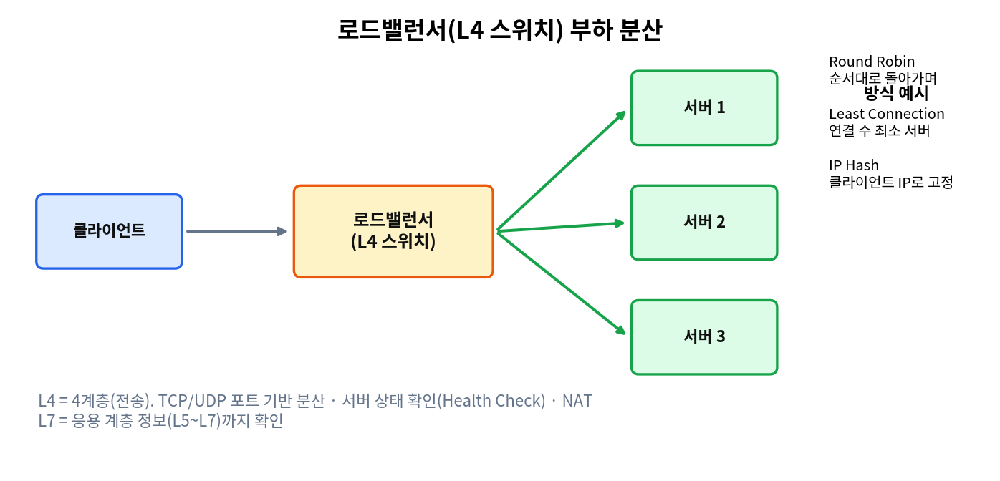


- **여러 서버로 요청을 분산**하여 처리량을 늘리고 지연·응답 시간을 줄이며 시스템 과부하를 피하는 기술입니다. 서버 상태를 확인해 **정상 서버로만 요청을 전달**하므로 장애 내성이 높아집니다. (`26.05` `24.02` `25.05`)

### 분산 알고리즘

| 방식 | 동작 |
|---|---|
| **Round Robin** | **특별한 규칙 없이 서버에 순서대로 돌아가며** 분배. DNS 서버가 클라이언트 요청 순서에 따라 각 IP를 교대로 응답하는 것도 같은 방식 (`26.05` `26.02` `25.08` `24.08` `25.02`) |
| Weighted Round Robin | 서버 가중치를 반영한 라운드 로빈 |
| **Least Connection** | **현재 연결 수가 가장 적은** 서버로 분배 |
| Weighted Least Connection | 가중치 + 최소 연결 |
| IP Hash | 클라이언트 IP로 서버를 고정 |
| Least Response Time | 응답 시간이 가장 짧은 서버로 분배 |

### L4 스위치

- **OSI 4계층(전송 계층)** 에 해당하는 장비입니다. **네트워크 계층 장비가 아닙니다.** (`26.08` `25.08`)
- **TCP, UDP, (HTTP 등) 포트·헤더를 분석**해 **서버 부하를 분산**합니다. 외부 요청은 모두 L4 스위치를 거쳐 서버로 분산됩니다.
- 기본 기능: **서버 상태 확인(Health Check), 알고리즘에 따른 분산, NAT**
- **애플리케이션 계층의 보안 기능은 L4의 기본 기능이 아닙니다.** (`25.11`)

### L7 스위치

- **응용 계층(7계층)** 에서 동작하며 **IP 주소와 포트 번호는 물론 L5~L7 정보까지** 보고 처리합니다.
- "TCP/UDP 헤더만을 기반으로 로드 밸런싱을 수행한다"는 설명은 틀립니다. (L4 설명) (`26.02`)
- L2·L3·L4 기능을 포괄해 제공할 수 있습니다.

출제: `26.08` `26.05` `26.02` `25.11` `25.08` `25.05` `25.02` `24.08` `24.02`

---

## 4-3. RAID (8회 출제)

**RAID**는 여러 개의 디스크를 묶어 하나의 디스크처럼 사용하는 기술입니다. (데이터를 병렬로 처리해 속도를 높이거나, 중복 저장해 장애에 대비)


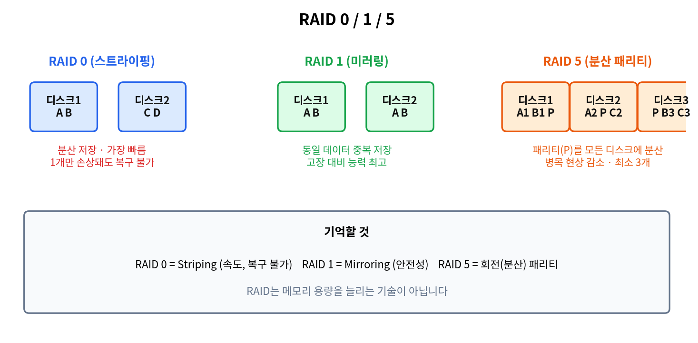

| 레벨 | 방식 | 특징 | 최소 디스크 |
|---|---|---|---|
| **RAID 0** | **스트라이핑(Striping)** | 데이터를 **분산 저장**, **가장 빠름**, **디스크 하나만 손상돼도 전체 데이터 복구 불가** (`25.11` `25.05` `24.05`) | 2개 |
| **RAID 1** | **미러링(Mirroring)** | 동일 데이터를 **다른 디스크에 중복 저장**, **고장 대비 능력 최고** (`26.05` `24.02`) | 2개 |
| RAID 3 | 전용 패리티 | 패리티를 **한 디스크에 집중** | 3개 |
| RAID 4 | 전용 패리티(블록 단위) | | 3개 |
| **RAID 5** | **분산(회전) 패리티** | 패리티를 모든 디스크에 분산하여 **병목 현상을 줄임** (`25.08`) | 3개 |

- RAID 0에서 "2개의 디스크 중 하나만 손상돼도 전체 복구 가능"은 **틀린 설명**입니다. (`25.05`)
- RAID는 메모리 용량을 늘려 주는 기술이 아닙니다. (`24.08`)
- 가동 중에 하드디스크에 장애가 생겨도 시스템 정지 없이 새 디스크로 교체할 수 있는 특징이 있으며(핫스왑), "여러 논리 드라이브를 하나의 물리 드라이브로 쓴다"는 설명은 반대입니다. (`25.02`)

출제: `26.05` `25.11` `25.08` `25.05` `25.02` `24.08` `24.05` `24.02`

---

## 4-4. 보안·접속 제어 장비와 기술

| 장비·기술 | 설명 |
|---|---|
| **방화벽(Firewall)** | **사전에 정의된 보안 정책과 접근 제어 규칙에 따라 트래픽을 허용·차단**. 자신을 **통과하는** 트래픽만 제어하며, 내부에서 발생하는 모든 공격을 완전히 막을 수는 없음. IP 주소·운영체제 프로세스 번호만으로 제어하는 것이 아님 (`26.08`) |
| **IDS** | 침입 **탐지** |
| **IPS** | 침입 **방지(차단)** |
| **WAF(Web Application Firewall)** | **웹서버 보호용** 전용 보안장비. **HTTP·HTTPS** 같은 웹 프로토콜 공격 방어 (`26.05` `25.05`) |
| **NAC(Network Access Control)** | 단말이 네트워크에 접속하기 전 **보안정책 준수 여부, IP·MAC 인가 여부를 검사**하여 인가된 사용자만 접속하도록 제어 (`25.02` `24.02`) |
| **PoE(Power over Ethernet)** | **UTP 케이블로 데이터와 전원을 동시에** 공급. 표준 전압 **직류 48V**, AP·CCTV 카메라 설치에 많이 사용. 전용 장치가 **PoE Switch** (`25.11` `24.05`) |
| **PXE** | **네트워크 카드를 통해 컴퓨터를 부팅**할 수 있게 하는 기술 (`26.05`) |

- **Proxy(프록시)**: 클라이언트가 다른 네트워크 서비스에 **간접적으로** 접속하게 해 주는 중계 서버. **캐시 기능**으로 트래픽을 줄이고 전송 시간을 향상시킵니다. (`24.02`)
- **네트워크 스토리지**: **NAS(Network Attached Storage)** 는 파일 단위로 네트워크에 연결된 스토리지, **SAN(Storage Area Network)** 은 스토리지 전용 고속 네트워크입니다. (`25.05` `26.05`)

---

# 5. 반복되는 오답 보기 패턴 (시험장 요약)

| 틀린 설명으로 자주 나오는 문장 | 올바른 내용 |
|---|---|
| A, B, C 클래스가 모두 같은 서브넷 마스크를 쓴다 | 클래스마다 기본 마스크가 다름 (A 255.0.0.0 / B 255.255.0.0 / C 255.255.255.0) |
| TCP는 실시간 통신(화상)에 적합 | 실시간·손실 허용은 UDP |
| SNMP는 TCP를 이용 | **UDP 161/162** |
| UDP 헤더에 확인 응답 번호·Window가 있다 | UDP 헤더는 포트 2개, 길이, 체크섬 |
| TCP Checksum 32비트 | **16비트** |
| ICMP Echo Request = 타입 0, 3, 5 | Echo Request는 **8**, Echo Reply는 **0** |
| TTL의 단위는 초 | **홉 수** |
| IPv6에서 브로드캐스트를 사용 | **없음**(멀티캐스트·애니캐스트로 대체) |
| FTP가 UDP 사용 / TFTP 포트 25 | FTP는 TCP(21, 20), TFTP는 UDP(69) |
| POP3는 서버 보관·동기화, IMAP은 삭제 | **IMAP**이 서버 보관·동기화, POP3는 내려받기 |
| OSPF는 단일 경로만 사용 | 동일 비용 다중 경로 사용 가능 |
| 패킷 교환은 유입 데이터가 많을수록 빨라짐 | 느려짐 |
| 성형(Star)은 단말 하나 고장 시 전체 영향 | 중앙 장치 고장 시에만 전체 영향 |
| 메시 네트워크는 중앙 제어 없이 구성 불가 | **가능** |
| 사설 클라우드는 내·외부 모든 이용자가 공유 / 클라우드는 단일 임차인 | 사설은 조직 전용, 클라우드는 멀티 테넌트 |
| on-premises는 클라우드 배포 모델 | 아님 (public / private / hybrid) |
| NFV는 하드웨어로 제어하는 기술 | **소프트웨어(VNF)** 로 구현 |
| NAT는 2계층 기술 | **3계층** |
| L4 스위치는 네트워크 계층 장비 | **전송 계층** |
| L7 스위치는 TCP/UDP 헤더만 본다 | 응용 계층 정보까지 확인 |
| 게이트웨이는 프레임만 중계 | 프로토콜 변환 |
| RAID 0은 디스크 하나 손상돼도 복구 가능 | **복구 불가** |
| `init 6`은 종료 | **재부팅** |
| `top`은 우선순위 최고 프로세스만 표시 | 실시간 전체 상태 모니터링 |
| `netstat -t`는 연결 시간 정보 표시 | **TCP** 연결 표시 |
| `/usr`은 사용자 계정 위치 | 사용자 계정은 **`/home`** |
| `chmod go=w`가 `a+w`와 동일 | `=`는 지정이므로 읽기 권한이 사라져 **다른 결과** |
| Hyper-V는 가용성을 줄이고 자원 사용률을 낮춘다 | 가용성 증가, 사용률 증가 |
| IIS 기본 사이트 홈 디렉터리는 반드시 `C:\inetpub\wwwroot` | **변경 가능** |
| PowerShell에서는 DOS 명령을 쓸 수 없다 | **쓸 수 있다** |
| `net user`로 도메인 사용자를 관리 | 도메인 계정은 `dsadd` `dsmod` `dsrm` |
| TTL이 길면 DNS 부하가 늘어난다 | 부하가 **줄어든다** |

---

# 6. 시험 직전 암기 체크리스트

- [ ] 클래스 범위: A 1~126 / B 128~191 / C 192~223 / D 224~239
- [ ] 사설 IP: 10.x / 172.16~31.x / 192.168.x
- [ ] 서브넷 호스트 수: /25=126, /26=62, /27=30, /28=14, /29=6, /30=2
- [ ] TCP 3-Way: SYN → SYN+ACK → ACK, 서버 상태 LISTEN → SYN_RECEIVED
- [ ] UDP 사용: DNS, TFTP, SNMP, DHCP
- [ ] 포트: 21 FTP제어, 22 SSH, 23 Telnet, 25 SMTP, 53 DNS, 80 HTTP, 110 POP3, 123 SNTP, 143 IMAP, 161 SNMP, 443 HTTPS
- [ ] ICMP: 0 Echo Reply, 3 도달불가, 5 Redirect, 8 Echo Request, 11 시간 초과, 13 Timestamp, 17 마스크 요청
- [ ] IPv6: 128비트, 브로드캐스트 없음, Hop Limit, SLAAC, `::`은 한 번만
- [ ] ARQ: Go-Back-N(그 지점부터 전부) / Selective(해당만) / Adaptive(프레임 길이 변경)
- [ ] 라우팅: RIP(거리벡터·홉) / OSPF(링크상태·다익스트라) / BGP(경로벡터·AS 간)
- [ ] VLAN = 브로드캐스트 도메인 분리, 트렁크 = VLAN 전달 포트
- [ ] chmod: r=4, w=2, x=1 / `-R`은 하위 포함
- [ ] crontab: 분 시 일 월 요일, `-r` 삭제
- [ ] netstat: Linux `-antp` / Windows `-r`(라우팅), `-b`(실행 파일)
- [ ] 로그: 부팅 커널 `dmesg`, 로그인 실패 `lastb`
- [ ] Windows: 검사점(Hyper-V), `perfmon`, `inetmgr`, `certmgr.msc`
- [ ] AD: 트러스트(도메인 간 신뢰), OU(부서 구분), 유니버설 그룹(포리스트 전체)
- [ ] 장비: L2=MAC, 라우터=3계층, L4=전송 계층 부하분산, WAF=웹 방어, NAC=접속 통제, PoE=전원+데이터, PXE=네트워크 부팅
- [ ] RAID: 0=스트라이핑(복구 불가) / 1=미러링 / 5=분산 패리티

---

> 참고: 이 문서는 업로드된 기출 11개 회차(2024.02~2026.08)의 문제와 정답표를 바탕으로 정리했습니다. 2024년 5월 해설집 PDF는 별도로 반영하지 않았으며, 정답이 의심스러운 문제는 전자문제집 CBT(www.comcbt.com)의 최신 수정본으로 확인하세요.
