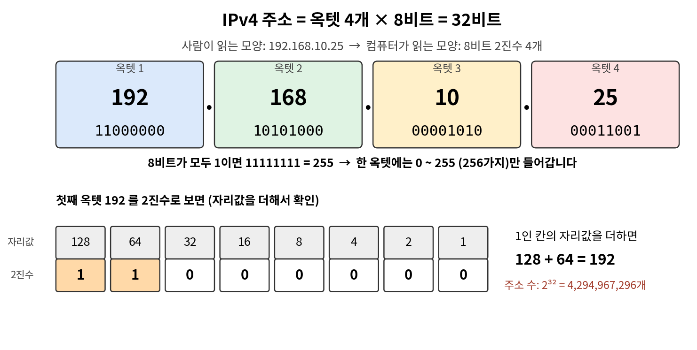
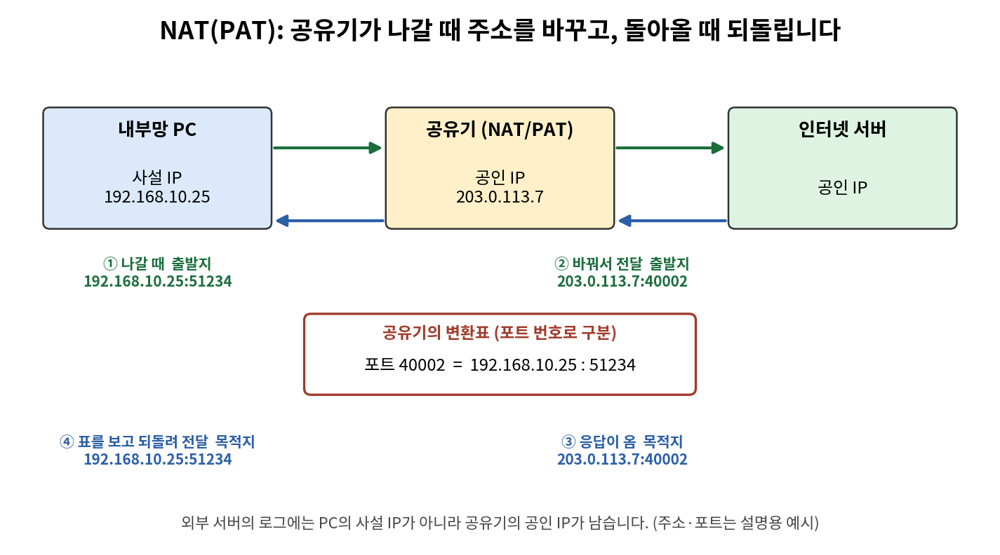
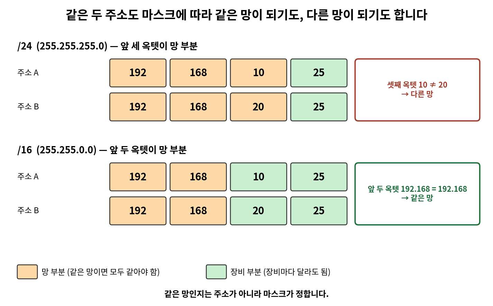
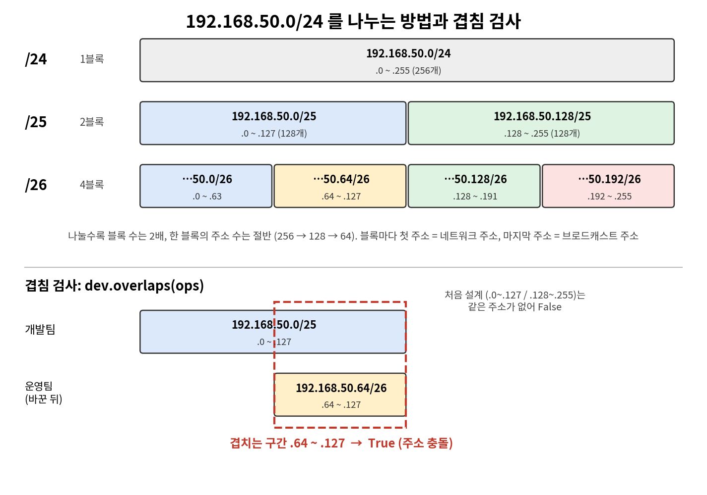
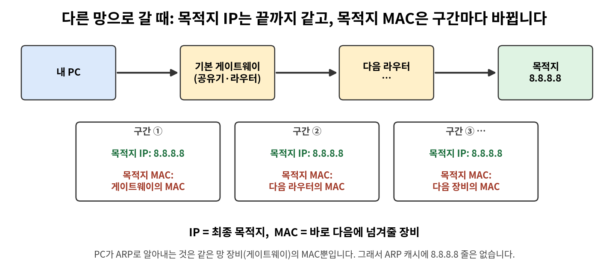
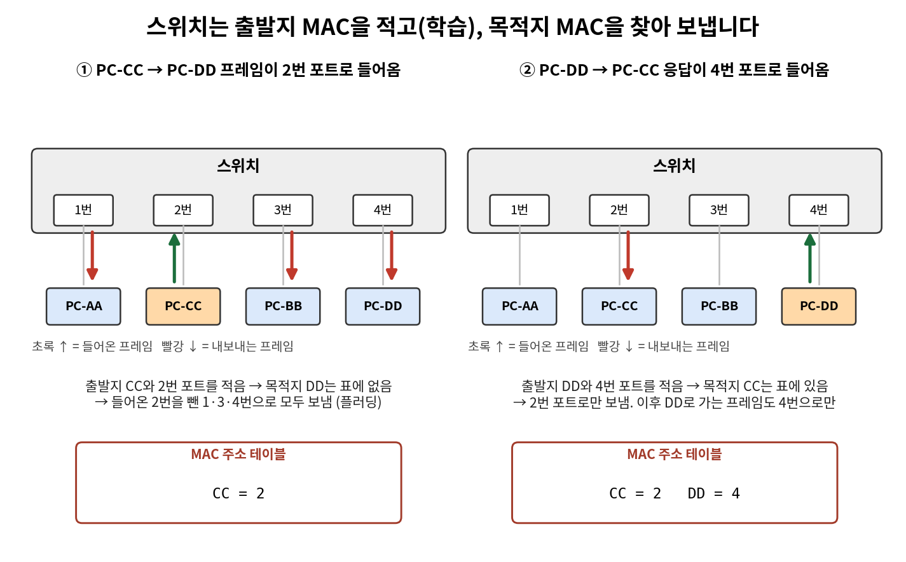
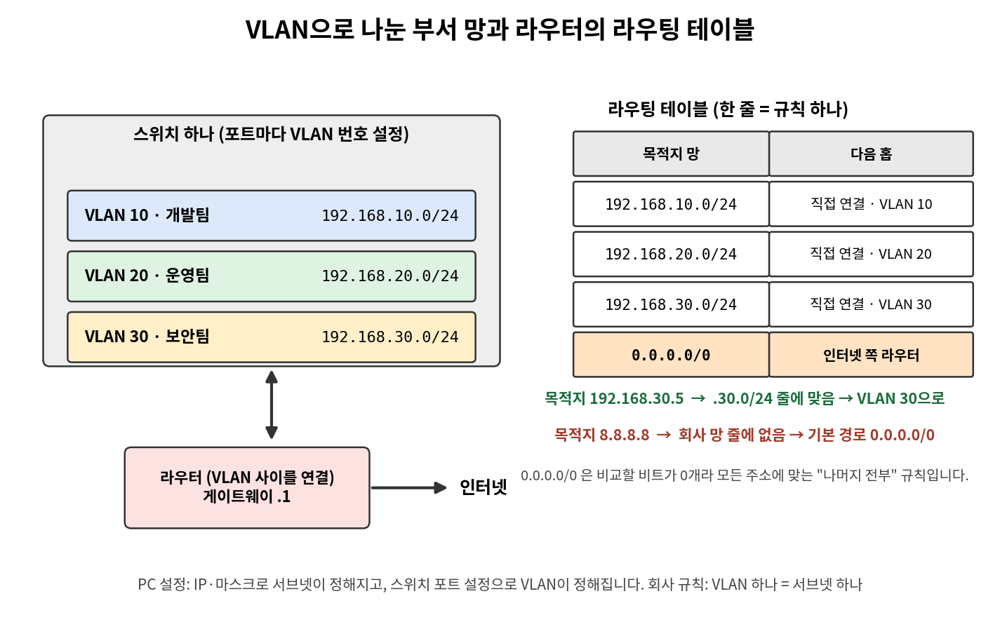

# 네트워크 2일차 정리 — IP 주소 · 서브넷 · 스위치 · 라우터 · VLAN

> 2026-10-13 (화) · 네트워크·ZT(제로 트러스트) 운영 기초 2일차
> 오전: IP 주소 구조, 사설 IP와 공인 IP, NAT, 서브넷 마스크, 서브네팅 · 오후: 스위치와 라우터, VLAN, 라우팅 테이블, 설계서 완성

---

## 0. 오늘 배운 것 한눈에 보기

| 시간 | 주제 | 핵심 질문 | 쓰는 것 |
|---|---|---|---|
| 오전 2교시 | IP 주소 구조 · 사설 IP와 공인 IP · NAT | 192.168로 시작하는 주소는 왜 많은가? | `ipconfig`, `curl`, 파이썬 |
| 오전 3교시 | 서브넷 마스크 · CIDR · 같은 망 판정 | 두 주소가 같은 망인지 어떻게 아는가? | `ipconfig`, `ipaddress` |
| 오전 4교시 | 서브네팅 | 회사 주소를 부서마다 어떻게 나누는가? | `subnets()`, `overlaps()` |
| 오후 5교시 | 스위치와 라우터 · MAC 주소 테이블 | 같은 망과 다른 망으로 보낼 때 무엇이 다른가? | `arp -a`, 파이썬 |
| 오후 6교시 | VLAN · 라우팅 테이블 · 기본 경로 | 나눈 망끼리는 어떻게 오가는가? | `ipconfig`, `tracert`, 파이썬 |
| 오후 7교시 | 처음 보는 주소로 다시 풀기 · 설계서 완성 | 배운 순서를 새 주소에 적용할 수 있는가? | 파이썬, `git` |

**2일차의 큰 흐름**

1. 어제 `ipconfig`에서 본 `192.168.0.15`는 **사설 IP**이고, 공유기가 **NAT**로 공인 IP로 바꿔서 인터넷에 내보냅니다.
2. IP 주소는 **망 부분**과 **장비 부분**으로 나뉘고, 어디까지가 망 부분인지는 **서브넷 마스크**가 정합니다.
3. 큰 망을 부서마다 작은 망으로 나누는 것이 **서브네팅**이고, 나눈 망이 모자라거나 **겹치지 않는지** 검증합니다.
4. PC는 보내기 전에 **목적지가 같은 망인지 계산**합니다. 같은 망이면 스위치로 바로, 다른 망이면 **기본 게이트웨이**로 보냅니다.
5. 스위치는 **MAC 주소**로 같은 망 안을, 라우터는 **IP 주소**로 다른 망 사이를 잇습니다. **VLAN**은 스위치 하나를 여러 망으로 나눕니다.

---

# Part 1. 오전 — IP 주소와 서브넷

## 1. IP 주소의 구조 (2교시)

### 1-1. 용어 정리

| 용어 | 뜻 | 예 |
|---|---|---|
| **비트 (bit)** | 0 또는 1 하나를 담는 2진수 한 자리. 컴퓨터가 다루는 가장 작은 정보 단위입니다. | IPv4 주소 하나는 32비트 |
| **2진수 (binary)** | 0과 1 두 글자로만 쓰는 수. 자리가 왼쪽으로 갈수록 값이 2배씩 커집니다(1 · 2 · 4 · 8 · …). | 192 = 128 + 64 = `11000000` |
| **옥텟 (octet)** | IP 주소에서 점으로 나뉜 숫자 하나(수업 자료에서는 「마디」). 8비트라서 0 ~ 255를 담습니다. | `192.168.10.25`는 옥텟이 4개 |

### 1-2. IPv4 주소는 32비트

`192.168.10.25`는 사람이 읽는 모양입니다. 컴퓨터는 옥텟 4개를 각각 **8비트 2진수**로 읽습니다. 그래서 IPv4 주소는 4 × 8 = **32비트**입니다.



| 옥텟 | 10진수 (평소 쓰는 수) | 2진수 (8비트) |
|---|---|---|
| 1 | 192 | `11000000` |
| 2 | 168 | `10101000` |
| 3 | 10 | `00001010` |
| 4 | 25 | `00011001` |

- 8비트가 모두 1이면 `11111111` = 255입니다. 그래서 한 옥텟에는 **0 ~ 255(256가지)** 만 들어갑니다.
- 비트 한 자리에는 0 또는 1, 두 가지 값이 들어갑니다. 자리가 하나 늘 때마다 경우의 수가 2배가 되므로, 32자리로 만들 수 있는 주소는 2³² = **4,294,967,296개(약 43억 개)** 입니다.
- 인터넷에 연결되는 장비가 이 수보다 많아졌기 때문에, 내부망에서는 **사설 IP**를 쓰고 **NAT**로 공인 IP 하나를 여러 PC가 함께 씁니다.

### 1-3. IPv4와 IPv6

| | IPv4 | IPv6 |
|---|---|---|
| 뜻 | 인터넷 프로토콜 4번째 버전의 규칙으로 쓰는 IP 주소 | 인터넷 프로토콜 6번째 버전의 규칙으로 쓰는 IP 주소 |
| 모양 | 점으로 나눈 숫자 4개: `192.168.0.15` | 콜론(`:`)으로 나눈 주소: `2001:db8::15` |
| 길이 | 32비트 | 128비트 |

IPv6는 IPv4보다 훨씬 많은 주소를 쓸 수 있도록 만들었습니다. 이번 수업의 서브넷 계산은 **IPv4**로 하고, IPv6는 생김새만 봅니다.

### 1-4. 10진수와 2진수 바꾸기 (13을 예로)

**① 10진수 → 2진수: 2로 나누고, 나머지를 아래에서 위로 읽기**

```text
13 ÷ 2 = 6  … 나머지 1
 6 ÷ 2 = 3  … 나머지 0
 3 ÷ 2 = 1  … 나머지 1
 1 ÷ 2 = 0  … 나머지 1
→ 아래에서 위로 읽으면 1101
```

**② 2진수 → 10진수: 1인 칸의 자리값을 더하기**

| 자리값 | 8 | 4 | 2 | 1 |
|---|---|---|---|---|
| 2진수 | 1 | 1 | 0 | 1 |
| 더할 값 | 8 | 4 | — | 1 |

8 + 4 + 1 = **13** ✔

IP 주소는 한 옥텟이 8칸이므로 앞을 0으로 채워서 `00001101`로 씁니다.

### 1-5. 파이썬으로 옥텟을 2진수로 바꾸기

```python
my_ip = "192.168.10.25"
parts = my_ip.split(".")             # 점에서 나눈 리스트: ['192', '168', '10', '25']

for part in parts:                   # 옥텟을 하나씩 꺼내 반복
    number = int(part)               # 글자 "192"를 숫자 192로
    bits = format(number, "08b")     # 숫자를 8자리 2진수 글자로
    print(part, bits)
```

```text
192 11000000
168 10101000
10 00001010
25 00011001
```

| 쓰는 것 | 뜻 |
|---|---|
| `글자.split(".")` | 글자를 점에서 나눈 **리스트**를 리턴합니다. |
| `리스트[0]` | 리스트의 첫 번째 값. 번호는 **0부터** 셉니다. |
| `int("25")` | 글자 `"25"`를 숫자 25로 바꿉니다. 글자인 채로는 더하기 계산을 할 수 없습니다. |
| `format(숫자, "08b")` | `b`는 2진수(binary)로 바꾸라는 뜻, `08`은 빈 앞자리를 0으로 채워 **8자리**를 만들라는 뜻입니다. |
| `len(글자)` | 글자 수를 리턴합니다. |

- `format(5, "08b")` → `00000101`, `format(255, "08b")` → `11111111`
- `08` 없이 `"b"`만 쓰면 `10`이 `1010`(4자리)이 되어 옥텟마다 길이가 달라집니다. 서브넷 마스크는 **비트 자리 단위**로 망 부분과 장비 부분을 나누므로, 옥텟마다 8자리로 맞춰 써야 합니다.
- `"08b"`를 따옴표 없이 `08b`로 쓰면 `SyntaxError`입니다. 글자로 넘겨야 합니다.

---

## 2. 사설 IP와 공인 IP (2교시)

### 2-1. 두 가지 IP

| | **사설 IP (private IP)** | **공인 IP (public IP)** |
|---|---|---|
| 쓰는 곳 | 회사·가정의 **내부망에서만** 씀 | **인터넷 전체에서 하나뿐인** 주소 |
| 누가 주나 | 내부망 관리자(공유기·네트워크 장비) | 통신사가 나눠 줌 |
| 인터넷 통신 | 이 주소 그대로는 **인터넷에서 통신하지 못함** | 인터넷의 서버들이 이 주소로 서로를 찾음 |
| 겹쳐도 되나 | 인터넷으로 나가지 않으므로 다른 회사와 **같은 주소를 써도 충돌하지 않음** | 겹치면 안 됨 |
| 예 | `192.168.10.25` | `8.8.8.8` (구글 DNS 서버) |

### 2-2. 사설 IP의 세 가지 범위

| 사설 IP 범위 | 예 | 주의 |
|---|---|---|
| `10.0.0.0` ~ `10.255.255.255` | `10.0.0.8` | **첫 옥텟이 10이면 전부** 사설 |
| `172.16.0.0` ~ `172.31.255.255` | `172.20.5.6` | ⚠️ **둘째 옥텟이 16~31일 때만** 사설. `172.32.5.6`은 **공인** |
| `192.168.0.0` ~ `192.168.255.255` | `192.168.10.25` | **첫 두 옥텟이 192.168**이면 사설 |

- 세 범위는 인터넷 공통 약속입니다(표준 문서 RFC 1918). **세 범위에 들지 않는 주소는 모두 공인 IP**입니다.
- 어제 PC마다 주소가 `192.168`로 시작했던 이유: 집·학원 공유기가 처음부터 사설 범위 `192.168`에서 주소를 나눠 주도록 설정되어 있기 때문입니다.
- 학원망 예: 서브넷 마스크 `255.255.0.0`(`/16`), 기본 게이트웨이 `192.168.1.1`

### 2-3. 사설·공인은 안전 여부가 아니라 사용 범위

| 구분 | 의미 | 로그를 볼 때 |
|---|---|---|
| 사설 IP | 회사·가정의 내부망에서만 쓰는 주소 | 내부 PC 주소일 수 있지만, **안전하다는 뜻은 아님** |
| 공인 IP | 인터넷에서 통신할 때 쓰는 주소 | 인터넷에서 보이는 주소일 수 있지만, **공격자라는 뜻은 아님** |

- 사설·공인은 **주소가 쓰이는 범위**를 구분합니다. 공격 여부는 통신 내용과 상황을 함께 보고 판단합니다.
- 관제 로그는 맨 앞 칸의 출발지 IP로 **내부망에서 온 접속인지 외부에서 온 접속인지**부터 가립니다.

```text
192.168.10.25 [10:05:12] "GET /intranet" 200      ← 사설 범위 → 내부망 PC. 자산 목록에서 어느 부서·누구의 PC인지 찾음
203.0.113.8   [10:05:40] "POST /login" 401        ← 사설 범위 밖 → 공인 IP, 외부. 같은 주소가 계속 접속하는지(로그인 실패 401 반복 등) 확인
```

> `203.0.113.8`은 문서 예시용으로 예약된 주소입니다(실제 사이트가 아님).

**실습: 내 주소 확인**

```bash
ipconfig                         # 내 IPv4 주소 (사설)
curl https://api.ipify.org       # 인터넷이 보는 내 주소 (공인)
```

두 주소는 **다릅니다.** `api.ipify.org`는 「내 요청이 어느 주소에서 왔는지」만 알려 주는 사이트이고, 그 주소가 공유기의 공인 IP입니다. 이 차이가 NAT 때문에 생깁니다.

---

## 3. NAT — 사설 IP를 공인 IP로 변환 (2교시)

### 3-1. NAT이란

**NAT (Network Address Translation, 나트·냇)** 은 내부망의 사설 IP를 인터넷으로 보낼 때 **공인 IP로 바꾸는 주소 변환**입니다. 집·학원의 **공유기**가 이 일을 합니다.

쓰는 이유는 두 가지입니다.

1. 사설 IP는 인터넷에서 쓸 수 없는 주소라서, 그대로 보내면 **응답이 돌아올 수 없습니다.**
2. IPv4 주소는 약 43억 개뿐이라 모든 PC에 공인 IP를 줄 수 없습니다. 공인 IP **하나를 내부망 PC 여러 대가 함께** 씁니다.

### 3-2. NAT의 세 가지 방식

| 방식 | 정의 | 쓰는 곳 |
|---|---|---|
| **정적 NAT** (Static NAT) | 사설 IP 하나와 공인 IP 하나를 **1 대 1로 고정**해 두는 NAT | 외부에서 접속하는 웹·메일 서버 |
| **동적 NAT** (Dynamic NAT) | 비어 있는 공인 IP를 **임시로 배정**하고, 접속이 끝나면 회수하는 NAT | 공인 IP를 여러 개 가진 회사망 |
| **PAT** (Port Address Translation) | 공인 IP **하나**로 내부망 PC 여러 대가 동시에 인터넷에 접속하는 NAT. 공유기가 PC마다 **다른 포트 번호**를 붙여 보내고, 응답이 오면 그 포트 번호로 원래 PC를 찾음 | **집·학원 공유기 대부분** |

- 정적 NAT = **공인 IP가 고정돼야 하는 서버용**입니다. 외부 사용자가 늘 같은 공인 IP로 찾아올 수 있어야 하므로, 인터넷에서 회사 내부망의 웹 서버에 접속하게 하려면 정적 NAT이 맞습니다.
- 동적 NAT = **PC 여러 대가 공인 IP 몇 개를 번갈아 쓰는 용도**(공인 IP 절약)입니다. 사원 PC는 밖에서 찾아올 일이 없어 공인 IP를 고정할 필요가 없습니다.

### 3-3. PAT의 동작 순서



| 순서 | 일어나는 일 | 예 |
|---|---|---|
| ① 나갈 때 | 공유기가 보내는 사람의 주소를 **자기 공인 IP로 바꿔서** 내보냄 | `192.168.10.25` → `203.0.113.7` |
| ② 기록 | 어느 PC가 보냈는지 **변환표**에 적어 둠 (포트 번호로 구분) | 포트 `40002` = `192.168.10.25:51234` |
| ③ 돌아올 때 | 응답이 오면 변환표를 보고 **원래 PC로 전달** | `203.0.113.7:40002` → `192.168.10.25` |

주소와 포트는 설명용 예시이고, `203.0.113.x`는 문서 예시용 주소입니다.

> 🔒 **보안 관점:** 외부 서버의 로그에는 내 PC의 사설 IP가 아니라 **공유기의 공인 IP**가 남습니다. 그 공인 IP 하나를 내부망 PC 여러 대가 함께 쓰므로, 로그의 주소만으로는 어느 PC인지 알 수 없습니다. 실제 PC를 찾으려면 **통신한 시각**과 공유기·방화벽의 **NAT 변환 기록**(공인 IP 쪽 포트 ↔ 내부 사설 IP·포트)을 함께 봐야 합니다.

---

## 4. 서브넷 마스크와 CIDR (3교시)

### 4-1. 왜 필요한가

- 두 주소가 **같은 망**인지 알아야 통신이 어떤 장비를 거쳐 가는지 말할 수 있습니다.
- 같은 망이면 **스위치**가 바로 전달하고, 다른 망이면 **게이트웨이(라우터)** 를 거칩니다. 방화벽 규칙도 이 경계를 기준으로 씁니다.
- 그 경계를 정하는 값이 `255.255.255.0` 같은 **서브넷 마스크**입니다.

### 4-2. 용어 정리

| 용어 | 뜻 | 예 |
|---|---|---|
| **서브넷 (subnet)** | 큰 망을 나눈 **작은 망** 하나. 같은 서브넷 안의 장비끼리는 공유기·라우터를 거치지 않고 바로 통신합니다. 회사는 부서마다 서브넷을 나눠 부서끼리 오가는 통신을 따로 관리합니다. | 개발팀 서브넷, 운영팀 서브넷 |
| **서브넷 마스크 (subnet mask)** | IP 주소에서 **어디까지가 같은 망인지** 정하는 값. `255`인 옥텟은 망 부분, `0`인 옥텟은 장비 부분입니다. | `255.255.255.0` |
| **CIDR (사이더)** | 서브넷 마스크를 `/숫자`로 짧게 쓰는 표기. `/` 뒤의 숫자는 마스크를 2진수로 바꿨을 때 **1의 개수**입니다. | `/24`, `/16` |
| **네트워크 부분** | 마스크가 1인 칸에 해당하는 IP 주소의 **앞쪽 자리**. 어느 망에 속하는지 나타냅니다. **같은 망의 장비는 이 부분이 모두 같습니다.** | `192.168.10.25/24`의 `192.168.10` |
| **호스트 부분** | 마스크가 0인 칸에 해당하는 **뒤쪽 자리**. 그 망 안에서 어느 장비인지 나타냅니다. **장비마다 다릅니다.** | `192.168.10.25/24`의 `25` |
| **호스트 (host)** | 망 안에서 주소를 받는 장비 하나. PC·서버·프린터·스마트폰이 각각 호스트입니다. | `192.168.10.25`를 받은 PC 한 대 |

### 4-3. 마스크를 2진수로 읽기

서브넷 마스크는 **「1인 자리는 망 부분, 0인 자리는 장비 부분」** 이라고 표시하는 값입니다. `255`는 2진수로 `11111111`이라 8자리가 모두 1이므로, `255`인 옥텟은 옥텟 전체가 망 부분입니다.

| | 옥텟 1 | 옥텟 2 | 옥텟 3 | 옥텟 4 |
|---|---|---|---|---|
| 마스크 `255.255.255.0` | `11111111` | `11111111` | `11111111` | `00000000` |
| 뜻 | 망 부분 | 망 부분 | 망 부분 | 장비 부분 |
| IP `192.168.10.25` | `192` | `168` | `10` | `25` |

**CIDR 숫자 계산:** 1이 8개인 옥텟의 수 × 8

| 서브넷 마스크 | 2진수 | 1이 8개인 옥텟 | CIDR |
|---|---|---|---|
| `255.255.255.0` | `11111111.11111111.11111111.00000000` | 3개 → 8 × 3 | **/24** |
| `255.255.0.0` | `11111111.11111111.00000000.00000000` | 2개 → 8 × 2 | **/16** |

- 마스크는 망을 관리하는 쪽이 정합니다. 집 공유기나 학원 네트워크 장비가 PC에 IP 주소와 함께 마스크를 나눠 줍니다.
- 앞 세 옥텟으로 망을 구분하는 곳(집 공유기 대부분)은 `255.255.255.0`(`/24`), 앞 두 옥텟으로 구분하는 학원망은 `255.255.0.0`(`/16`)입니다.

### 4-4. 같은 망인지 판정하는 법

**두 주소에서 망 부분만 꺼내 비교합니다.** 망 부분이 같으면 같은 망, 하나라도 다르면 다른 망입니다. 장비 부분은 달라도 상관없습니다.

**`/24`이면 앞 세 옥텟을 비교**

| 주소 A | 주소 B | A의 앞 세 옥텟 | B의 앞 세 옥텟 | 결과 |
|---|---|---|---|---|
| `192.168.10.25` | `192.168.10.200` | `192.168.10` | `192.168.10` | **같은 망** (넷째 옥텟은 장비 부분) |
| `192.168.10.25` | `192.168.20.25` | `192.168.10` | `192.168.20` | **다른 망** (셋째 옥텟 10 ≠ 20) |

**`/16`이면 앞 두 옥텟을 비교**

| 주소 A | 주소 B | A의 앞 두 옥텟 | B의 앞 두 옥텟 | 결과 |
|---|---|---|---|---|
| `192.168.10.25` | `192.168.20.25` | `192.168` | `192.168` | **같은 망** (셋째 옥텟은 장비 부분) |
| `192.168.10.25` | `172.16.10.25` | `192.168` | `172.16` | **다른 망** (첫째 옥텟 192 ≠ 172) |



**같은 망인지는 주소가 아니라 마스크가 정합니다.** 같은 두 주소 `192.168.10.25`와 `192.168.20.25`도 `/24`에서는 다른 망, `/16`에서는 같은 망입니다.

> 🔒 **관제 관점:** 마스크를 잘못 알면 「같은 망이라 스위치가 바로 전달하는가, 다른 망이라 게이트웨이를 거치는가」와 「방화벽 규칙이 덮는 범위」를 모두 잘못 판단합니다.

**같은 망과 다른 망의 차이**

| | 같은 망 | 다른 망 |
|---|---|---|
| 누가 전달하나 | **스위치**(같은 망 안의 장비들을 잇는 장비)가 바로 전달 | **기본 게이트웨이**(라우터)를 거쳐 감 |
| 예 | 같은 교실의 PC 두 대가 주고받는 통신 | 교실 PC가 인터넷 서버로 보내는 통신 |
| 보안 규칙 | 라우터·방화벽을 거치지 않아서 경계 방화벽 규칙으로는 막을 수 없음(각 PC의 자체 방화벽만 적용) | 반드시 경계(라우터·방화벽)를 지나므로 「출발지 망 → 목적지 망·포트」 규칙으로 허용하거나 막을 수 있음 |

---

## 5. 네트워크 주소 · 브로드캐스트 주소 · AND 연산 (3교시)

### 5-1. 두 개의 특별한 주소

`192.168.10.25/24`가 속한 망에는 `192.168.10.0`부터 `192.168.10.255`까지 주소 256개가 있습니다.

| 용어 | 뜻 | 예 |
|---|---|---|
| **네트워크 주소** | 망의 **맨 첫 주소**(가장 작은 주소). 장비 하나가 아니라 **망 자체를 가리키는** 주소라서 PC에 줄 수 없습니다. 장비 부분이 모두 `0`입니다. | `192.168.10.0` |
| **브로드캐스트 주소** | 망의 **맨 끝 주소**(가장 큰 주소). 이 주소 하나로 보내면 **같은 망의 모든 장비가 한꺼번에** 받는 전체 전달용 주소라서 PC에 줄 수 없습니다. 장비 부분이 모두 1(10진수로 `255`)입니다. | `192.168.10.255` |

- 보통 주소 `192.168.10.30`으로 보내면 그 장비 **한 대만** 받습니다. 브로드캐스트 주소 `192.168.10.255`로 보내면 `.1` ~ `.254`의 **망 안 장비가 모두** 받습니다.
- 누구에게 보내야 할지 모를 때 브로드캐스트를 씁니다. 예: 「이 IP 주소를 쓰는 장비는 대답해 주세요」를 망 전체에 한 번에 묻고, 해당 장비만 대답합니다(ARP).
- **장비에 줄 수 있는 주소 수 = 주소 수 − 2** (네트워크 주소와 브로드캐스트 주소 제외)

### 5-2. `192.168.10.25/24` 풀이 4단계

| 단계 | 하는 일 | 결과 |
|---|---|---|
| ① 마스크 읽기 | `/24`의 마스크를 찾음 (아래 5-4 표) | `255.255.255.0` |
| ② 둘로 나누기 | 마스크가 `255`인 옥텟까지는 망 부분, `0`인 옥텟은 장비 부분 | 망 부분 `192.168.10` / 장비 부분 `25` |
| ③ 양 끝 주소 구하기 | 장비 부분을 `0`으로 두면 네트워크 주소, `255`로 두면 브로드캐스트 주소 | `192.168.10.0` / `192.168.10.255` |
| ④ 장비에 줄 수 있는 주소 | 양 끝 주소를 뺀 나머지 | `192.168.10.1` ~ `192.168.10.254` (254개) |

- 기본 게이트웨이도 ④의 범위 안에서 하나를 씁니다(보통 `.1`). 게이트웨이가 네트워크 주소나 브로드캐스트 주소로 설정되면, PC가 다른 망으로 보낼 패킷을 넘길 **특정 장비**가 없어서 인터넷과 통신하지 못합니다.
- 학원망 `/16`이면 ②의 망 부분이 앞 두 옥텟이고, ③에서는 뒤 두 옥텟이 함께 `0` · `255`가 됩니다. 예: `192.168.100.x/16` → 네트워크 주소 `192.168.0.0`, 브로드캐스트 주소 `192.168.255.255`.

### 5-3. 컴퓨터는 AND 연산으로 계산한다

**AND 연산**은 같은 자리의 비트끼리 비교해서 **둘 다 1일 때만 1**, 하나라도 0이면 0을 남기는 계산입니다. (`1 AND 1 = 1`, `1 AND 0 = 0`, `0 AND 0 = 0`)

| | 옥텟 1 | 옥텟 2 | 옥텟 3 | 옥텟 4 |
|---|---|---|---|---|
| IP `192.168.10.25` | `11000000` | `10101000` | `00001010` | `00011001` |
| 마스크 `255.255.255.0` | `11111111` | `11111111` | `11111111` | `00000000` |
| **AND 결과** | `11000000` | `10101000` | `00001010` | `00000000` |
| 10진수 | 192 | 168 | 10 | **0** |

| 마스크 자리 | AND하면 |
|---|---|
| **1**인 자리 | IP의 비트가 **그대로** 남음 → 망 부분이 그대로 나옴 |
| **0**인 자리 | IP의 비트와 상관없이 **모두 0** → 장비 부분이 0이 됨 |

결과 `192.168.10.0`이 **네트워크 주소**입니다. 다른 주소도 같은 마스크로 AND해서 네트워크 주소가 같으면 같은 망입니다.

- `192.168.10.200` AND 마스크 = `192.168.10.0` → `192.168.10.25`와 **같은 망**
- `192.168.20.25` AND 마스크 = `192.168.20.0` → **다른 망**

### 5-4. 마스크 · CIDR · 주소 수 표

주소 수는 계산하지 않고 이 표에서 찾습니다.

| 서브넷 마스크 | 2진수 (1의 개수 = CIDR 숫자) | CIDR | 주소 수 | 장비에 쓸 수 있는 수 |
|---|---|---|---|---|
| `255.255.0.0` | `11111111.11111111.00000000.00000000` | `/16` | 65,536 | 65,534 |
| `255.255.255.0` | `11111111.11111111.11111111.00000000` | `/24` | 256 | 254 |
| `255.255.255.128` | `11111111.11111111.11111111.10000000` | `/25` | 128 | 126 |
| `255.255.255.192` | `11111111.11111111.11111111.11000000` | `/26` | 64 | 62 |
| `255.255.255.224` | `11111111.11111111.11111111.11100000` | `/27` | 32 | 30 |
| `255.255.255.240` | `11111111.11111111.11111111.11110000` | `/28` | 16 | 14 |

- 2진수의 `1`을 세면 CIDR 숫자가 됩니다. 예: `/26` = 8 + 8 + 8 + 2 = 26개.
- **CIDR 숫자가 클수록 망이 작아집니다.**
- `/25` ~ `/28`은 넷째 옥텟 **중간**에서 망 부분과 장비 부분이 나뉘는 마스크입니다(서브네팅에서 다룹니다).

### 5-5. 파이썬 `ipaddress`로 같은 순서 풀기

`ipaddress`는 IP 주소와 망을 계산하는 파이썬 모듈이며, 파이썬에 기본으로 들어 있어 설치가 필요 없습니다.

```python
import ipaddress

net = ipaddress.ip_network("192.168.10.0/24")       # 「주소/CIDR」 글자로 망 객체를 만듦
print(net.netmask)                                   # 255.255.255.0

net2 = ipaddress.ip_network("192.168.10.25/24", strict=False)   # 망의 첫 주소가 아닌 값을 넣어도 속한 망을 만듦
print(net2)                                          # 192.168.10.0/24
```

```python
import ipaddress

my_ip = "192.168.10.25"
prefix = 24
net = ipaddress.ip_network(f"{my_ip}/{prefix}", strict=False)

print(net.netmask)             # 255.255.255.0   ← ① 마스크
print(net.network_address)     # 192.168.10.0    ← ③ 네트워크 주소
print(net.broadcast_address)   # 192.168.10.255  ← ③ 브로드캐스트 주소
```

| 쓰는 것 | 뜻 |
|---|---|
| `import ipaddress` | 모듈을 불러옵니다. 파일 맨 위에 한 번 씁니다. |
| `ipaddress.ip_network("주소/CIDR")` | 그 주소가 속한 망을 나타내는 **망 객체**를 리턴합니다. |
| `strict=False` | 망의 첫 주소가 아닌 값(`192.168.10.25/24`)을 넣어도 에러 없이 그 주소가 속한 망을 만듭니다. **빼면 `ValueError`** 가 납니다. |
| `f"{my_ip}/{prefix}"` | f-string으로 변수 두 개를 이어 `"192.168.10.25/24"` 같은 글자를 만듭니다. |
| `망.netmask` | 서브넷 마스크 |
| `망.network_address` | 네트워크 주소 (망에서 가장 작은 주소) |
| `망.broadcast_address` | 브로드캐스트 주소 (망에서 가장 큰 주소) |

> 객체는 값과 그 값으로 할 수 있는 기능을 함께 가진 것이고, 객체 뒤에 `.이름`을 붙여 그 값이나 기능을 씁니다.

---

## 6. 서브네팅 (4교시)

### 6-1. 서브네팅이란

- **서브네팅 (subnetting)**: 큰 망을 **작은 망 여러 개로 나누는 일**입니다. 부서마다 망을 따로 주면 부서 사이 통신을 나눠 관리할 수 있습니다.
- **블록**: 큰 망을 나눠 생긴 **작은 망 하나**입니다. 블록 하나도 5장에서 푼 망과 같아서, 가장 작은 주소가 네트워크 주소, 가장 큰 주소가 브로드캐스트 주소입니다.
- 아무렇게나 나누면 주소가 모자라거나 **두 부서가 같은 주소를 받는** 사고가 납니다. 그래서 표로 블록 크기를 정하고 코드로 검증합니다.

**상황:** 회사가 `192.168.50.0/24`(주소 256개)를 받았고, 개발팀·운영팀 2개 부서가 각자 **다른 망**을 써야 합니다.

| 질문 | 답 |
|---|---|
| 왜 나누나 | 부서마다 다른 망이면 다른 부서 PC로 가는 통신이 게이트웨이를 거치므로, 부서 사이 통신을 **경계의 규칙으로 허용하거나 막을 수 있음** |
| 몇 개로 나누나 | 부서 수 = 망 수. 부서 2개 → `/25`(마지막 옥텟 앞 1비트 → 2가지), 부서 4개 → `/26`(앞 2비트 → 4가지) |

### 6-2. `/24`를 `/25` 두 개로 나누기

**`/25`는 「25로 나눈다」는 뜻이 아닙니다.** IP 주소의 앞 25비트를 네트워크 부분으로 쓴다는 표기입니다. 호스트 부분이 `/24`는 8비트(2⁸ = 256개)이고, `/25`는 7비트(2⁷ = 128개)입니다.

| 순서 | 하는 일 |
|---|---|
| ① 블록 크기 찾기 | 5-4 표에서 `/25` 줄의 주소 수 = **128개** |
| ② 앞에서부터 128개씩 자르기 | 256 ÷ 128 = **2개** 블록 |
| ③ 범위 읽기 | 블록 1: `.0`부터 128개 → `.127`까지 / 블록 2: 바로 다음 `.128`부터 `.255`까지 |
| ④ 양 끝 주소 정하기 | 가장 작은 주소 = 네트워크 주소, 가장 큰 주소 = 브로드캐스트 주소 |

| 블록 | 범위 | 네트워크 주소 | 브로드캐스트 주소 | 장비에 줄 수 있는 주소 | 쓸 수 있는 수 |
|---|---|---|---|---|---|
| `192.168.50.0/25` | `.0` ~ `.127` | `.0` | `.127` | `.1` ~ `.126` | 126 |
| `192.168.50.128/25` | `.128` ~ `.255` | `.128` | `.255` | `.129` ~ `.254` | 126 |

- 블록 이름 `192.168.50.128/25`는 「`.128`에서 시작하는 `/25` 크기 블록」이라는 뜻입니다. **`/` 앞의 주소가 그 블록의 네트워크 주소**입니다.
- 블록은 쓸 수 있는 수(126)가 아니라 **주소 수(128)** 만큼씩 자릅니다. 네트워크 주소와 브로드캐스트 주소까지 포함해서 자르지 않으면 블록의 시작과 끝이 마스크가 정하는 경계와 어긋납니다.
- 세는 것은 장비에 쓸 수 있는 주소 수가 아니라 **전체 주소 수**입니다.

### 6-3. 더 작게 나누기 — `/26`

방법은 같고 자르는 크기만 바뀝니다. 자르는 크기는 5-4 표의 주소 수입니다.

| CIDR | 한 블록의 주소 수 | 블록 수 | 블록이 시작하는 주소 |
|---|---|---|---|
| `/25` | 128개 | 256 ÷ 128 = 2개 | `.0` · `.128` |
| `/26` | 64개 | 256 ÷ 64 = 4개 | `.0` · `.64` · `.128` · `.192` |



- 넷째 옥텟의 앞쪽 비트가 **n개** 늘면 블록은 **2ⁿ개**가 됩니다. (1비트 → 2블록, 2비트 → 4블록)
- 나눌수록 블록 수는 2배, 한 블록의 주소 수는 절반이 됩니다(256 → 128 → 64). 반대로 `/23`은 `/24` 두 개를 합친 512개입니다.
- 같은 두 PC도 `/25`에서는 같은 블록이던 것이 `/26`에서는 갈라질 수 있습니다. 예: `192.168.50.25`와 `192.168.50.100`
  - `/25`: 둘 다 앞 1비트가 `0` → 같은 블록(`.0` ~ `.127`)
  - `/26`: `.25`는 앞 2비트 `00`(`.0` ~ `.63`), `.100`은 `01`(`.64` ~ `.127`) → 다른 블록

### 6-4. 설계 검증 — 용량과 겹침

| 검증 | 묻는 것 | 확인하는 법 |
|---|---|---|
| **용량** | 부서 망의 「쓸 수 있는 수」가 장비 수 이상인가 | 5-4 표에서 **쓸 수 있는 수 ≥ 장비 수**인 첫 줄을 고름 |
| **겹침** | 두 부서의 망이 같은 주소를 갖지 않는가 | 파이썬 `.overlaps()` |

- **장비 64대인 부서에 `/26`을 주면 설계 실수**입니다. `/26`은 주소가 64개지만 장비에 줄 수 있는 주소는 62개뿐이라 2대가 주소를 받지 못합니다. 한 단계 큰 `/25`(126대)를 골라야 합니다.
- **겹침(overlap)** 은 두 부서의 망이 같은 주소를 함께 가진 상태입니다. 같은 주소를 두 부서 장비가 받으면 **주소 충돌**로 통신이 끊기고, 로그의 주소로 어느 장비인지 가릴 수 없습니다.
- 용량이 충분해도 겹칠 수 있으므로 **두 검증을 모두** 봅니다. 새 부서 망을 더할 때마다 겹침을 다시 검사합니다.

### 6-5. 파이썬 `subnets()`와 `overlaps()`

**망을 블록으로 나누기: `.subnets(new_prefix=…)`**

```python
import ipaddress

parent = ipaddress.ip_network("192.168.50.0/24")

for block in parent.subnets(new_prefix=26):   # /26 크기 블록을 앞에서부터 하나씩 꺼냄
    print(block)

# 192.168.50.0/26
# 192.168.50.64/26
# 192.168.50.128/26
# 192.168.50.192/26
```

| 쓰는 것 | 뜻 |
|---|---|
| `망.subnets(new_prefix=26)` | 망을 `/26` 크기 블록으로 나눠 앞에서부터 하나씩 리턴합니다. `new_prefix`는 나눈 뒤의 CIDR 숫자입니다. |
| `for block in …:` | 리턴된 블록을 하나씩 `block`에 담아 **들여쓴 줄**을 반복합니다. 줄 끝의 `:`을 빠뜨리면 `SyntaxError`입니다. |

**겹침 검사: `.overlaps()`**

```python
import ipaddress

a = ipaddress.ip_network("192.168.50.0/26")     # .0 ~ .63
b = ipaddress.ip_network("192.168.50.64/26")    # .64 ~ .127
c = ipaddress.ip_network("192.168.50.0/25")     # .0 ~ .127

print(a.overlaps(b))    # False ← 같은 주소가 하나도 없음
print(a.overlaps(c))    # True  ← a의 주소가 모두 c에도 있음
```

- `망1.overlaps(망2)`는 같이 가진 주소가 **하나라도 있으면 `True`**, 없으면 `False`를 리턴합니다. `a.overlaps(b)`와 `b.overlaps(a)`의 결과는 같습니다.
- `True`·`False`는 따옴표 없이 첫 글자를 대문자로 씁니다.
- **실습 결과:** 개발팀 `192.168.50.0/25`와 운영팀 `192.168.50.128/25`는 `False`(정상). 운영팀을 `192.168.50.64/26`으로 바꾸면 `.64` ~ `.127`이 개발팀 범위에 통째로 들어가므로 `True`(겹침)입니다.

> 🔒 **관제 관점:** 로그에 `192.168.50.200`이 찍히면 `.128` ~ `.255` 블록, 즉 둘째 망(`192.168.50.128/25`)에서 온 것입니다. 부서 망이 필요보다 크면 쓰지 않는 주소가 많이 남아, 허가 없이 꽂은 장비가 그 주소를 받기 쉬워집니다.

---

# Part 2. 오후 — 스위치 · 라우터 · VLAN

## 7. 홉과 기본 게이트웨이 (5교시)

### 7-1. 용어 정리

| 용어 | 뜻 | 예 |
|---|---|---|
| **홉 (hop)** | 패킷이 목적지까지 가면서 거쳐 가는 **라우터 하나를 세는 단위**. 라우터 하나를 지날 때마다 홉이 하나씩 늘어납니다. | 내 PC → 공유기 → 통신사 라우터 → … → `8.8.8.8`이면 공유기가 1번 홉, 통신사 라우터가 2번 홉 |
| **다음 홉 (next hop)** | 지금 장비가 패킷을 **바로 넘겨줄 다음 장비**. 장비마다 다음 홉만 알면 패킷이 하나씩 건너가 목적지에 닿습니다. | 내 PC의 다음 홉은 1번 홉, 곧 기본 게이트웨이(공유기) |
| **기본 게이트웨이** (default gateway) | **내 망 밖으로 가는 패킷을 PC가 먼저 넘겨주는 라우터의 주소.** PC마다 설정해 두며 `ipconfig`의 「기본 게이트웨이」 줄에서 확인합니다. | 개발팀 PC의 기본 게이트웨이 `192.168.10.1` |
| **ARP** | IP 주소를 보고 그 장비의 **MAC 주소를 알아내는** 방법. 알아낸 「IP → MAC」 목록이 **ARP 캐시**이고 `arp -a`로 봅니다. | `192.168.1.1` → `a0-b1-c2-d3-e4-f5` |

- **홉**은 「몇 번째로 거치는 라우터인가」를 세는 말, **다음 홉**은 「지금 바로 넘겨줄 장비」를 가리키는 말입니다.
- PC는 다른 망으로 보낼 때 **기본 게이트웨이**에게 넘기고, 그때 필요한 게이트웨이의 **MAC 주소는 ARP로** 알아냅니다.

### 7-2. PC는 보내기 전에 「같은 망인지」 계산한다

| | 내용 |
|---|---|
| PC의 계산 | 목적지가 **같은 망**이면 **스위치로 바로** 보냅니다. **다른 망**이면 **기본 게이트웨이로** 보냅니다. |
| 관제 문의 | 「같은 층 PC끼리는 되는데 다른 부서로만 안 된다」 같은 문의는 대부분 이 판정(같은 망인가, 다른 망인가)에서 원인이 나옵니다. |
| 조용한 장애 | PC `192.168.10.25/24`의 게이트웨이를 다른 네트워크의 주소 `192.168.20.1`로 잘못 설정하면, 랜선·Wi-Fi 같은 물리적 연결이 정상이어도 다른 망(인터넷)으로 패킷을 보내지 못하고 **오류 메시지도 나오지 않습니다.** |

### 7-3. 회사 예시: 개발팀 PC가 보내는 방법

오후의 회사는 부서마다 `/24` 망을 하나씩 주었고, 셋째 옥텟이 부서를 가리킵니다.

| 부서 | 망 | 게이트웨이 (이 회사의 예시) |
|---|---|---|
| 개발팀 | `192.168.10.0/24` | `192.168.10.1` |
| 운영팀 | `192.168.20.0/24` | `192.168.20.1` |
| 보안팀 | `192.168.30.0/24` | `192.168.30.1` |

- 게이트웨이가 모두 `.1`인 것은 규칙이 아니라 **이 회사가 정한 값**입니다. `.0`은 네트워크 주소라 장비에 못 쓰므로, 망의 첫 번째로 쓸 수 있는 주소 `.1`을 게이트웨이에 주는 경우가 많습니다. 설정에 따라 `.254` 같은 다른 주소도 가능합니다.
- `/24`는 앞 세 옥텟이 네트워크 부분이고, 이 회사는 앞 두 옥텟 `192.168`이 모두 같으니 **셋째 옥텟이 같은가**만 보면 같은 망인지 압니다.

| 목적지 | 옥텟 3 비교 | 보낼 곳 | 프레임의 목적지 MAC |
|---|---|---|---|
| `192.168.10.30` (개발팀) | 10 = 10, **같은 망** | 스위치로 직접 | `.30` PC의 MAC |
| `192.168.30.5` (보안팀) | 10 ≠ 30, **다른 망** | 게이트웨이 `192.168.10.1` | **게이트웨이의 MAC** |
| `8.8.8.8` (인터넷) | 첫째 옥텟부터 달라 **다른 망** | 게이트웨이 `192.168.10.1` | **게이트웨이의 MAC** |

### 7-4. 목적지 IP는 그대로, 목적지 MAC은 바뀐다



| 필드 | 값 (개발팀 PC → 보안팀 `192.168.30.5`) | 바뀌나 |
|---|---|---|
| 목적지 IP | `192.168.30.5` — 최종 목적지인 보안팀 PC의 주소 | **끝까지 그대로** |
| 목적지 MAC | 게이트웨이(`192.168.10.1`)의 MAC | **라우터를 하나 지날 때마다 바뀜** |

- **목적지 IP = 최종 목적지, 목적지 MAC = 바로 다음에 넘겨줄 장비**입니다.
- PC는 **같은 망의 장비에게만** ARP 요청을 보내 MAC을 알아냅니다. 다른 망으로 보낼 때는 **게이트웨이의 MAC만** 알면 됩니다.
- 그래서 방금 `8.8.8.8`로 보냈어도 **ARP 캐시에는 `8.8.8.8` 줄이 없고**, 게이트웨이 같은 내 망 장비의 IP와 MAC만 기록됩니다.

### 7-5. `arp -a`로 게이트웨이의 MAC 찾기

```bash
ping -n 1 8.8.8.8
arp -a
```

```text
인터페이스: 192.168.1.57 --- 0x7
  인터넷 주소           물리적 주소           유형
  192.168.1.1           a0-b1-c2-d3-e4-f5     동적
  192.168.1.23          3c-52-82-11-22-33     동적
  192.168.255.255       ff-ff-ff-ff-ff-ff     정적
  224.0.0.22            01-00-5e-00-00-16     정적
```

| 열 | 뜻 | 이 실습에서 |
|---|---|---|
| 인터넷 주소 | IP 주소 | 내 기본 게이트웨이 주소(`ipconfig`의 값)를 찾습니다. |
| 물리적 주소 | 그 IP의 MAC 주소 | **게이트웨이 줄의 이 열**을 읽습니다. |
| 유형 | **동적** = ARP 요청·응답으로 알아낸 것, **정적** = Windows가 미리 넣어 둔 것 | 읽지 않습니다. |

`224.`로 시작하거나 `255`로 끝나는 줄은 여러 장비에 한꺼번에 보내는 주소용 줄이라 이 실습과 상관없습니다. 예시이며 PC마다 다릅니다(맥북도 같은 명령).

**ARP의 질문은 브로드캐스트로, 답은 한 장비만 하는 이유:** 질문을 보낼 때는 그 IP의 MAC을 아직 모르므로 **같은 망의 모든 장비**에게 보냅니다. 그 IP를 가진 장비만 자신에게 온 질문임을 확인하고 응답합니다.

**MAC과 IP를 누가 정하나:** MAC 주소는 보통 네트워크 장비의 **제조사가 인터페이스에 부여**하고, IP 주소는 네트워크 관리자나 DHCP 서버가 설정에 따라 할당합니다.

---

## 8. 스위치와 MAC 주소 테이블 (5교시)

### 8-1. 용어 정리

| 용어 | 뜻 | 예 |
|---|---|---|
| **프레임 (frame)** | **2계층**에서 주고받는 데이터 묶음. 맨 앞에 **출발지 MAC**과 **목적지 MAC**이 적혀 있고, 스위치는 이 MAC을 보고 내보낼 포트를 고릅니다. | 출발지 `CC` → 목적지 `DD` (MAC 주소를 줄여 쓴 이름) |
| **스위치 포트** | 스위치에 랜선을 꽂는 구멍. 1번·2번 … 번호가 붙어 있습니다. | `CC`의 PC가 꽂힌 2번 포트 |
| **MAC 주소 테이블** | 스위치가 「**이 MAC 주소는 몇 번 포트에 있다**」를 적어 둔 표. 프레임이 들어오면 출발지 MAC과 들어온 포트를 적고, 다음부터 그 MAC으로 가는 프레임은 그 포트로만 보냅니다. | `CC → 2번` = CC가 2번 포트에 있다는 기록 |

### 8-2. 스위치와 라우터의 차이

| | 스위치 (switch) | 라우터 (router) |
|---|---|---|
| 계층 | **2계층**(데이터링크) 장비 | **3계층**(네트워크) 장비 |
| 보는 주소 | 프레임의 **MAC 주소** | 패킷의 **IP 주소** |
| 주소의 예 | MAC `00-11-22-33-44-55` (장비마다 붙은 주소) | IP `192.168.10.10` (망 안의 위치를 나타내는 주소) |
| 잇는 범위 | **같은 망 안**의 장비들 | **다른 망 사이** |
| 참고하는 테이블 | **MAC 주소 테이블**: MAC 주소마다 몇 번 포트인지 | **라우팅 테이블**: 목적지 망마다 다음 홉이 누구인지 |

### 8-3. 스위치의 세 단계: 적고 · 찾고 · 내보낸다

프레임이 들어올 때마다 스위치는 아래 세 단계를 합니다. 예: `CC`가 2번 포트로 `DD`에게 보냄.

| 단계 | 스위치가 하는 일 | 예 |
|---|---|---|
| ① 출발지를 **적음** | 출발지 MAC과 **들어온 포트 번호**를 짝지어 테이블에 적음 | 「CC = 2번」 적음 |
| ② 목적지를 **찾음** | 목적지 MAC이 테이블에 있는지 찾음 | DD를 찾음 |
| ③ **내보냄** | 있으면 **적힌 포트 하나로만** 보냄. 없으면 **들어온 포트를 뺀 모든 포트로** 보냄(**플러딩**) | 있음(4번) → 4번으로만 / 없음 → 1·3·4번으로 |



- **플러딩 (flooding)**: 목적지 MAC이 테이블에 없을 때 프레임을 모든 포트로 복사해서 보내는 것입니다. 답이 돌아오면 ①에서 그 MAC의 포트를 배웁니다.
- **테이블에 적는 것은 언제나 출발지**이고, 목적지는 찾기만 합니다.
- 브로드캐스트 프레임도 여러 포트로 전달됩니다.
- 플러딩이 많아지면:
  - **성능:** 프레임 복사본이 여러 포트로 퍼져 불필요한 트래픽이 늘고 망이 느려질 수 있습니다.
  - **보안:** 원래 다른 장비로 가야 할 프레임이 여러 장비에도 전달되어, 같은 망의 장비가 통신 내용을 엿볼 기회가 생길 수 있습니다.

**스위치에서 MAC 주소 테이블을 볼 때 (값은 예시)**

```text
Vlan    Mac Address       Type       Ports
  10    0011.2233.4455    DYNAMIC    Gi0/2     ← 2번 포트에 있음
  10    00aa.bbcc.ddee    DYNAMIC    Gi0/4     ← 4번 포트에 있음
```

| 칸 | 뜻 |
|---|---|
| Mac Address | 장비의 MAC 주소 (4자리씩 점으로 끊어 씀) |
| Ports | 그 장비가 꽂힌 스위치 포트 (`Gi0/2` = 2번 포트) |
| Vlan · Type | `Vlan`은 다음 장(VLAN)에서 배움. `DYNAMIC` = 스위치가 스스로 적은 줄 |

읽는 법: 찾는 MAC을 Mac Address 칸에서 찾고 → **같은 줄의 Ports 칸**이 그 장비가 꽂힌 포트입니다.

### 8-4. 파이썬으로 MAC 주소 테이블 흉내 내기

MAC 주소 테이블은 딕셔너리(키 → 값)로 표현합니다. 키는 MAC, 값은 포트 번호입니다.

```python
mac_table = {"CC": 2}
print("CC" in mac_table, "DD" in mac_table)   # True False
print(mac_table["CC"])                        # 2   ← 키 CC에 연결된 값(포트 번호)
print(mac_table["DD"])                        # KeyError: 'DD'  ← 없는 키를 바로 꺼내면 에러
```

| 쓰는 것 | 뜻 |
|---|---|
| `키 in 사전` | 사전에 그 키가 있으면 `True`, 없으면 `False` |
| `사전[키]` | 키로 값을 꺼냄. `CC`의 포트 번호 `2`가 나옴 |
| `사전[없는 키]` | 없는 키를 바로 꺼내면 **`KeyError`로 프로그램이 멈춤** → 먼저 `in`으로 확인 |

- 출력에 `AA`가 아니라 **숫자**가 나온 이유: `AA`는 키이고, 숫자 `1`은 그 키에 대응하는 값(= 스위치의 **포트 번호**)이기 때문입니다.
- 목적지가 테이블에 **없으면** `모든 포트로`(플러딩), **있으면** `포트 N으로만`을 출력하는 것이 스위치의 ②·③ 단계를 코드로 옮긴 것입니다.

---

## 9. VLAN (6교시)

### 9-1. 용어 정리

| 용어 | 뜻 | 예 |
|---|---|---|
| **LAN** (Local Area Network) | 건물·층처럼 **가까운 곳의 장비를 묶은 망**. 같은 LAN의 장비끼리는 스위치가 MAC 주소로 프레임을 전달합니다. | 한 층의 PC들이 스위치 하나에 꽂힌 망 |
| **VLAN** (Virtual LAN, 브이랜) | **스위치 포트마다 번호를 정해 스위치 하나를 여러 망으로 나눈 것.** VLAN이 다르면 같은 스위치에 꽂혀 있어도 서로 다른 망이라 **직접 통신하지 못하고**, 브로드캐스트도 그 VLAN에만 퍼집니다. | 포트 1·2는 VLAN 10, 포트 3·4는 VLAN 20 |
| **액세스 포트** (access port) | 스위치에서 PC·프린터 같은 장비를 꽂는 포트. 관리자가 그 자리를 **VLAN 번호로 설정**합니다. | 개발팀 PC가 연결된 2번 포트를 VLAN 10으로 설정 |

### 9-2. VLAN을 쓰는 이유

| | 내용 |
|---|---|
| 비용 | 부서마다 스위치를 따로 사면 비쌉니다. 스위치 하나를 VLAN으로 여러 망으로 나눕니다. |
| 보안 | VLAN이 다르면 같은 스위치에 꽂혀 있어도 직접 주고받지 못합니다. 개발팀 PC가 감염돼도 보안팀 망으로 바로 퍼지지 않습니다. |
| 오가려면 | VLAN 사이를 오가려면 **라우터**가 필요하고, 라우터는 **라우팅 테이블**을 보고 경로를 고릅니다. |

> 🔒 **보안 관점:** 부서마다 VLAN을 나누면 감염된 PC의 브로드캐스트 트래픽은 우선 그 부서 VLAN 안에 머물러 다른 부서로 바로 퍼지지 않습니다. 부서 사이 통신은 라우터를 거치므로, 라우터의 **접근 통제 규칙**으로 감염된 VLAN에서 다른 부서나 인터넷으로 가는 통신을 제한해 피해를 줄일 수 있습니다.

### 9-3. VLAN과 서브넷은 짝으로 설정한다

부서 하나를 다른 네트워크로 쓰려면 **PC와 스위치, 두 군데**를 설정해야 합니다.

| | ① PC에서 | ② 스위치에서 |
|---|---|---|
| 설정하는 것 | IP 주소 · 서브넷 마스크 | 꽂힌 포트의 **VLAN 번호** |
| 그래서 정해지는 것 | 이 PC의 **서브넷**(IP 주소 범위) | 이 PC의 **VLAN** |
| 개발팀 예 | `192.168.10.25` · `255.255.255.0` | 1번 포트 = VLAN 10 |
| 이 회사의 짝 | 개발팀 = 서브넷 `192.168.10.0/24` + VLAN 10 (같은 숫자는 기억하기 쉽게 정한 회사 규칙) | |

⚠️ **짝이 어긋나면:** 운영팀 포트(VLAN 20)의 PC에 개발팀 주소 `192.168.10.40`을 주면 → PC는 개발팀 PC를 **같은 망**으로 보고 게이트웨이 없이 ARP로 직접 찾으려 함 → 스위치는 VLAN이 달라 막음 → **통신 안 됨.** 그래서 **VLAN 하나에 서브넷 하나**씩 짝지어 줍니다.

- 같은 서브넷이면 PC는 같은 VLAN 안에서 직접 통신하고, 다른 서브넷과는 게이트웨이를 통해 통신하므로 경로와 접근 통제가 명확해집니다.

---

## 10. 라우팅 테이블과 기본 경로 (6교시)

### 10-1. 용어 정리

| 용어 | 뜻 |
|---|---|
| **라우팅 테이블** (routing table) | 「이 망으로 가려면 다음 홉은 누구」를 적은 표. **한 줄(행) = 목적지 망 하나와 그 다음 홉을 짝지은 규칙**입니다. 목적지 주소가 들어가는 줄을 찾아 그 줄의 다음 홉으로 보냅니다. |
| **게이트웨이** (gateway) | 내 망 밖으로 나갈 때 패킷을 넘겨받는 라우터. `ipconfig`에는 「기본 게이트웨이」 줄로 나옵니다. |
| **기본 경로** (default route, 디폴트 라우트) | 라우팅 테이블에서 목적지 망이 **`0.0.0.0/0`**인 한 줄. 다른 줄에 하나도 맞지 않는 **나머지 전부**를 이 줄의 다음 홉(게이트웨이)으로 보냅니다. |

- **기본 경로가 필요한 이유:** 인터넷의 망은 너무 많아 다 적을 수 없습니다. 아는 망만 적고 나머지는 이 한 줄로 게이트웨이에 맡깁니다. **기본 경로가 없으면** 표에 없는 목적지(`8.8.8.8`)로 가는 패킷은 다음 홉을 정하지 못해 **버려지고 인터넷이 안 됩니다.** 단, 같은 망 통신은 직접 연결된 망 줄이 남아 있어 계속 됩니다.
- **`/0`의 뜻:** 망 부분으로 비교하는 비트가 **0개**라는 뜻입니다. 비교할 부분이 하나도 없어 **모든 주소에 맞습니다.** 그래서 「나머지 전부」 규칙이 됩니다.
- (참고) 여러 줄이 함께 맞으면 `/` 뒤 숫자가 큰, 더 구체적인 줄을 우선하고, 기본 경로는 마지막 수단으로 쓰입니다.

### 10-2. PC의 라우팅 테이블은 규칙 두 개

개발팀 PC의 라우팅 테이블(한 행 = 규칙 하나):

| 목적지 망 | 다음 홉 | 목적지가 이렇다면 | PC가 하는 일 | 예 |
|---|---|---|---|---|
| `192.168.10.0/24` | 직접 연결 | `192.168.10.x` | 스위치로 바로 보냄 | `192.168.10.30` |
| `0.0.0.0/0` | `192.168.10.1` | 나머지 전부 | 게이트웨이에 넘김 | `8.8.8.8`, `192.168.20.5` |

- **직접 연결** = 같은 망이라 넘겨줄 장비 없이 바로 보낸다는 뜻입니다.
- 다른 부서(`192.168.20.5`)도 같은 망이 아니므로 「나머지 전부」에 해당하여 게이트웨이로 보냅니다.

### 10-3. 라우터의 라우팅 테이블 (회사 예시)



| 목적지 망 | 다음 홉 |
|---|---|
| `192.168.10.0/24` | 직접 연결 · VLAN 10 |
| `192.168.20.0/24` | 직접 연결 · VLAN 20 |
| `192.168.30.0/24` | 직접 연결 · VLAN 30 |
| `0.0.0.0/0` | 인터넷 쪽 라우터 |

| 목적지 | 라우터가 하는 판단 | 선택 |
|---|---|---|
| `192.168.30.5` | 회사 망 줄 중 `192.168.30.0/24`에 속함 | **직접 연결 VLAN 30**으로 |
| `8.8.8.8` | 회사의 세 `/24` 망 어디에도 속하지 않음 | **기본 경로** `0.0.0.0/0`, 인터넷 쪽 라우터로 |

라우터는 **먼저 목적지가 들어가는 회사 망 줄이 있는지** 확인하고, 없으면 기본 경로를 고릅니다.

### 10-4. 파이썬으로 「회사 망 줄인가, 기본 경로인가」 판정하기

라우팅 테이블 줄은 **튜플**(괄호로 묶은 값 여러 개)의 리스트로 담고, `for 첫값, 둘째값 in …`으로 꺼냅니다. 목적지 망과 다음 홉 두 값을 한 묶음으로 짝지어 두면 짝이 섞이지 않습니다.

```python
import ipaddress

routes = [("192.168.10.0/24", "VLAN 10"),      # 튜플 = (목적지 망, 다음 홉)
          ("192.168.20.0/24", "VLAN 20"),
          ("192.168.30.0/24", "VLAN 30")]

dest = ipaddress.ip_address("192.168.30.5")    # 주소 글자 → 주소 객체
found = False                                  # 처음엔 「못 찾음」

for net, hop in routes:                        # 튜플의 첫 값은 net, 둘째 값은 hop에 담김
    if dest in ipaddress.ip_network(net):      # 주소 in 망 → 그 망에 들어 있으면 True
        print("맞는 줄:", net, "→ 직접 연결", hop)
        found = True                           # 찾았을 때만 실행

if not found:                                  # 끝까지 못 찾았으면 기본 경로
    print("회사 망 줄에 없음 → 기본 경로 0.0.0.0/0 (인터넷 쪽 라우터)")
```

| 쓰는 것 | 뜻 |
|---|---|
| `("192.168.10.0/24", "VLAN 10")` | **튜플.** 괄호로 묶은 값 여러 개. 여기서는 라우팅 테이블 한 줄 |
| `ipaddress.ip_address("주소")` | 주소 하나를 나타내는 **주소 객체** |
| `주소 in 망` | 주소가 그 망에 들어 있으면 `True`, 아니면 `False` |
| `found` | 찾았는지 적는 표시. 처음 `False`, 찾은 순간에만 `True`. 반복이 끝난 뒤 보면 결과를 앎 |

- `192.168.30.5` → 세 번째 줄에서 `found = True` → `맞는 줄: 192.168.30.0/24 → 직접 연결 VLAN 30`
- `8.8.8.8` → 어떤 줄에도 안 맞아 `found`가 **끝까지 `False`로 남음** → 기본 경로 사용

(위 코드는 수업 6-2의 구조를 정리한 예시입니다.)

---

## 11. `tracert`로 경로 따라가기 (6교시)

### 11-1. `tracert`란

**`tracert`** (trace route)는 목적지까지 거쳐 가는 **홉을 순서대로** 보여 주는 명령입니다. **줄 하나가 홉 하나**이고, 몇 번째 줄부터 응답이 끊기는지로 **장애 구간을 좁힙니다.** 1번 줄이 기본 게이트웨이입니다.

```bash
tracert -d -h 5 8.8.8.8
```

```text
  1   <1 ms   <1 ms   <1 ms  192.168.1.1
  2    2 ms    1 ms    1 ms  10.10.0.1
  3     *       *       *    요청 시간이 만료되었습니다.
```

| 부분 | 뜻 (예시이며 PC마다 다름) |
|---|---|
| `-d` · `-h 5` | `-d`는 이름 찾기를 빼서 빠르게, `-h 5`는 최대 홉 수를 5로 정함 |
| 맨 앞 숫자 | 몇 번째 다음 홉인가. `1`은 내 PC가 처음 넘겨준 장비 |
| 가운데 `ms` 세 개 | 같은 홉에 세 번 보내 답이 오기까지 걸린 시간. `<1 ms`의 `<`는 「~보다 작다」로, 바로 옆 게이트웨이라 1ms보다 짧음 |
| 맨 끝 주소 | 그 홉의 **라우터 주소**. 패킷이 어느 장비를 거쳐 갔는지 알려 주는 값은 이 주소뿐이라 이것을 읽음 |
| `* * *` | 그 장비가 답하지 않도록 막아 둔 것. **길이 끊긴 것이 아님** |

### 11-2. 내 PC의 첫 홉 = 기본 게이트웨이인지 확인

```bash
ipconfig              # 「기본 게이트웨이」 줄의 주소
tracert -d -h 5 8.8.8.8   # 1번 줄 끝의 주소
```

| 결과 | 뜻 |
|---|---|
| **두 주소가 같다** | 내 PC가 인터넷 쪽으로 보낸 패킷은 **기본 게이트웨이를 첫 번째로 거칩니다.** 목적지가 내 망 밖이면 프레임을 게이트웨이의 MAC으로 보내고, 게이트웨이가 다음 망으로 전달합니다. |
| **두 주소가 다르다** | 먼저 `ipconfig`에서 **다른 네트워크 어댑터**의 게이트웨이를 본 것은 아닌지 확인합니다. 같은 어댑터인데도 다르면 VPN이나 별도의 라우팅 설정으로 다른 장비가 첫 홉이 되는지, 게이트웨이 설정이 잘못되었거나 예상하지 않은 장비를 거치는지 점검합니다. |

---

## 12. 처음 보는 주소로 다시 풀기 (7교시)

관제 업무에서는 매번 **처음 보는 주소**가 나옵니다. 주소가 바뀌어도 같은 순서로 풀 수 있어야 합니다. 새 주소 `172.16.8.40/24`로 오늘 배운 것을 다시 풀어 봅니다.

| 질문 | 풀이 | 근거 |
|---|---|---|
| 사설인가 공인인가? | **사설 IP** | `172.16.0.0` ~ `172.31.255.255` 범위. 둘째 옥텟이 16~31 |
| 마스크 | `255.255.255.0` | `/24` |
| 네트워크 주소 | `172.16.8.0` | 장비 부분(넷째 옥텟)을 `0`으로 |
| 브로드캐스트 주소 | `172.16.8.255` | 장비 부분을 `255`로 |
| `172.16.8.200`은? | **같은 망** → 스위치로 바로 | 앞 세 옥텟 `172.16.8`이 같음 |
| `172.16.9.40`은? | **다른 망** → 게이트웨이를 거침 | 셋째 옥텟 `8` ≠ `9` |

### 12-1. 서브넷 마스크는 무엇을 정하는 값인가

서브넷 마스크는 IP 주소에서 **망 부분과 장비 부분을 나눕니다.** 2진수 마스크에서 **1인 자리는 망 부분, 0인 자리는 장비 부분**입니다. 예: `/24`는 앞 24비트가 망 부분이고 나머지 8비트가 장비 부분입니다.

| 서브넷 마스크 | CIDR | 주소 수 |
|---|---|---|
| `255.255.0.0` | `/16` | 65,536개 |
| `255.255.255.0` | `/24` | 256개 |
| `255.255.255.128` | `/25` | 128개 |

**같은 두 주소인데 판정이 달라지는 이유:** `172.16.8.40`과 `172.16.9.40`은

- `255.255.255.0`(`/24`): 앞 세 옥텟이 망 부분 → `172.16.8` ≠ `172.16.9` → **다른 망**
- `255.255.0.0`(`/16`): 앞 두 옥텟만 망 부분 → 둘 다 `172.16` → **같은 망**

### 12-2. 마스크를 잘못 설정하면 (조용한 장애)

원래 `/24`로 써야 하는 PC에 실수로 `255.255.0.0`을 설정하면:

1. 그 PC는 `/16` 기준으로 `172.16.9.40`을 **같은 망**이라고 판단합니다.
2. 그래서 게이트웨이로 보내지 않고, ARP로 같은 망에서 상대를 **직접 찾으려** 합니다.
3. 하지만 상대는 원래 `/24`의 **다른 망**에 있으므로 찾지 못할 수 있습니다.
4. 라우터의 게이트웨이를 거치지 않아 **통신이 실패**합니다. 오류 메시지 없이 조용히 실패하는 경우가 많습니다.

---

## 13. 최종 설계서 정리와 git 업로드 (7교시)

### 13-1. 설계서에 들어가는 것

**설계서** = 주소 · VLAN · 게이트웨이 · 경로를 정리해 적은 문서입니다.

| 부서 | 망 | VLAN | 게이트웨이 |
|---|---|---|---|
| 개발팀 | `192.168.10.0/24` | VLAN 10 | `192.168.10.1` |
| 운영팀 | `192.168.20.0/24` | VLAN 20 | `192.168.20.1` |
| 보안팀 | `192.168.30.0/24` | VLAN 30 | `192.168.30.1` |

**운영팀 PC `192.168.20.30` → 인터넷 `8.8.8.8`의 경로**

1. 운영팀 PC가 목적지가 다른 망임을 판정 (앞 세 옥텟이 다름)
2. 프레임의 목적지 MAC을 게이트웨이(`192.168.20.1`)의 MAC으로 해서 스위치(VLAN 20)로 보냄
3. 회사 라우터가 라우팅 테이블에서 회사 망 줄에 맞는 것이 없음을 확인
4. **기본 경로 `0.0.0.0/0`** 을 골라 인터넷 쪽 라우터로 전달

라우터가 `192.168.30.5`(보안팀 PC)와 `8.8.8.8`에서 다음 홉을 다르게 고른 이유: 라우터는 먼저 목적지가 들어가는 회사 망 줄이 있는지 보고, `192.168.30.5`는 `192.168.30.0/24`에 속해 직접 연결 VLAN 30으로 보내지만 `8.8.8.8`은 어떤 회사 망에도 속하지 않아 기본 경로를 고릅니다.

### 13-2. git으로 올리기 전에 확인

```bash
git status       # 어떤 파일이 올라갈지 먼저 확인 (.env 가 있으면 멈춤)
git add .
git commit -m "Add day 2 subnet design report"
git push
```

- `git add .`는 `.gitignore`에서 제외되지 않은 현재 폴더 아래의 변경·새 파일을 **한꺼번에** 고릅니다.
- `.env` 같은 비밀 파일이 제외되지 않았다면 **API 키** 같은 비밀 정보가 함께 올라갈 수 있습니다. 깃허브에 공개되면 다른 사람이 키를 악용할 수 있으므로, 그 경우 키를 즉시 폐기·교체해야 합니다.
- 그래서 **올리기 전에 `git status`로 포함 파일을 확인**합니다.
- `git commit`만 하고 `git push`를 빠뜨리면 깃허브에 반영되지 않습니다. 로컬 변경은 커밋하고 푸시해야 깃허브에 올라갑니다.

---

# 14. 핵심 개념 한 번에 정리

## 14-1. 개념 비교표

| 구분 | 핵심 | 한 줄 정리 |
|---|---|---|
| IPv4 주소 | 옥텟 4개 × 8비트 = 32비트 | 한 옥텟에는 0 ~ 255만 들어간다. 주소는 약 43억 개 |
| 사설 IP | `10.` · `172.16~31.` · `192.168.` | 내부망에서만 쓴다. 안전하다는 뜻은 아니다 |
| 공인 IP | 세 범위 밖의 주소 | 인터넷에서 하나뿐인 주소. 공격자라는 뜻은 아니다 |
| NAT | 사설 IP → 공인 IP 변환 | 정적(1대1 고정), 동적(임시 배정), **PAT(포트로 구분, 공유기 대부분)** |
| 서브넷 마스크 | 1 = 망 부분, 0 = 장비 부분 | 같은 망인지는 **주소가 아니라 마스크**가 정한다 |
| CIDR | 마스크의 1의 개수 | `/24` = 앞 세 옥텟, `/16` = 앞 두 옥텟 |
| 네트워크 주소 | 장비 부분이 모두 0 | 망 자체. 장비에 못 준다 |
| 브로드캐스트 주소 | 장비 부분이 모두 1(255) | 망 전체에 보냄. 장비에 못 준다 |
| 서브네팅 | 큰 망을 작은 블록으로 | 블록은 **주소 수** 만큼 자른다. 용량 + 겹침을 검증한다 |
| 기본 게이트웨이 | 내 망 밖으로 나가는 첫 라우터 | 다른 망이면 PC가 여기로 보낸다 |
| 스위치 | 2계층, MAC 주소 테이블 | 출발지를 적고, 목적지를 찾고, 없으면 플러딩 |
| 라우터 | 3계층, 라우팅 테이블 | IP로 다른 망 사이를 잇는다 |
| VLAN | 스위치 하나를 여러 망으로 | VLAN 하나 = 서브넷 하나. 사이는 라우터가 잇는다 |
| 기본 경로 | `0.0.0.0/0` | 맞는 줄이 없을 때의 「나머지 전부」 |

## 14-2. 같은 망 vs 다른 망 보내기 요약

| | 같은 망 | 다른 망 |
|---|---|---|
| 판정 | 마스크로 비교한 망 부분이 같음 | 망 부분이 다름 |
| 보내는 곳 | 스위치로 **바로** | **기본 게이트웨이**로 |
| 목적지 IP | 상대 PC의 IP | **최종 목적지 IP (끝까지 그대로)** |
| 목적지 MAC | 상대 PC의 MAC | **게이트웨이의 MAC** (라우터마다 바뀜) |
| ARP | 상대 PC의 MAC을 물음 | **게이트웨이의 MAC만** 물음 |

## 14-3. 오늘 쓴 명령어·코드 모음

| 하려는 일 | 명령·코드 |
|---|---|
| 내 IPv4 주소·마스크·게이트웨이 확인 | `ipconfig` |
| 인터넷이 보는 내 공인 IP 확인 | `curl https://api.ipify.org` |
| ARP 캐시(IP ↔ MAC) 보기 | `arp -a` |
| 경로를 홉 단위로 따라가기 | `tracert -d -h 5 8.8.8.8` |
| 글자를 점에서 나눔 | `"192.168.10.25".split(".")` |
| 8비트 2진수로 바꿈 | `format(숫자, "08b")` |
| 망 객체 만들기 | `ipaddress.ip_network("주소/CIDR", strict=False)` |
| 마스크·네트워크·브로드캐스트 주소 | `망.netmask` · `망.network_address` · `망.broadcast_address` |
| 망을 블록으로 나눔 | `망.subnets(new_prefix=26)` |
| 두 망이 겹치는지 | `망1.overlaps(망2)` |
| 주소가 망에 들어 있는지 | `ipaddress.ip_address("주소") in 망` |
| 사전에 키가 있는지 | `키 in 사전` |

## 14-4. 자주 하는 실수

| 실수 | 올바른 방법 |
|---|---|
| `192.168.…`을 공인 IP로 적음 | 사설 IP. 인터넷에서는 보이지 않음 |
| `172.32.…`를 사설로 판정 | 둘째 옥텟이 **16~31**일 때만 사설 (`172.32`는 공인) |
| 사설이면 안전하다고 판단 | 사설·공인은 사용 범위일 뿐 안전 여부가 아님 |
| 예시 `/24` 기준으로만 판정 | **내 PC의 마스크**(학원 `/16`)로 판정 |
| `ipconfig`에서 마스크 대신 IP·게이트웨이 줄을 읽음 | `서브넷 마스크` 줄을 읽음 |
| `format(n, "b")`로 8자리 맞추기 생략 | `"08b"`로 8자리를 맞춤 |
| `strict=False` 없이 `192.168.10.25/24` 입력 | `ValueError`. `strict=False`를 붙임 |
| 두 번째 파일에 예시 값(`prefix = 24`)을 그대로 둠 | 내 주소·내 CIDR(학원 `16`)로 바꿔 실행 |
| 블록을 쓸 수 있는 수(126)로 자름 | **주소 수(128)** 로 자름 |
| 주소 수 64를 장비 수로 계산 | 장비 수 = 주소 수 − 2 (62) |
| 게이트웨이를 네트워크·브로드캐스트 주소로 설정 | 양 끝 사이(`.1` ~ `.254`)의 주소를 사용 |
| `8.8.8.8`이 ARP 캐시에 없다고 이상하게 생각 | 다른 망은 **게이트웨이의 MAC만** 알면 되므로 정상 |
| 스위치가 목적지도 테이블에 적는다고 생각 | **출발지**를 적고 목적지는 찾기만 함 |
| `tracert`의 `* * *`를 길이 끊긴 것으로 단정 | 그 장비가 응답하지 않도록 막아 둔 것일 수 있음 |
| 서로 다른 VLAN에 같은 서브넷을 줌 | VLAN 하나에 서브넷 하나 |
| `git status` 없이 `git add .` | 먼저 `git status`로 `.env` 등이 없는지 확인 |

## 14-5. 보안·관제 관점 요약

| 관찰 | 의심하거나 할 일 |
|---|---|
| 로그의 출발지가 사설 범위 | 내부망 장비로 먼저 분류하고 자산 목록에서 부서·사용자 찾기 |
| 로그의 출발지가 사설 범위 밖 | 외부 주소. 같은 주소의 반복 접속(로그인 실패 401 반복 등) 확인 |
| 외부 서버 로그의 공인 IP | 공유기의 공인 IP일 수 있음 → 통신 시각 + **NAT 변환 기록**으로 실제 PC 특정 |
| `172.20.x.x` vs `172.32.x.x` | 앞은 사설(내부), 뒤는 공인(외부) |
| 부서 망이 필요보다 큼 | 쓰지 않는 주소가 많아 허가 없는 장비가 주소를 받기 쉬움 |
| 두 부서 망이 겹침 | IP 충돌, 로그 주소로 장비 특정 불가, 방화벽 규칙이 엉뚱한 부서까지 덮음 |
| 같은 층 PC끼리는 되는데 다른 부서만 안 됨 | 같은 망/다른 망 판정(마스크, 게이트웨이 설정)부터 확인 |
| 게이트웨이 IP의 MAC이 평소와 다름 | ARP 스푸핑 의심 (1일차) |
| 플러딩이 많음 | 불필요한 트래픽 증가, 같은 망 장비가 통신을 엿볼 가능성 |
| `ipconfig` 게이트웨이와 `tracert` 1번 홉이 다름 | 다른 어댑터인지, VPN·별도 라우팅 설정인지 점검 |
| 기본 경로가 빠진 라우터 | 인터넷 통신 불가 (같은 망 통신은 가능) |
| 부서별 VLAN 분리 | 감염 시 브로드캐스트 확산이 그 VLAN에 머물고, 라우터의 접근 통제로 부서 간 통신 제한 |

---

## 다음 수업 예고

이름을 IP로 바꿔 주는 **DNS (Domain Name System)** 를 배웁니다. 1일차의 `ping google.com`에서 대괄호 안에 나온 주소가 어디서 왔는지 밝힙니다.
