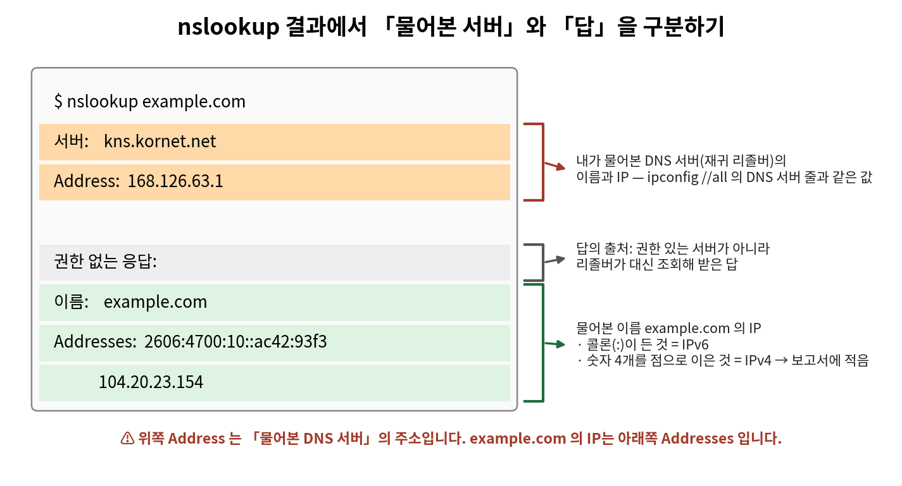
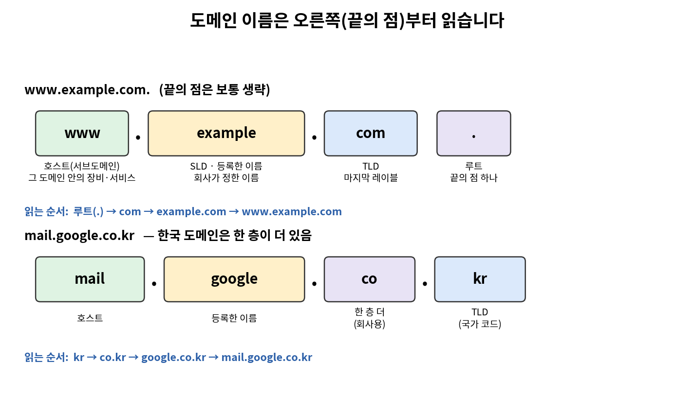
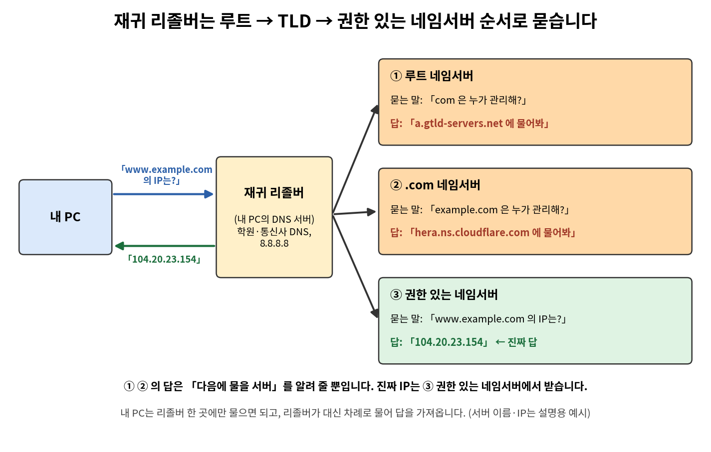
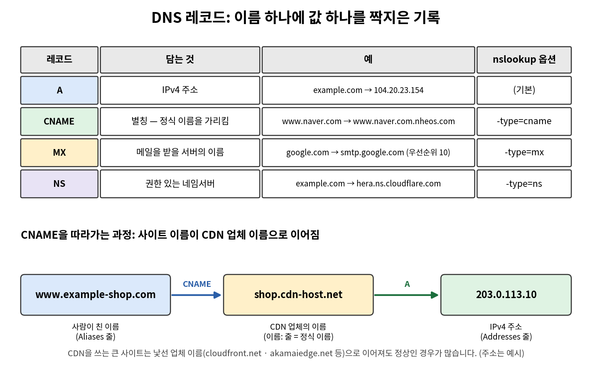
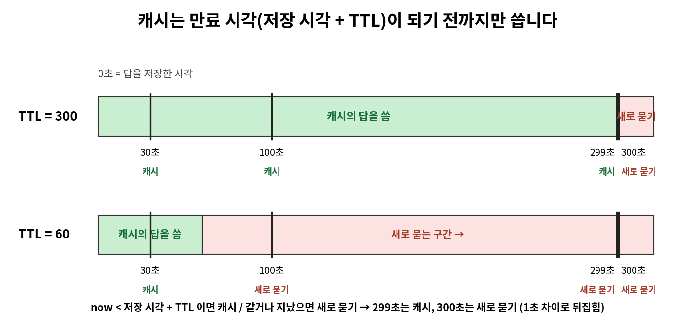
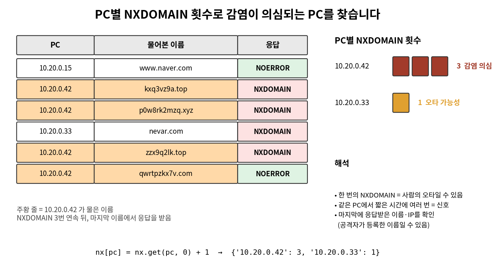
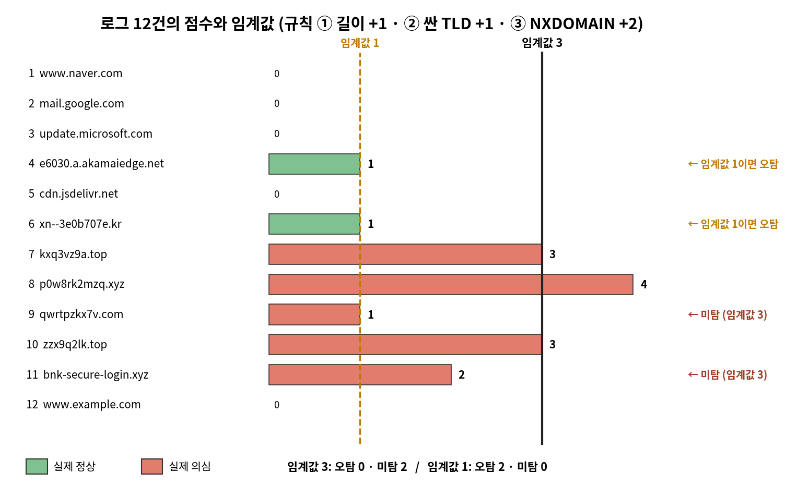
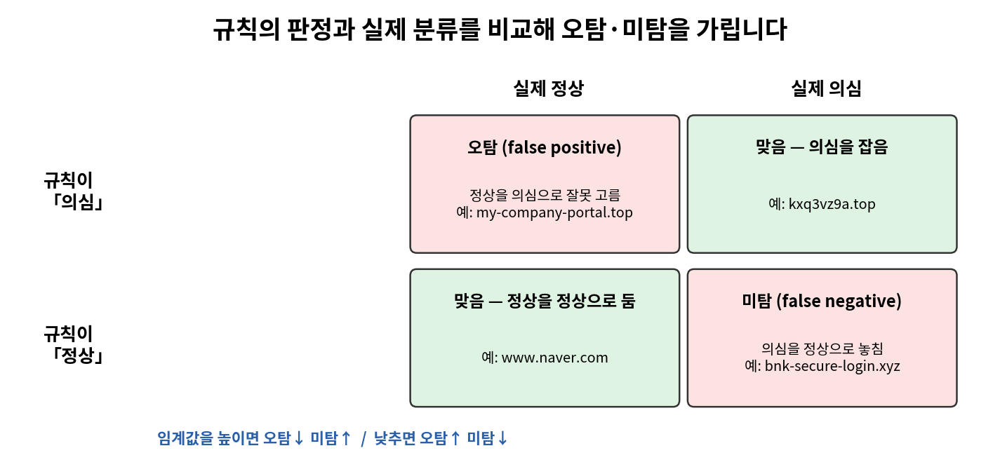

# 네트워크 3일차 정리 — DNS · 레코드 · TTL · 의심 도메인 탐지

> 2026-10-14 (수) · 네트워크·ZT(제로 트러스트) 운영 기초 3일차
> 오전: DNS의 동작, `nslookup`, 도메인 계층, 레코드(A · CNAME · MX · NS), TTL과 캐시 · 오후: DGA·사칭 도메인, 점수 규칙, 오탐·미탐, 분석서 작성

---

## 0. 오늘 배운 것 한눈에 보기

| 시간 | 주제 | 핵심 질문 | 쓰는 것 |
|---|---|---|---|
| 오전 2교시 | DNS가 필요한 이유 · `nslookup` | 내 PC는 `google.com`의 IP를 어느 DNS 서버에 묻나? | `nslookup`, `socket` |
| 오전 3교시 | 도메인 계층 · 권한 있는 네임서버 | 그 DNS 서버는 IP를 어디서 알아 오나? | `nslookup -type=ns`, 리스트 슬라이싱 |
| 오전 4교시 | 레코드 · TTL · 캐시 | 답에 IP 말고 무엇이 있고, 얼마나 다시 쓰나? | `-type=mx`, `ipconfig //displaydns` |
| 오후 5교시 | 의심 도메인의 지표 | DGA·사칭 도메인·NXDOMAIN이 많은 PC를 어떻게 가르나? | 파이썬 반복문, 딕셔너리 `get` |
| 오후 6교시 | 점수 규칙 · 임계값 · 오탐·미탐 | 규칙이 얼마나 맞았는지 어떻게 재나? | 파이썬 `if`, 판정표 출력 |
| 오후 7교시 | 분석서 작성 | 판단 기준을 어떻게 문서로 남기나? | `nslookup`, `git` |

**3일차의 큰 흐름**

1. 1일차 `ping google.com`의 대괄호 안 IP는 **DNS**가 이름을 IP로 바꿔서 나온 값입니다.
2. 내 PC는 **재귀 리졸버**(DNS 서버) 한 곳에만 묻고, 리졸버가 **루트 → TLD → 권한 있는 네임서버** 순서로 대신 물어 답을 가져옵니다.
3. DNS 답은 IP만이 아니라 **레코드**(A · CNAME · MX · NS)로 저장되어 있고, 받은 답은 **TTL** 동안 **캐시**에 저장해 다시 씁니다.
4. 악성 코드도 공격자 서버를 **도메인 이름**으로 찾으므로, **DNS 질의 기록**은 관제가 가장 먼저 보는 로그 중 하나입니다.
5. 이름의 모양(길이·TLD)과 DNS 응답(NXDOMAIN)을 **점수로 합쳐** 의심 도메인을 고르고, 그 규칙이 **얼마나 맞았는지(오탐·미탐)** 를 숫자로 확인합니다.

---

# Part 1. 오전 — DNS의 동작

## 1. DNS가 필요한 이유 (2교시)

### 1-1. 용어 정리

| 용어 | 뜻 | 예 |
|---|---|---|
| **도메인 이름 (domain name)** | 사람이 외우기 쉽게 붙인 **인터넷 이름**. 컴퓨터는 이 이름으로는 보낼 수 없어서, 먼저 DNS에 물어 IP 주소로 바꾼 뒤 접속합니다. | `example.com`, `naver.com` |
| **URL** | 주소창에 치는 **웹 주소 전체**. 방식(`https://`) · 도메인 이름 · 경로가 붙어 있습니다. | `https://example.com/news` |
| **DNS (Domain Name System)** | 도메인 이름을 **IP 주소로 바꿔 주는 체계**. 내 PC가 이름을 물으면 DNS 서버가 그 이름의 IP 주소를 답으로 돌려줍니다. | `example.com` → `104.20.23.154` (예시) |
| **재귀 리졸버 (recursive resolver)** | 내 PC가 「이 도메인 이름의 IP는?」 하고 **맨 먼저 묻는 DNS 서버**. 자기가 답을 모르면 다른 DNS 서버(루트, TLD, 권한 있는 네임서버)에 차례로 물어 IP를 알아낸 뒤, 그 답을 내 PC에 돌려줍니다. 「재귀」 = 답이 나올 때까지 이어서 묻는다는 뜻입니다. | 학원·통신사 DNS 서버, 구글 `8.8.8.8` |
| **`nslookup`** | DNS 서버에 이름을 **직접 물어보는 명령**. 결과에 물어본 서버와 답이 함께 나와서, 어느 서버가 무엇이라고 답했는지 확인할 수 있습니다. | `nslookup example.com` |

- 내 PC는 **리졸버 한 곳에만 물으면** 됩니다. 나머지 조회는 리졸버가 대신 합니다.
- 내 PC가 어느 리졸버에 묻는지는 `ipconfig //all`의 **DNS 서버** 줄에서 확인합니다(Git Bash에서는 `/`를 두 번 칩니다). 그 값은 IP처럼 생겼지만 **내 PC의 IP와는 다른 주소**(DNS 서버의 주소)입니다.
- 회사 DNS 서버는 위험한 도메인에 대한 질의를 막고, 어느 PC가 어떤 이름을 물었는지 **기록**을 남깁니다.
- PC는 DNS 서버가 준 IP로 접속합니다. **DNS 서버가 틀린 IP를 답하면 PC는 그 틀린 IP로 접속합니다.**

### 1-2. DNS가 중요한 세 가지 상황

| 상황 | 무슨 일이 일어나나 | DNS가 중요한 이유 |
|---|---|---|
| 웹 사이트에 접속할 때 | 사람은 `naver.com` 같은 이름을 치지만, 컴퓨터는 IP 주소로만 보낼 수 있음 | 접속 전에 DNS가 도메인 이름을 IP로 바꿔 줌 |
| 악성 코드가 공격자 서버를 찾을 때 | 악성 코드도 공격자 서버를 **도메인 이름**으로 찾아감 → DNS에 물은 기록이 남음 | 관제는 **DNS 질의 기록**(DNS에 이름을 물은 기록)을 가장 먼저 봄 |
| 「인터넷이 안 돼요」 문의 | 숫자 IP로는 되는데 **도메인 이름으로만 안 되는** 경우가 많음 | **DNS 문제**(7계층)를 먼저 의심 (1일차 장애 판단 순서) |

> 참고: 2025년 10월 AWS 장애는 DNS가 IP를 알려 주지 못해 시작되었습니다. DNS가 도메인 이름을 IP로 바꾸지 못하면 웹 서비스에 접속할 수 없습니다.

### 1-3. URL에서 DNS가 묻는 부분은 도메인 이름뿐

`https://example.com/news/today`를 주소창에 치면:

| 부분 | 이름 | 누구에게 묻나 |
|---|---|---|
| `https://` | 방식(scheme) — 암호화한 웹 | **어디에도 안 물음.** 브라우저가 쓰는 접속 방식 |
| `example.com` | **도메인 이름** | **DNS 서버**에 물어 IP를 받음. DNS가 묻는 것은 **이것뿐** |
| `/news/today` | 경로(path) — 서버 안의 어느 페이지 | **웹 서버**에 물음. IP로 접속한 **뒤에야** 물음 |

---

## 2. `nslookup` 사용법 (2교시)

### 2-1. 기본 형태

```bash
nslookup example.com            # 내 PC의 DNS 서버(재귀 리졸버)에 물음
nslookup example.com 8.8.8.8    # 이름 뒤에 서버 주소를 적으면 그 서버에 직접 물음
```

| 부분 | 뜻 |
|---|---|
| `nslookup` | name server lookup — DNS 서버에 이름을 묻는 명령 |
| `example.com` | 물어볼 도메인 이름 |
| (DNS 서버 주소를 안 적으면) | 내 PC가 기본으로 묻는 **재귀 리졸버**에 물음 |
| `8.8.8.8` | 구글이 운영하는 **공개 재귀 리졸버**. 적으면 이 서버에 직접 물음 |

- 학원망이 외부 DNS를 막으면 `8.8.8.8`에 물을 때 **시간 초과**가 납니다. 그것 자체가 「회사(학원)가 DNS를 통제한다」는 관찰입니다.
- `dig`는 Windows에 없어서 오늘은 `nslookup`을 씁니다.

### 2-2. 결과 화면 읽기

```text
$ nslookup example.com
서버:    kns.kornet.net
Address:  168.126.63.1

권한 없는 응답:
이름:    example.com
Addresses:  2606:4700:10::ac42:93f3
          104.20.23.154
```



| 줄 | 무엇인가 | 자세히 |
|---|---|---|
| `서버:` · `Address:` (위 두 줄) | **내가 물어본** DNS 서버의 이름·주소 | 서버 주소를 안 적어서 내 PC가 기본으로 묻는 재귀 리졸버. `ipconfig //all`의 DNS 서버 줄과 같은 값 |
| `권한 없는 응답:` | 답의 출처 | 리졸버가 대신 조회해 받아 온 답(3장에서 설명) |
| `이름:` | 내가 조회한 도메인 이름 | 답이 어느 이름의 것인지 표시 |
| `Addresses:` (아래) | **조회한 도메인의 IP 주소** | 콜론(`:`)으로 나뉜 긴 주소 = **IPv6**, 숫자 4개·점 3개 = **IPv4** → 보고서에는 IPv4를 적음 |

> ⚠️ 위쪽 `Address`는 **물어본 DNS 서버**의 주소이고, `example.com`의 IP는 **아래쪽 `Addresses`** 입니다. 둘 다 `Address`로 시작해서 위쪽 주소를 도메인의 IP로 적는 실수가 가장 많습니다.

- **IP가 여러 개인 것은 정상**입니다. 큰 서비스는 서버를 여러 대 둡니다.
- 물어보는 서버를 바꾸면(`8.8.8.8`) 위 두 줄(`서버:` · `Address:`)이 `dns.google` · `8.8.8.8`로 바뀌고, 답의 IPv4는 같을 수 있습니다. 위 두 줄은 「누구에게 물었나」이기 때문입니다.
- `서버:`가 `UnKnown`으로 나와도 정상입니다. DNS 서버에 이름이 등록되지 않은 경우이며, 그 아래 `Address`를 읽습니다.
- IP·이름은 시간·장소에 따라 바뀔 수 있습니다. 예시와 모양이 같으면 맞습니다.

> 🔒 **관제 관점**
> - 회사 PC가 회사 DNS 서버 대신 `8.8.8.8` 같은 **외부 DNS 서버에 직접** 묻고 있다면, 회사의 **차단과 기록을 피해 가는 것**이므로 확인합니다.
> - 내 PC의 DNS 서버 설정이 나도 모르게 **낯선 주소로 바뀌어** 있다면, 악성 코드가 설정을 바꿔 은행 이름을 물어도 **가짜 사이트의 IP**를 받게 만들었을 수 있습니다.
> - 의심 도메인이 가리키는 IP를 `nslookup`으로 확인해 방화벽 로그의 접속 IP와 맞춰 봅니다.

### 2-3. 없는 이름: NXDOMAIN

```bash
nslookup abc.nowhere-not-exist.com
```

- **NXDOMAIN (Non-Existent Domain)** 은 DNS 서버가 「**그런 이름은 없다**」고 답한 것입니다. 화면에는 `Non-existent domain`이 들어간 줄로 나옵니다(맥북은 `NXDOMAIN`).
- 오타(`exampeeel.com`)이거나 등록되지 않은 도메인일 때 나옵니다.
- **NXDOMAIN이 나왔다고 인터넷이 끊긴 것은 아닙니다.** DNS 서버가 정상으로 답했고, 그 답이 「이름이 없다」입니다. 연결이 끊겼다면 답 자체가 오지 않아 **시간 초과**가 납니다.

---

## 3. 파이썬으로 DNS에 묻기 (2교시)

### 3-1. `socket.gethostbyname()`

`socket`은 파이썬에 들어 있는 **네트워크 도구 모음(모듈)** 입니다. `import socket`으로 불러오면 이름을 DNS에 묻는 함수를 쓸 수 있습니다.

```python
import socket

ip = socket.gethostbyname("example.com")   # 이름 → IPv4 주소(문자열)
print(ip)          # 104.20.23.154 (예시 — 실행할 때마다 다를 수 있음)
print(type(ip))    # <class 'str'>
```

| 쓰는 것 | 뜻 |
|---|---|
| `import socket` | 파일 맨 위에서 한 번 불러옵니다. 빠뜨리면 `NameError: name 'socket' is not defined` |
| `socket.gethostbyname("이름")` | 이름을 DNS에 묻고 **IPv4 하나를 글자(str)로** 리턴합니다. `nslookup`과 달리 **PC의 DNS 캐시를 거칩니다.** |
| 없는 이름을 물으면 | `socket.gaierror` 에러가 나고 프로그램이 그 줄에서 **멈춥니다.** |

### 3-2. URL에서 도메인 이름 꺼내기

```python
import socket

url = "https://example.com/news/today"
parts = url.split("/")                          # "/" 마다 잘라 리스트로
name = parts[2]                                 # 0번부터 세어 셋째 칸
print(parts)
# ['https:', '', 'example.com', 'news', 'today']
print(name, "→", socket.gethostbyname(name))
# example.com → 104.20.23.154 (예시)
```

| 번호 | 0 | 1 | 2 | 3 | 4 |
|---|---|---|---|---|---|
| `parts`의 값 | `"https:"` | `""` | `"example.com"` | `"news"` | `"today"` |

- `https://`의 `//` 사이에는 글자가 없어서 **빈 문자열 `''` 한 칸**이 생깁니다. 그래서 0번이 `https:`, 1번이 `''`, **2번이 도메인 이름**입니다. 빈 칸을 빼고 세어 `parts[2]`를 `news`로 적는 실수가 많습니다.
- 인덱스는 **0부터** 시작하므로 `[2]`는 세 번째 항목입니다.

**없는 이름을 넣으면**

```python
url = "https://abc.nowhere-not-exist.com/login"   # 나머지 줄은 같음
```

- 첫 `print(parts)`는 정상 출력되고, DNS에 묻는 줄(`gethostbyname`)에서 `socket.gaierror: ... getaddrinfo failed`로 멈춥니다(맥북은 `nodename nor servname provided, or not known`).
- 같은 이름을 `nslookup`하면 `Non-existent domain`(NXDOMAIN)이 나옵니다. **DNS 서버가 「없다」는 공식 답을 주었고, 파이썬은 그 답을 에러로 알려 준 것**입니다.

> 🔒 **관제 관점:** 접속 로그의 URL에서 **도메인만 잘라** DNS 질의 기록과 맞춰 봅니다. 한 PC의 **NXDOMAIN 수**를 세어 많이 튀는 PC를 먼저 봅니다(오후 5교시).

---

## 4. 도메인 계층 (3교시)

### 4-1. 용어 정리

| 용어 | 뜻 | 예 |
|---|---|---|
| **레이블 (label)** | 도메인 이름을 점으로 나눈 **각 부분**. 오른쪽 레이블일수록 **상위 계층**이고, 리졸버는 오른쪽 계층부터 차례로 묻습니다. | `www.example.com`의 레이블: `www` · `example` · `com` |
| **TLD (Top-Level Domain)** | 도메인 이름의 **마지막 레이블**(마지막 점 뒤의 부분). `com` · `net` 같은 일반 TLD와 `kr` · `jp` 같은 국가 코드 TLD가 있습니다. | `com`, `kr` |
| **루트 (root)** | DNS 계층의 **최상위**. 도메인 이름 끝에 생략된 점(`.`) 하나가 루트를 뜻합니다. | `www.example.com.`의 마지막 `.` |
| **레코드 (record)** | DNS 서버에 적어 둔 **기록 한 줄**. 이름 하나에 값 하나를 짝지어 두며, 값은 IP일 수도 다른 이름일 수도 있습니다. | `example.com` → `104.20.23.154` |
| **네임서버 (name server)** | 레코드를 저장해 두고 「이 이름의 IP는?」 같은 물음에 답하는 DNS 서버. 루트·TLD·도메인마다 **계층별로 따로** 있고, 재귀 리졸버가 차례로 묻는 상대입니다. | 루트 네임서버, `.com` 네임서버 |
| **권한 있는 네임서버 (authoritative name server)** | 그 도메인의 레코드를 **직접 관리**하고 답하는 네임서버. **답의 원본**을 가지고 있어서, 이 서버가 준 답이 「권한 있는 응답」입니다. | `hera.ns.cloudflare.com` (`example.com`의) |
| **NS 레코드** | 그 도메인의 **권한 있는 네임서버 이름**을 적은 레코드. `nslookup -type=ns 이름`으로 묻습니다. 이 값이 바뀌면 도메인 전체의 답이 바뀌므로 보안에서 중요합니다. | `example.com` → `hera.ns.cloudflare.com` |

### 4-2. 이름은 오른쪽(끝의 점)부터 읽는다



`www.example.com`은 끝의 점이 생략된 `www.example.com.`입니다. **오른쪽이 상위 계층**입니다.

| 계층 | 이 이름에서 | 관리하는 네임서버 |
|---|---|---|
| 루트 | `.` (마지막 점) | 루트 네임서버 |
| TLD | `com` | `.com`의 네임서버 (`.kr` · `.net`도 각각 따로) |
| 등록한 이름 (SLD) | `example.com` | **권한 있는 네임서버** |
| 호스트 이름 | `www.example.com` | 위 권한 있는 네임서버가 함께 답함 |

- 세상의 모든 이름을 한 서버가 다 알 수는 없으므로, **점으로 나뉜 계층마다 관리하는 네임서버가 따로** 있습니다.
- **한국 도메인은 한 층이 더** 있습니다. `mail.google.co.kr`은 `kr` → `co.kr`(회사용) → `google.co.kr` → `mail.google.co.kr` 순서이며, `.com` 이름보다 한 칸 많습니다.
- `.`의 의미는 장소마다 다릅니다.

| 어디서 | 기호 | 뜻 |
|---|---|---|
| DNS | `example.com.`의 맨 끝 점 | DNS 계층의 **루트** |
| 리눅스 경로 | `/` | 파일 시스템의 최상위 — 루트 디렉터리 |
| 리눅스 경로 | `.` (예: `./file.txt`) | **현재 디렉터리** (루트가 아님) |

### 4-3. 파이썬으로 이름을 끝에서부터 꺼내기

```python
parts = ["www", "example", "com"]   # "www.example.com".split(".") 의 결과
print(parts[0])       # www
print(parts[-1])      # com        ← 마지막 요소(TLD)
print(parts[-2])      # example    ← 끝에서 둘째 칸. 글자 하나
print(parts[-2:])     # ['example', 'com']  ← 끝에서 둘째 칸부터 끝까지. 리스트
```

| 쓰는 것 | 뜻 | 결과의 종류 |
|---|---|---|
| `리스트[-1]` | 마지막 요소 하나 — 도메인 이름이면 TLD | 글자 하나 |
| `리스트[-2]` | 끝에서 둘째 칸 하나 | 글자 하나 |
| `리스트[-2:]` | 끝에서 둘째 칸부터 **끝까지** | **리스트** |

> ⚠️ `[-2]`와 `[-2:]`는 **콜론 하나 차이**입니다. 콜론이 있으면 요소 하나가 아니라 리스트가 나옵니다.

**다시 잇기와 뒤집기**

```python
parts = ["www", "example", "com"]
print(".".join(parts[-2:]))        # example.com  ← 요소 사이에 점을 넣어 글자 하나로 이음 (split 의 반대)
print(reversed(parts))             # <list_reverseiterator object ...> ← 내용이 안 보임
print(list(reversed(parts)))       # ['com', 'example', 'www']  ← list() 로 감싸야 내용이 보임
print(parts)                       # ['www', 'example', 'com']  ← 원래 리스트는 그대로
```

- `mail.google.co.kr`을 넣으면 `parts[-1]` = `kr`, `".".join(parts[-2:])` = **`co.kr`**, `list(reversed(parts))` = `['kr', 'co', 'google', 'mail']`입니다. 한국 도메인은 계층이 하나 더 있어서, 끝의 두 요소로는 `co.kr`까지만 되고 회사 이름 `google.co.kr`은 세 레이블이 필요합니다.

> 🔒 **관제 관점:** 로그의 도메인을 **TLD별로 묶어** 셉니다. 오후 5교시에 TLD와 그 앞 레이블을 꺼내 의심 도메인을 가를 때 같은 `[-1]` · `[-2]`를 씁니다.

---

## 5. 재귀 리졸버의 조회 순서 (3교시)

### 5-1. 루트 → TLD → 권한 있는 네임서버



`www.example.com`의 IP를 알아내려고 재귀 리졸버가 차례로 묻는 과정입니다.

| 순서 | 재귀 리졸버가 묻는 곳 | 묻는 말 | 그 서버가 답하는 것 |
|---|---|---|---|
| ① | **루트 네임서버** (이름 맨 끝 점 · 최상위) | 「com은 누가 관리해?」 | 「`a.gtld-servers.net`에 물어봐」 — **IP가 아니라 다음에 물을 서버** |
| ② | **`com` 네임서버** | 「example.com은 누가 관리해?」 | 「`hera.ns.cloudflare.com`에 물어봐」 — 역시 다음에 물을 서버 |
| ③ | **권한 있는 네임서버** (`hera.ns.cloudflare.com`) | 「www.example.com의 IP는?」 | 「`104.20.23.154`」 — **진짜 답 (권한 있는 응답)** |

- ① ②의 답은 **다음에 물을 서버를 알려 줄 뿐**이고, 진짜 IP는 ③ 권한 있는 네임서버에서 받습니다.
- 공격자가 **권한 있는 네임서버 정보를 바꾸면 도메인 전체를 가로챌 수 있으므로**(공격자가 웹·메일 주소를 자기 서버로 돌릴 수 있음) NS 레코드를 읽을 줄 알아야 합니다.

### 5-2. `-type=ns`로 권한 있는 네임서버 찾기

```bash
nslookup -type=ns example-shop.com
```

```text
example-shop.com   nameserver = ns1.dns-host.net
example-shop.com   nameserver = ns2.dns-host.net       # ← 네임서버 이름
ns1.dns-host.net   internet address = 203.0.113.53
ns2.dns-host.net   internet address = 203.0.113.54     # ← 그 서버의 IP
```

| 부분 · 줄 | 뜻 |
|---|---|
| `-type=ns` | 「IP 말고 **NS 레코드**(권한 있는 네임서버)를 달라」는 옵션 |
| `nameserver =` 뒤 | 이 도메인의 기록을 가진 **권한 있는 네임서버의 이름** |
| `internet address =` 줄 | 바로 그 네임서버의 **IP 주소** |

- 권한 있는 네임서버가 **둘 이상**인 이유: 한 대가 멈춰도 다른 서버가 **같은 기록**으로 답하도록 하기 위해서입니다. 하나뿐이면 그 서버가 멈출 때 그 도메인의 모든 이름이 풀리지 않습니다.
- `internet address` 줄의 IP를 네임서버 이름으로 적지 않도록 주의합니다. 네임서버는 `nameserver =` 뒤의 **이름**입니다(맥북은 이름 끝에 점이 붙어 `hera.ns.cloudflare.com.`처럼 보이며, 끝의 점은 루트 표시입니다).
- 한 회사 도메인의 네임서버가 **갑자기 낯선 서버로 바뀌었다면** 도메인을 빼앗겼다는 신호일 수 있으므로 확인합니다.

### 5-3. 권한 있는 응답과 권한 없는 응답

| | 권한 있는 응답 | 권한 없는 응답 (Non-authoritative) |
|---|---|---|
| 누가 답했나 | **권한 있는 네임서버**가 직접 | 리졸버가 **대신 조회해 받은 답** (또는 캐시에 저장해 둔 답) |
| 언제 보나 | 권한 있는 네임서버에 **직접** 물을 때 | 평소 `nslookup`할 때 **거의 항상** |
| `nslookup` 화면 | `권한 없는 응답:` 줄이 **없음** | `권한 없는 응답:` 줄이 **있음** |

```bash
nslookup example.com                          # 리졸버에 물음 → 권한 없는 응답: 줄 있음
nslookup example.com hera.ns.cloudflare.com   # 권한 있는 네임서버에 직접 물음 → 그 줄 없음
```

- 「권한 없는」은 **답이 틀렸다는 뜻이 아닙니다.** 답을 준 서버(리졸버)에게 권한이 없다는 뜻이고, 권한 있는 네임서버의 레코드를 받아 온 답입니다.
- 다만 리졸버가 **TTL 동안 저장해 둔 답**이므로, 권한 있는 네임서버에서 막 바꾼 값이면 옛 값일 수 있습니다.
- 리졸버의 답이 이상해 보일 때 **권한 있는 네임서버에 직접 물어 비교**하면, 답이 오래되었거나 중간에서 바뀌었는지 가릴 수 있습니다.

---

## 6. DNS 레코드 (4교시)

### 6-1. 자주 보는 레코드 네 가지

DNS는 IP만 알려 주지 않습니다. **메일은 어느 서버가 받나, 이 이름의 정식 이름은 무엇인가** 같은 정보도 **레코드**로 담고 있고, `-type=` 옵션으로 종류를 골라 묻습니다.



| 레코드 | 담는 것 | 예 | `nslookup` 옵션 |
|---|---|---|---|
| **A** (Address) | 이름 → **IPv4 주소** | `example.com` → `104.20.23.154` | (기본) |
| **CNAME** (canonical name) | **별칭(alias)** — 이 이름의 정식 이름을 가리킴 | `www.naver.com` → `www.naver.com.nheos.com` | `-type=cname` |
| **MX** (mail exchanger) | **메일을 받을 서버**의 이름 | `google.com` → `smtp.google.com` (우선순위 10) | `-type=mx` |
| **NS** (name server) | **권한 있는 네임서버** | `example.com` → `hera.ns.cloudflare.com` | `-type=ns` |

- `ping google.com`의 대괄호 속 IP도 A 레코드의 값입니다.
- 같은 도메인에도 웹 서버 IP(A) · 메일 서버(MX) · 별칭(CNAME)이 **따로 적혀** 있어서, **종류를 골라 물어야** 원하는 정보가 나옵니다.
- ⚠️ **이름까지 쳐야** 결과가 나옵니다. 이름 없이 `nslookup -type=mx`만 치면 `>` 프롬프트에서 입력을 기다립니다(`exit`로 빠져나옵니다).

### 6-2. CNAME과 CDN

| 방식 | 내 DNS에 적어 둔 것 | 업체가 IP를 `…10` → `…99`로 바꾸면 |
|---|---|---|
| **A 레코드** | `www.shop.com` → `203.0.113.10` (IP를 직접) | **접속 안 됨** — 내 DNS에 옛 IP가 남아 내가 직접 고쳐야 함 |
| **CNAME** | `www.shop.com` → `cdn.host.net` (업체 이름) | **접속됨** — 업체가 자기 IP만 바꾸면 이름을 따라가 새 IP를 받음 |

- **CDN (Content Delivery Network)** 은 같은 이미지·영상·페이지를 서울·도쿄·미국 등 **여러 지역 서버에 미리 복사**해 두고, 접속하면 **가까운 복사본**이 보내 주는 서비스입니다.

| 방식 | 한국 사용자가 접속하면 | 결과 |
|---|---|---|
| 서버 한 곳 | 서버가 미국에만 한 대 → 바다 건너 접속 | 멀어서 느리고, 한 대에 몰리면 더 느려짐 |
| CDN | 서울 서버의 복사본을 받음 | 가까워서 빠르고, 접속자가 서버별로 나뉨 |

- 큰 사이트는 CNAME으로 **CDN 업체 이름**에 이어 두므로, 낯선 업체 이름이 나와도 정상인 경우가 많습니다. 예: Amazon → `cloudfront.net`, Akamai → `akamaiedge.net`, Cloudflare → `cdn.cloudflare.net`
- `nslookup www.naver.com` 같은 결과에서 별칭과 정식 이름은 이렇게 읽습니다.

```text
이름:      shop.cdn-host.net         # ← 정식 이름 (별칭을 끝까지 따라가 도착한 진짜 이름)
Addresses: 203.0.113.10
Aliases:   www.example-shop.com      # ← 별칭 (정식 이름을 가리키는 다른 이름, 내가 친 이름)
```

  맥북은 `canonical name =` 줄로 같은 정보를 보여 줍니다. 별칭이 여러 단계인 것은 정상입니다. **최종 이름은 `이름:` 줄**이며 `Aliases:`의 마지막 줄이 아닙니다.

### 6-3. MX 레코드

```bash
nslookup -type=mx shop.com
```

```text
shop.com   MX preference = 10, mail exchanger = mail1.shop.com
shop.com   MX preference = 20, mail exchanger = mail2.shop.com
mail1.shop.com   internet address = 203.0.113.25      # 메일 서버의 IP
```

| 부분 | 뜻 |
|---|---|
| `-type=mx` | IP 말고 MX 레코드(메일 서버)를 달라는 옵션 |
| `mail exchanger =` 뒤 | 메일을 받을 **서버의 이름** |
| **MX preference** | 메일 서버의 **우선순위**. **숫자가 작을수록 먼저** 시도하고, 연결되지 않으면 다음 서버를 시도 |

- MX는 「메일을 받을 서버가 누구인가」를 담는 레코드라 **서버 이름**으로 답하고, 그 이름의 **IP는 다시 A 레코드로** 물어 알아냅니다. 같이 나온 아래의 IP를 메일 서버로 적지 않도록 주의합니다(메일 서버는 이름입니다).
- 메일을 주고받는 회사 도메인은 보통 MX가 있고, 메일을 받지 않는 도메인은 `-type=mx` 결과에 `mail exchanger` 줄이 없습니다.

> 🔒 **관제 관점 (수상한 메일)**
> - 보낸 쪽 도메인에 **MX가 없거나** 막 만든 낯선 서버를 가리키면, 피싱용으로 급히 만든 도메인일 수 있습니다.
> - 낯선 이름이 나와도 **CDN에 이어진 별칭**이면 정상일 수 있습니다. 잘 아는 이름이 처음 보는 도메인으로 CNAME이 설정돼 있으면, 별칭을 끝까지 따라가 정상 CDN인지 남의 서버인지 확인합니다.

---

## 7. 캐시와 TTL (4교시)

### 7-1. 용어

| 용어 | 뜻 | 예 |
|---|---|---|
| **캐시 (cache)** | 받은 답을 **정해진 시간 동안 저장**해 두고 다시 쓰는 것. 같은 이름을 또 물으면 DNS 서버에 묻지 않고 저장한 답을 바로 써서 **빠르고 서버 부담이 줄어듭니다.** | 내 PC·재귀 리졸버의 DNS 캐시 |
| **TTL (DNS에서)** | 답을 캐시에 **몇 초 동안 둘지** 정한 시간. **권한 있는 네임서버가 레코드마다** 정해 두고, 시간이 지나면 보관한 답을 버리고 DNS 서버에 다시 묻습니다. | TTL 300 = 5분 |

- **TTL 300이면 5분 동안은 IP가 바뀌어도 옛 IP가 그대로 쓰입니다.** 그래서 권한 있는 네임서버에서 IP를 바꿔도 **TTL이 지날 때까지는 옛 IP로** 접속되는 사람이 있습니다. TTL이 길수록 바뀐 IP가 늦게 퍼집니다.
- 1일차 `ping`의 TTL(패킷이 거칠 수 있는 라우터 수)과는 **이름만 같은 다른 값**입니다.

### 7-2. 내 PC의 DNS 캐시 보기·비우기

```bash
ping -n 1 example.com          # 한 번 접속해 DNS 답을 캐시에 넣음 (맥북: ping -c 1)
ipconfig //displaydns          # DNS 캐시 보기 → example.com 의 TTL(Time To Live) 값이 남은 초
ipconfig //flushdns            # 내 PC 의 DNS 캐시를 비움
ipconfig //displaydns          # 다시 실행 → example.com 항목이 사라졌으면 비워진 것
```

- 슬래시는 **두 번**(`//`)입니다. 맥북에는 캐시 내용을 보는 명령이 없어서 `ping -c 1`까지만 하고 캐시 보기는 건너뜁니다.
- **`nslookup`은 PC의 캐시를 거치지 않고** DNS 서버에 바로 물어서 **캐시를 채우지 못합니다.** 캐시를 채울 때는 `ping` · 브라우저처럼 보통 프로그램이 쓰는 방식으로 접속합니다. (파이썬 `socket.gethostbyname()`은 PC의 캐시를 거칩니다.)
- 「표시할 수 없습니다」가 나오는 PC도 있습니다(설정에 따라 다름).

> 🔒 **관제 관점:** 어떤 PC가 **계속 이상한 주소로 접속**된다면 캐시에 옛 답이나 위조된 답이 남아 있을 수 있어서, `ipconfig //flushdns`로 지운 뒤 다시 물어 새 답으로 확인합니다. 도메인의 IP가 바뀐 직후에는 TTL이 지날 때까지 옛 IP와 새 IP가 로그에 섞여 나옵니다.

### 7-3. 파이썬으로 캐시 만료 판정하기



```python
ttl = 300          # 답을 저장해 써도 되는 초
saved_at = 0       # 답을 저장한 시각(초)

for now in [30, 100, 299, 300]:        # 저장한 뒤 지난 초
    if now < saved_at + ttl:           # 만료 시각(저장한 시각 + TTL)보다 작으면
        print(now, "초: 캐시의 답을 쓴다")
    else:                              # 같거나 지났으면
        print(now, "초: DNS 서버에 새로 묻는다")
```

| 지난 초 (now) | TTL 300 | TTL 60 | 이 값을 고른 이유 |
|---|---|---|---|
| 30 | 캐시 | 캐시 | 만료 한참 전 |
| 100 | **캐시** | **새로 묻기** | TTL에 따라 결과가 갈리는지 |
| 299 | 캐시 | 새로 묻기 | 만료 1초 전 — 끝까지 캐시를 쓰는지 |
| 300 | **새로 묻기** | 새로 묻기 | 딱 만료 — 299와 1초 차인데 답이 뒤집히는지 |

| 쓰는 것 | 뜻 |
|---|---|
| `a < b` | `a`가 `b`보다 **작을 때만** `True`. **같으면 `False`** |
| `a <= b` | 작거나 **같으면** `True` |
| 캐시에서는 | `지금 < 만료 시각`이면 캐시를 씀. **만료 시각이 되는 순간** 새로 묻습니다. |

- 만료 시각은 `saved_at + ttl`이며, TTL 300이면 300초, TTL 60이면 60초입니다.
- ⚠️ **300초 줄도 캐시라고 적는 실수**가 많습니다. 만료 시각과 **같으면** 새로 묻습니다.

---

# Part 2. 오후 — DNS 로그로 수상한 도메인 찾기

## 8. 오늘 쓰는 DNS 로그 (5교시)

오후에는 DNS 로그에서 **수상한 도메인을 골라내는 규칙**을 직접 만들고, 그 규칙이 맞았는지 채점합니다. 쓰는 의심 도메인은 **수업용으로 지어낸 이름**이며, **접속하지 않고** `nslookup`으로 있는지만 봅니다.

### 8-1. 용어

| 용어 | 뜻 | 예 |
|---|---|---|
| **rcode (response code)** | DNS 답의 **결과 코드**. DNS 로그에 물어본 이름마다 함께 남습니다. `NOERROR` = 에러 없음(이름이 등록돼 있음), `NXDOMAIN` = 「그런 이름 없음」 에러 | `NOERROR`, `NXDOMAIN` |
| **퓨니코드 (Punycode)** | 한글 같은 글자를 쓴 도메인 이름을 DNS가 쓰는 **영문 문자(ASCII)로 바꾸는 방식**. `xn--`로 시작하고 뒤는 무작위 글자처럼 보입니다. **`xn--`라서 의심인 것은 아님** — 정상도 있고, 비슷한 글자로 사칭하는 데 쓰이기도 합니다. | `xn--3e0b707e.kr` = `한국.kr` |

### 8-2. 로그 12건

| # | 물어본 이름 | 답(rcode) | 실제 |
|---|---|---|---|
| 1 | `www.naver.com` | NOERROR | 정상 |
| 2 | `mail.google.com` | NOERROR | 정상 |
| 3 | `update.microsoft.com` | NOERROR | 정상 |
| 4 | `e6030.a.akamaiedge.net` | NOERROR | 정상 — CDN 이름 |
| 5 | `cdn.jsdelivr.net` | NOERROR | 정상 |
| 6 | `xn--3e0b707e.kr` | NOERROR | 정상 — 퓨니코드 |
| 7 | `kxq3vz9a.top` | **NXDOMAIN** | 의심 |
| 8 | `p0w8rk2mzq.xyz` | **NXDOMAIN** | 의심 |
| 9 | `qwrtpzkx7v.com` | NOERROR | 의심 |
| 10 | `zzx9q2lk.top` | **NXDOMAIN** | 의심 |
| 11 | `bnk-secure-login.xyz` | NOERROR | 의심 — 은행 사칭 |
| 12 | `www.example.com` | NOERROR | 정상 |

- **「실제」 칸은 규칙이 맞았는지 채점할 때만 쓰는 정답**입니다. 규칙의 입력이 아니며, 규칙은 이 칸을 보지 않습니다.
- 7 · 8 · 10번은 NXDOMAIN입니다. **9 · 11번은 의심인데도 NOERROR**입니다. 공격자가 등록한 이름이라 DNS가 에러 없이 답하기 때문입니다.

---

## 9. 의심 도메인의 특징 (5교시)

### 9-1. DGA와 C2 서버

| 용어 | 뜻 | 예 |
|---|---|---|
| **DGA (Domain Generation Algorithm)** | 악성 코드가 도메인 이름을 **정해진 계산식으로 자동 생성**하는 방식. 매일 이름을 수백 개씩 만들고, 공격자는 그 가운데 **하나만 실제로 등록**해 둡니다. 감염된 PC가 그 이름들을 차례로 물으면, 등록되지 않은 대부분은 DNS가 「그런 이름 없음」으로 답해서 **DNS 로그에 NXDOMAIN이 몰려 남습니다.** | `kxq3vz9a.top` |
| **C2 서버 (Command and Control)** | 공격자가 **감염된 PC에 명령을 보내는 서버**. DGA로 만든 도메인 가운데 공격자가 등록한 하나를 물으면 DNS가 이 서버의 IP를 알려 주고, 감염된 PC는 그 IP로 접속해 명령을 받습니다. | 등록된 DGA 도메인 하나 → C2 서버의 IP |

**왜 DGA를 쓰나:** 고정된 이름 하나만 쓰면 그 이름을 막는 것으로 끝납니다. 그래서 공격자는 이름을 매일 많이 자동으로 만들어 그중 하나만 등록합니다.

| DNS 응답 | 뜻 | 의심 도메인에서는 |
|---|---|---|
| **NOERROR** | 등록된 이름 — 에러 없이 처리됨(IP 답이 따라옴) | 공격자가 등록한 하나 · 사칭 도메인. **에러 없음이 정상이라는 뜻은 아님** |
| **NXDOMAIN** | 등록되지 않은 이름 — 「그런 이름 없음」 | DGA가 만든 나머지 대부분. 많이 쌓이면 의심 |

### 9-2. 이름을 부분별로 나누기: SLD와 서브도메인

| 용어 | 뜻 | 예 |
|---|---|---|
| **SLD (Second-Level Domain)** | **TLD 바로 앞 레이블.** 회사나 서비스가 등록비를 내고 **직접 정한 이름**이라 어느 사이트인지 드러납니다. | `naver`, `akamaiedge` |
| **서브도메인 (subdomain)** | SLD 앞에 붙은 **나머지 레이블.** 등록한 쪽이 마음대로 만들어 붙이므로 **무작위처럼 길어 보여도 정상일 수 있습니다.** | `www`, `e6030.a` |

**정상 CDN 이름을 의심하지 않으려면 맨 앞이 아니라 SLD의 모양을 봅니다.**

| 이름 | 맨 앞 레이블로 판단하면 | SLD로 판단하면 |
|---|---|---|
| `e6030.a.akamaiedge.net` | `e6030` — 무작위라 **정상인데 의심** | `akamaiedge` — 회사 이름, 정상 |
| `www.naver.com` | `www` — 짧아서 정상 | `naver` — 뜻 있는 이름, 정상 |
| `kxq3vz9a.top` | `kxq3vz9a` — 무작위, 의심 | `kxq3vz9a` — 무작위, 그대로 의심 |

```python
name = "e6030.a.akamaiedge.net"
name.split(".")[-2]      # 'akamaiedge'  ← 점으로 나눠 뒤에서 둘째 조각 = SLD
```

### 9-3. DGA 도메인을 가르는 다섯 가지 지표

| 지표 | 정상 도메인 | DGA 도메인 | 왜 |
|---|---|---|---|
| **레이블 길이** (SLD) | 짧고 뜻이 있음 — `naver` | 길고 뜻이 없음 — `p0w8rk2mzq` | 계산식이 만든 문자열 |
| **숫자** | 거의 없음 | 여러 개 섞여 있음 | 무작위로 고르므로 숫자도 섞임 |
| **모음** (a · e · i · o · u) | 사람이 읽을 수 있게 섞여 있음 | **거의 없음** — `kxq3vz9a` | 발음할 수 없는 이름 |
| **TLD** | `.com` · `.net` · `.kr` | 등록비가 **싼** `.top` · `.xyz` · `.tk`가 많음 | 이름을 수백 개 만드니 비용이 적은 TLD를 고름 |
| **DNS 응답** | NOERROR | **NXDOMAIN이 많음** | 수백 개 중 하나만 등록하므로 나머지는 모두 없는 이름 |

- NXDOMAIN은 오타로 가끔 한두 번은 정상입니다. **한 PC가 짧은 시간에 연속으로 여러 번** 받으면 의심합니다.
- **지표 하나만 쓰면 놓치는 도메인이 있어서** 여러 지표를 점수로 합칩니다.

| 오늘 로그 | 도메인 | 싼 TLD 지표 | NXDOMAIN 지표 |
|---|---|---|---|
| 7번 | `kxq3vz9a.top` | 해당 | 해당 |
| 9번 | `qwrtpzkx7v.com` | `.com` — 해당 안 됨 | NOERROR — 해당 안 됨 |
| 11번 | `bnk-secure-login.xyz` | 해당 | NOERROR — 해당 안 됨 |

9번은 두 지표를 모두 놓치고, 11번은 응답 지표를 놓칩니다. 앞의 레이블 길이·숫자·모음 지표까지 함께 봐야 잡힙니다.

### 9-4. 사칭 도메인

| 용어 | 뜻 | 예 |
|---|---|---|
| **타이포스쿼팅 (typosquatting)** | 진짜 도메인과 **철자가 비슷한** 도메인을 등록해 사람을 속이는 사칭. 오타를 내거나 비슷한 글자를 못 알아본 사람이 가짜 사이트로 들어가게 합니다. | `nav3r.com` (e → 3), `g00gle.com` (o → 0) |
| **피싱 (phishing)** | 가짜 사이트·메일로 사람을 속여 **계정·정보를 빼내는** 공격. 사칭 도메인으로 진짜처럼 보이는 로그인 화면을 띄우는 경우가 많습니다. | `bnk-secure-login.xyz` 같은 가짜 로그인 사이트 |

| 의심 신호 | 무엇을 보나 | 예 |
|---|---|---|
| 사칭 ① 철자 바꾸기 | 진짜 도메인과 **한두 글자만** 다른가 | `nav3r.com`, `g00gle.com` |
| 사칭 ② 낱말 붙이기 | 은행·로그인 같은 **낱말**을 붙여 진짜처럼 보이게 했나 | `bnk-secure-login.xyz` |
| NXDOMAIN이 많은 PC | 한 PC가 짧은 시간에 NXDOMAIN을 **몇 번** 받았나 | DGA 도메인을 차례로 묻는 감염 PC |

- 사칭 도메인은 뜻이 있는 단어로 만들고 공격자가 **실제로 등록**해 두어 NXDOMAIN이 나오지 않으므로, **DGA 지표로는 탐지하기 어렵습니다.** 관제에서는 사칭 도메인과 함께 그 도메인의 DNS 기록을 확인합니다.

---

## 10. 파이썬으로 지표 세기 (5교시)

### 10-1. 레이블의 글자 수 · 숫자 수 · 모음 수

```python
name = "p0w8rk2mzq.xyz"
label = name.split(".")[-2]                # TLD 바로 앞 레이블
digits = 0
vowels = 0
for ch in label:                           # 레이블을 한 글자씩 꺼내 반복
    if ch in "0123456789":                 # 숫자 열 개 가운데 하나면
        digits = digits + 1
    if ch in "aeiou":                      # 모음이면
        vowels = vowels + 1
print(label, len(label), digits, vowels)   # 레이블 · 글자 수 · 숫자 수 · 모음 수
```

| 도메인 | 레이블 | 글자 수 | 숫자 수 | 모음 수 |
|---|---|---|---|---|
| `p0w8rk2mzq.xyz` (DGA) | `p0w8rk2mzq` | 10 | **3** | **0** |
| `www.naver.com` (정상) | `naver` | 5 | 0 | 2 |

- `p0w8rk2mzq`는 숫자 `0` · `8` · `2`가 섞여 있고 모음이 하나도 없습니다. 계산식이 무작위로 고른 문자열이라 사람이 발음할 수 있게 모음을 넣지 않습니다. `naver`는 사람이 지은 이름이라 숫자가 없고 모음 `a` · `e`가 있습니다.
- ⚠️ 숫자 **`0`을 모음 `o`로 세는** 실수가 많습니다. `0`은 숫자입니다.
- 길이 지표는 **정상 이름에도 해당**될 수 있습니다. CDN 이름 `e6030.a.akamaiedge.net`의 `akamaiedge`는 10글자이고, 한글 도메인 `xn--3e0b707e.kr`은 숫자가 많고 모음이 적습니다.

| 쓰는 것 | 뜻 |
|---|---|
| `for ch in label` | 레이블에서 **한 글자씩** 꺼내 반복 |
| `ch in "0123456789"` | 글자가 숫자 열 개 가운데 하나면 `True` |

### 10-2. PC별 NXDOMAIN 횟수 세기

DGA 이름을 차례로 묻는 **감염 의심 PC**를 찾으려면 도메인 하나가 아니라 **PC별로** NXDOMAIN을 셉니다.



```python
logs = [("10.20.0.15", "www.naver.com",    "NOERROR"),     # (PC 주소, 물어본 이름, 응답)
        ("10.20.0.42", "kxq3vz9a.top",     "NXDOMAIN"),
        ("10.20.0.42", "p0w8rk2mzq.xyz",   "NXDOMAIN"),
        ("10.20.0.33", "nevar.com",        "NXDOMAIN"),
        ("10.20.0.42", "zzx9q2lk.top",     "NXDOMAIN"),
        ("10.20.0.42", "qwrtpzkx7v.com",   "NOERROR")]
nx = {}                                      # PC 주소별 횟수를 담을 빈 딕셔너리
for pc, name, rcode in logs:                 # 튜플의 세 값을 나눠 담아 반복
    if rcode == "NXDOMAIN":                  # NXDOMAIN 인 줄만
        nx[pc] = nx.get(pc, 0) + 1           # 그 PC 의 횟수 + 1
print(nx)                                    # {'10.20.0.42': 3, '10.20.0.33': 1}
```

**`딕셔너리.get(키, 0) + 1`의 동작**

| 상황 | `nx.get(pc, 0)` | `+ 1` | 결과 |
|---|---|---|---|
| 처음 보는 PC (키가 없음) | 괄호 안 두 번째 값 **0**을 리턴 | 0 + 1 = 1 | 새 키로 담김 |
| 이미 있는 PC (키가 있음, 값 1) | 저장된 **1**을 리턴 (0은 쓰이지 않음) | 1 + 1 = 2 | 값이 2로 바뀜 |

- `get` 없이 `nx[pc] + 1`이면 꺼낼 값이 없어 **`KeyError`로 멈춥니다.** 두 번째 값을 안 적으면 `None`이 되어 `None + 1`도 에러입니다. 세기에는 기본값으로 **0**을 씁니다.
- **해석:**
  - `10.20.0.42`는 무작위 이름을 차례로 물어 NXDOMAIN을 **3번** 받았고, 마지막 `qwrtpzkx7v.com`에서 응답을 받았습니다. DGA 이름 가운데 공격자가 실제로 등록한 하나를 찾아 **C2 서버의 IP를 알아낸 것**일 수 있습니다 → **감염 의심 PC**.
  - `10.20.0.33`은 `naver`의 철자를 틀린 `nevar.com`을 **한 번** 물었으므로 사람의 오타일 가능성이 큽니다.
  - ⚠️ NXDOMAIN이 한 번이라도 나온 PC를 모두 감염으로 보지 않습니다. **횟수가 신호**입니다.

> 🔒 **관제 관점:** PC별 NXDOMAIN 횟수로 **먼저 점검할 PC**를 고르고, 그 PC가 마지막에 응답을 받은 이름과 IP를 확인합니다.

---

## 11. 점수 규칙과 오탐·미탐 (6교시)

### 11-1. 용어

| 용어 | 뜻 | 예 |
|---|---|---|
| **탐지 룰 (detection rule)** | 로그에서 의심스러운 것을 골라내는 **조건과 점수의 묶음**. **만들고 → 로그에 걸어 재고 → 틀린 판정을 보고 고치는** 순서로 다듬습니다. | 오늘의 점수 규칙 세 개 + 임계값 3 |
| **임계값 (threshold)** | 점수 합이 **이 값 이상이면 「의심」으로 판정**하는 기준. | 3 |
| **오탐 (false positive)** | 실제로는 **정상**인데 규칙이 「의심」으로 **잘못 고른 것**. 많아지면 관제가 정상 이름에 울린 잘못된 경보를 확인하느라 시간을 씁니다. | 정상 이름인데 점수가 임계값 이상 |
| **미탐 (false negative)** | 실제로는 **의심**인데 규칙이 「정상」으로 **잘못 판정한 것**. 많아지면 실제 공격을 놓칩니다. | 의심 이름인데 점수가 임계값 미만 |
| **예외 목록 (allowlist)** | 근거가 분명한 **정상 도메인을 규칙에서 빼 주는 목록**. 규칙에 걸려도 목록에 있으면 「정상」으로 둬서 오탐을 줄입니다. 근거 없이 많이 넣으면 그 이름은 규칙이 보지 않게 되므로 **넣는 이유를 적어 둡니다.** | `e6030.a.akamaiedge.net` (확인을 거친 정상 CDN 이름) |

### 11-2. 오늘의 점수 규칙

지표 다섯 가운데 세 가지만 씁니다(숫자·모음 지표는 오늘 규칙에 넣지 않음).

| 규칙 | 더하는 점수 | 로그 8번 `p0w8rk2mzq.xyz` | `www.naver.com` |
|---|---|---|---|
| ① SLD(TLD 바로 앞 레이블)가 **10글자 이상** | +1 | `p0w8rk2mzq` = 10글자 → **+1** | `naver` = 5글자 → 0 |
| ② TLD가 `top` · `xyz` · `tk` | +1 | `.xyz` → **+1** | `.com` → 0 |
| ③ DNS 응답이 **NXDOMAIN** | **+2** | NXDOMAIN → **+2** | NOERROR → 0 |
| **합계 점수가 3 이상이면 「의심」** | | 합계 4점 → **의심** | 합계 0점 → 정상 |

- 레이블 길이는 DGA가 만든 도메인에 나타나는 **약한 단서**라서 1점입니다(길다고 악성은 아님). **NXDOMAIN은 DGA의 흔적이라 가장 큰 2점**입니다.
- `>= 10`은 **10글자도 포함**합니다.

```python
name = "p0w8rk2mzq.xyz"
rcode = "NXDOMAIN"
parts = name.split(".")
score = 0                                    # 합계 점수는 0에서 시작
if len(parts[-2]) >= 10:                     # 규칙 ①: SLD 가 10글자 이상
    score = score + 1
if parts[-1] in ["top", "xyz", "tk"]:        # 규칙 ②: TLD 가 세 값 가운데 하나
    score = score + 1
if rcode == "NXDOMAIN":                      # 규칙 ③: 응답이 NXDOMAIN
    score = score + 2
print(name, score, score >= 3)               # p0w8rk2mzq.xyz 4 True
```

| 쓰는 것 | 뜻 |
|---|---|
| `score` | 합계 점수. 0에서 시작해 **걸린 규칙마다 쌓임** (예: 0 → +1 → +1 → +2 = 4) |
| `len(parts[-2]) >= 10` | SLD의 글자 수가 10 이상 |
| `parts[-1] in [...]` | TLD가 리스트의 세 값 가운데 하나면 `True` |
| `rcode == "NXDOMAIN"` | 응답이 NXDOMAIN이면 `True` |
| `score >= 3` | 임계값 이상이면 `True`(의심) |

**은행 사칭 도메인은 임계값을 넘지 못합니다.** `name = "bnk-secure-login.xyz"`, `rcode = "NOERROR"`로 바꾸면:

| | `p0w8rk2mzq.xyz` | `bnk-secure-login.xyz` |
|---|---|---|
| ① 10글자 이상 | `p0w8rk2mzq` 10글자 → +1 | `bnk-secure-login` 16글자 → +1 |
| ② TLD | `.xyz` → +1 | `.xyz` → +1 |
| ③ NXDOMAIN | NXDOMAIN → +2 | NOERROR → **0** (등록된 이름이라) |
| 합계 | **4점 ≥ 3 → 의심** | **2점 < 3 → 정상으로 나옴** |

실제로는 사칭인데 점수 규칙만으로는 **놓칩니다.** 철자·낱말 신호를 더 봐야 합니다.

### 11-3. 로그 12건 판정과 채점

```python
LOG = [("www.naver.com", "NOERROR", "정상"), ...]      # (이름, 응답, 실제) 12건
THRESHOLD = 3                                            # 대문자 이름 = 바꾸지 않는 값
print("| 이름 | 응답 | 점수 | 판정 | 실제 |")
print("|---|---|---|---|---|")
for name, rcode, truth in LOG:
    parts = name.split(".")
    score = 0
    # 규칙 ① ② ③ — 앞 코드와 같음
    if score >= THRESHOLD:
        judged = "의심"
    else:
        judged = "정상"
    print(f"| {name} | {rcode} | {score} | {judged} | {truth} |")
```

`f"| {name} | … |"`는 f-string으로 `{ }` 안의 값을 넣어 **마크다운 표 한 줄**을 만듭니다. 출력된 표가 분석서에 붙일 **판정표**가 됩니다.



| # | 이름 | 응답 | 점수 | 판정 (임계값 3) | 실제 | 채점 |
|---|---|---|---|---|---|---|
| 1 | `www.naver.com` | NOERROR | 0 | 정상 | 정상 | 맞음 |
| 2 | `mail.google.com` | NOERROR | 0 | 정상 | 정상 | 맞음 |
| 3 | `update.microsoft.com` | NOERROR | 0 | 정상 | 정상 | 맞음 |
| 4 | `e6030.a.akamaiedge.net` | NOERROR | 1 | 정상 | 정상 | 맞음 (임계값 1이면 **오탐**) |
| 5 | `cdn.jsdelivr.net` | NOERROR | 0 | 정상 | 정상 | 맞음 |
| 6 | `xn--3e0b707e.kr` | NOERROR | 1 | 정상 | 정상 | 맞음 (임계값 1이면 **오탐**) |
| 7 | `kxq3vz9a.top` | NXDOMAIN | 3 | 의심 | 의심 | 맞음 |
| 8 | `p0w8rk2mzq.xyz` | NXDOMAIN | 4 | 의심 | 의심 | 맞음 |
| 9 | `qwrtpzkx7v.com` | NOERROR | 1 | 정상 | 의심 | **미탐** |
| 10 | `zzx9q2lk.top` | NXDOMAIN | 3 | 의심 | 의심 | 맞음 |
| 11 | `bnk-secure-login.xyz` | NOERROR | 2 | 정상 | 의심 | **미탐** |
| 12 | `www.example.com` | NOERROR | 0 | 정상 | 정상 | 맞음 |

- 4번의 1점은 `akamaiedge`가 10글자라 규칙 ①, 6번의 1점은 `xn--3e0b707e`가 12글자라 규칙 ①에 해당하기 때문입니다.
- 7번은 ② +1, ③ +2 = 3점, 10번도 같은 구성의 3점이라 둘 다 임계값 3에 **딱 걸립니다.**

### 11-4. 오탐·미탐 채점



| 규칙의 판정 | 실제 분류 | 채점 | 예 |
|---|---|---|---|
| 의심 | 의심 | 맞음 — 의심을 잡음 | `kxq3vz9a.top` |
| 의심 | 정상 | **오탐** — 정상을 의심으로 잘못 고름 | `my-company-portal.top` |
| 정상 | 정상 | 맞음 — 정상을 정상으로 둠 | `www.naver.com` |
| 정상 | 의심 | **미탐** — 의심을 정상으로 놓침 | `bnk-secure-login.xyz` |

- 출력 표에서 **판정 칸과 실제 칸이 다른 줄만** 찾으면 됩니다. 그 줄의 판정이 「의심」이면 오탐, 「정상」이면 미탐입니다.
- ⚠️ 오탐과 미탐을 **반대로 적는** 실수가 많습니다. **「실제」가 정상인데 「의심」이면 오탐**입니다.

### 11-5. 임계값을 바꾸면

| 임계값 | 판정이 달라지는 모습 | 오탐 | 미탐 |
|---|---|---|---|
| **3** (오늘 규칙) | 점수 3 이상만 의심 | **0건** | **2건** — `qwrtpzkx7v.com`(1점), `bnk-secure-login.xyz`(2점) |
| **1** (낮춤) | 점수 1 이상이면 의심 | **2건** — `e6030.a.akamaiedge.net`(1점), `xn--3e0b707e.kr`(1점) | **0건** |

- 임계값을 **낮추면 미탐은 줄지만 오탐이 늘고**, **높이면 오탐은 줄지만 미탐이 늘어나기 쉽습니다.** 둘이 서로 반대로 움직입니다.
- **오탐이 많으면** 담당자가 확인할 경보가 늘어 지치고 **진짜 공격 경보를 놓치기** 쉽습니다. **미탐이 많으면** 공격이 경보 없이 지나가 **피해를 늦게 알게** 됩니다. 그래서 둘을 함께 보고 임계값을 정합니다.
- 현업은 정밀도(precision)·재현율(recall) 같은 지표로도 평가하며, 이 과정에서는 **개수**로 셉니다.

**오탐을 줄이는 순서:** ① 규칙이 정상 CDN 이름(`e6030.a.akamaiedge.net`)을 의심으로 잘못 고름 → ② `nslookup` 등으로 정상 CDN 이름임을 확인 → ③ **예외 목록에 넣고 넣는 이유를 적어 둠** → ④ 규칙이 그 이름을 건너뛰어 오탐이 줄어듦.

---

## 12. 분석서 작성과 확인 방법 (7교시)

### 12-1. 처음 보는 로그 5건에 같은 규칙 적용하기

만든 규칙은 **처음 보는 로그에서도** 통해야 쓸모가 있습니다. 손으로 점수를 먼저 매기고, 코드 결과와 견줍니다.

| # | 이름 | 응답 | ① 길이 | ② TLD | ③ 응답 | 점수 | 판정 |
|---|---|---|---|---|---|---|---|
| 1 | `mail.naver.com` | NOERROR | `naver` 5 → 0 | `com` → 0 | 0 | **0** | 정상 |
| 2 | `x7q9pz2kd.top` | NXDOMAIN | `x7q9pz2kd` 9 → **0** | `top` → +1 | +2 | **3** | 의심 |
| 3 | `login-kbbank.xyz` | NOERROR | `login-kbbank` 12 → +1 | `xyz` → +1 | 0 | **2** | 정상 (사칭인데 놓침) |
| 4 | `cdn.cloudflare.com` | NOERROR | `cloudflare` 10 → +1 | `com` → 0 | 0 | **1** | 정상 |
| 5 | `zq8w4n6r1m.tk` | NXDOMAIN | `zq8w4n6r1m` 10 → +1 | `tk` → +1 | +2 | **4** | 의심 |

- ⚠️ `x7q9pz2kd`는 **9글자**라 규칙 ①에 해당하지 않고, `cloudflare`는 **10글자**라 해당합니다. 글자 수를 잘못 세기 쉽습니다.
- **`login-kbbank.xyz`가 2점인 이유:** 길이와 TLD로 2점을 받지만, 공격자가 등록해 둔 이름이라 응답이 NOERROR여서 규칙 ③의 2점을 받지 못합니다. 2 < 3이라 정상으로 판정됩니다.
- 임계값을 1로 낮추면 `cdn.cloudflare.com`(1점)과 `login-kbbank.xyz`(2점)가 의심으로 바뀝니다. 사칭은 잡지만 정상인 `cdn.cloudflare.com`이 **오탐**이 됩니다. 그래서 임계값은 숫자 하나로 정하지 않고, **오탐이 늘어도 감당할 수 있는지(경보를 확인할 사람 수)** 와 **놓치면 안 되는 대상이 무엇인지**를 함께 보고 정합니다.

**규칙 보완 예: 사칭 낱말 규칙**

| 규칙 | 조건 | 점수 |
|---|---|---|
| ④ (새로 설계) | 이름에 `login` · `secure` · `bank` 중 하나가 들어 있으면 | +2 |

- 이 규칙이면 `login-kbbank.xyz`가 4점이 되어 잡힙니다.
- **위험:** `login.microsoft.com`이나 은행의 진짜 로그인 주소처럼 **정상 이름에도 같은 낱말**이 있어 **오탐**이 생깁니다. 그래서 **예외 목록(진짜 도메인)과 함께** 씁니다.
- **새 규칙은 먼저 지난 로그에 걸어 오탐·미탐을 센 뒤에 적용**합니다.

### 12-2. 규칙의 한계 점검: AI와 함께 시험 데이터 만들기

- 규칙을 **쓰는 사람에서 평가하는 사람**으로 바뀌는 연습입니다. 규칙을 일부러 **빠져나가는 이름**(미탐)과 **잘못 걸리는 이름**(오탐)을 직접 만들어 보면, 오탐·미탐이 언제 생기는지 내 데이터로 확인됩니다.
- 예: 정상인데 걸리는 이름 `intranet-old-wiki.top`(NXDOMAIN → 4점, 오탐), 빠져나가는 이름 `secure-pay-bank.net`(NOERROR → 1점, 미탐).
- **AI는 아이디어를 같이 내는 도구이고, 판정은 코드가 합니다.** 지킬 점:
  1. AI가 만든 이름이 **실제로 존재하는 도메인**일 수 있으므로 **접속하지 않습니다.**
  2. AI가 센 글자 수·점수는 **틀릴 수 있으므로 코드로 검증**하고, 판정은 코드 결과를 따릅니다.
- 「실제」 칸을 규칙의 판정과 같게 적어 **어긋남이 하나도 없는 데이터**를 만들면 규칙의 한계를 확인할 수 없습니다.

### 12-3. 의심 도메인은 접속하지 않고 `nslookup`으로 확인

| 확인 방법 | 하는 일 | 안전성 · 알 수 있는 것 |
|---|---|---|
| `nslookup 이름` | DNS에 이름이 **있는지만** 물음 (서버에 연결하지 않음) | **가장 안전.** 존재 여부와 IP만 알 수 있음 |
| **위협 인텔리전스** 조회 | 알려진 악성 도메인·IP를 모아 둔 정보·조회 사이트(예: VirusTotal) | 접속하지 않아 안전. **이미 알려진 악성인지, 등록일** 등을 알 수 있음 |
| 브라우저로 접속 | 서버에 실제로 연결됨 | 파일이 내려받아지거나 접속 기록이 공격자에게 남을 수 있어 **마지막 수단** |

**먼저 쓸 순서:** `nslookup` → 위협 인텔리전스 조회 → (필요할 때만) 격리된 환경에서 접속

```bash
nslookup e6030.a.akamaiedge.net     # 주소가 나오면 실제로 있는 이름 → 무작위처럼 보여도 CDN 의 정상 이름
nslookup qzkx7wp2v.invalid          # *** … 찾을 수 없습니다. Non-existent domain → 없는 이름 (NXDOMAIN)
```

- 두 이름 모두 **무작위처럼 보여서 모양으로는 구별되지 않고, DNS 응답만 다릅니다.** 점수 규칙은 이름 모양만 보고, `nslookup`은 DNS가 주소를 주는지 직접 확인합니다.
- **`.invalid`** 는 **존재하지 않도록 예약해 둔 TLD**입니다. 어디에도 등록될 수 없어서 DNS에 물으면 늘 NXDOMAIN이 돌아옵니다. 그래서 누군가 실제로 등록한 이름과 겹칠 걱정 없이 「없는 이름」을 시험할 때 씁니다(`example.com`은 아무 하위 이름에도 응답하도록 설정돼 있어 쓰지 않습니다).

### 12-4. 분석서에 남기는 것

**규칙을 만든 사람만 아는 규칙은 쓸 수 없으므로**, 무엇을 · 왜 · 얼마나 맞았나를 문서로 남깁니다. 다른 사람도 규칙을 검토하고 고칠 수 있게 됩니다.

| 남기는 것 | 오늘의 예 | 왜 필요한가 |
|---|---|---|
| **판정표** | 이름 · 응답 · 점수 · 판정 · 실제 5칸 (한 줄 = 도메인 하나) | 규칙이 도메인마다 무엇을 했는지 한눈에 보임 |
| 오탐·미탐 개수 | 임계값 3 → 오탐 0 · 미탐 2 | 규칙이 얼마나 맞았는지 **숫자로** 말할 수 있음 |
| 판단 근거 한 문장 | 「임계값 3을 고른 이유는 …」 | 왜 그렇게 정했는지 알아야 다른 사람이 고칠 수 있음 |
| 처음 보는 로그 적용 | 새 로그 5건에 같은 규칙 | 규칙의 한계를 직접 확인하고 보완할 규칙을 생각함 |
| `nslookup` 확인 | 판정이 정상인 이름을 다시 조회 | 문서에 쓸 판정이 실제로 맞는지 마지막으로 확인 |

**최종 분석서의 구성**

| 절 | 채울 것 |
|---|---|
| 1. 의심 도메인 판정 | 판정표 붙이기 · 「의심」 하나가 **어느 규칙에서 점수를 받았나** (예: `p0w8rk2mzq.xyz`는 ① ② ③ 모두 해당 → 긴 레이블 + 싼 TLD + 등록되지 않은 이름 세 지표가 함께 나타나 DGA 가능성이 큼) |
| 2. 판단 기준 | 규칙 세 개 · 점수 · 임계값 · 고른 임계값의 오탐 또는 미탐 · 보완 (예: 실제 악성 도메인과 정상 도메인을 각각 수십 건 이상 모은 목록에 임계값 1 · 2 · 3을 적용해 오탐·미탐 건수를 세면 어느 값이 나은지 숫자로 정할 수 있음) |
| 3. 규칙의 한계 | 임계값 3의 미탐 두 개(`qwrtpzkx7v.com` · `bnk-secure-login.xyz`) · 더 필요한 정보 · 예외 목록이 많아질 때의 위험 |
| 4. 오늘 하루 정리 | 가장 중요한 것과 그 이유 |

- `qwrtpzkx7v.com`은 **모음 비율 지표**를 더하면 잡히지만 `xn--3e0b707e.kr` 같은 정상 한글 도메인이 걸릴 수 있습니다. 그래서 **새 규칙은 지난 로그에 먼저 걸어 오탐·미탐을 센 뒤에 더하고, 오탐이 나는 이름은 예외 목록**에 넣습니다.

### 12-5. 터미널에서 빈 파일 만들기: `touch`

```bash
touch memo.txt       # 빈 파일 memo.txt 를 지금 있는 폴더에 만듦 (내용은 비어 있음)
ls memo.txt          # 파일이 만들어졌는지 확인 — 이름이 그대로 출력되면 있음
```

- 이미 있는 이름이면 내용은 지워지지 않고 **수정 시각만 바뀌므로** 실수로 써도 안전합니다.

### 12-6. git으로 올리기 전에 확인

```bash
cd ..                 # network_zt 폴더 밖(저장소 폴더)으로 이동
git status            # 어떤 파일이 올라갈지 먼저 확인 — .env · .venv 가 있으면 멈춤
git add .
git commit -m "Add day 3 DNS analysis report"
git push
```

- `git add .`는 `.gitignore`에 적힌 것을 빼고 **지금 폴더 아래 바뀐 파일을 한꺼번에** 고릅니다. `.gitignore`가 빠졌거나 잘못돼 있으면 `.env`도 골라질 수 있습니다.
- `.env`가 깃허브에 올라가면 다른 사람이 그 안의 **API 키로 내 계정을 쓸 수 있어 키를 폐기**해야 합니다. 그래서 **올리기 전에 `git status`** 를 봅니다.
- `git commit`만 하고 `git push`를 빠뜨리면 깃허브에 보이지 않습니다. `git push`가 거절(`rejected`)되면 `git pull`로 받아 온 뒤 다시 `git push`합니다.

---

# 13. 핵심 개념 한 번에 정리

## 13-1. 개념 비교표

| 구분 | 핵심 | 한 줄 정리 |
|---|---|---|
| DNS | 도메인 이름 → IP 변환 | URL 중 **도메인 이름만** 묻는다. 경로는 IP로 접속한 뒤 웹 서버에 묻는다 |
| 재귀 리졸버 | 내 PC의 DNS 서버 | 내 PC는 여기 한 곳에만 묻고, 리졸버가 루트 → TLD → 권한 있는 네임서버에 대신 묻는다 |
| 루트 · TLD | 도메인 계층의 최상위와 마지막 레이블 | 루트/TLD의 답은 **다음에 물을 서버**일 뿐, 진짜 IP는 권한 있는 네임서버가 준다 |
| 권한 있는 네임서버 | 그 도메인의 원본 레코드 보유 | 그 서버의 답 = 권한 있는 응답. 리졸버가 대신 받은 답 = **권한 없는 응답**(틀린 답이 아님) |
| NS 레코드 | 권한 있는 네임서버 이름 | 둘 이상 둔다. 낯선 서버로 바뀌면 도메인 탈취 신호 |
| A / CNAME / MX | IPv4 / 별칭 / 메일 서버 | 종류를 골라 `-type=`으로 묻는다. CNAME은 CDN 이름으로 이어질 수 있다 |
| NXDOMAIN | 「그런 이름 없음」 | 정상 응답이다. 인터넷이 끊긴 것이 아니다 |
| TTL · 캐시 | 답을 몇 초 저장해 쓰는가 | `지금 < 저장 시각 + TTL`이면 캐시. 같으면 새로 묻는다 |
| DGA | 계산식으로 만든 이름 | 긴 레이블 · 숫자 · 적은 모음 · 싼 TLD · **NXDOMAIN 다수** |
| 사칭 도메인 | 철자 바꾸기 · 낱말 붙이기 | 등록된 이름이라 NOERROR → DGA 지표로 놓친다 |
| 임계값 | 의심으로 판정하는 점수 기준 | 낮추면 오탐↑ 미탐↓, 높이면 오탐↓ 미탐↑ |
| 오탐 / 미탐 | 정상을 의심 / 의심을 정상 | 「실제」가 정상인데 의심 = 오탐 |

## 13-2. 오늘 쓴 명령어·코드 모음

| 하려는 일 | 명령·코드 |
|---|---|
| 내 PC의 DNS 서버 확인 | `ipconfig //all` (DNS 서버 줄) |
| 이름 → IP | `nslookup 이름` (아래쪽 `Addresses`) |
| 다른 DNS 서버에 직접 묻기 | `nslookup 이름 8.8.8.8` |
| 권한 있는 네임서버 찾기 | `nslookup -type=ns 이름` |
| 권한 있는 네임서버에 직접 묻기 | `nslookup 이름 hera.ns.cloudflare.com` |
| 메일 서버 · 우선순위 | `nslookup -type=mx 이름` |
| 별칭 | `nslookup -type=cname 이름` |
| DNS 캐시에 넣기 | `ping -n 1 이름` (맥북 `ping -c 1`) |
| DNS 캐시 보기 · 비우기 | `ipconfig //displaydns` · `ipconfig //flushdns` |
| 파이썬으로 이름 → IPv4 | `socket.gethostbyname("이름")` |
| URL에서 도메인 꺼내기 | `url.split("/")[2]` |
| TLD · SLD 꺼내기 | `parts[-1]` · `parts[-2]` · `".".join(parts[-2:])` |
| 리스트 뒤집기 | `list(reversed(parts))` |
| 키별 횟수 세기 | `nx[pc] = nx.get(pc, 0) + 1` |
| 임계값 판정 | `score >= THRESHOLD` |
| 빈 파일 만들기 | `touch 파일이름` |

## 13-3. 자주 하는 실수

| 실수 | 올바른 방법 |
|---|---|
| `nslookup` 위쪽 `Address`를 도메인의 IP로 적음 | 위쪽은 **물어본 DNS 서버**, 도메인의 IP는 아래쪽 `Addresses` |
| `parts[2]`가 `news`라고 생각함 | `//` 사이의 빈 문자열 `''`도 한 칸이라 2번이 도메인 이름 |
| NXDOMAIN을 「인터넷이 끊겼다」로 판단 | DNS가 정상으로 답한 것(「이름 없음」). 끊기면 시간 초과 |
| `[-2:]`를 요소 하나로 읽음 | 콜론이 있으면 **리스트**(`['co', 'kr']`) |
| `-type=ns` 결과의 `internet address` IP를 네임서버 이름으로 적음 | 네임서버는 `nameserver =` 뒤의 **이름** |
| 「권한 없는 응답」을 틀린 답으로 적음 | 리졸버가 대신 조회한 답. 틀린 것이 아님 |
| MX 아래 IP를 메일 서버로 적음 / `Aliases:`의 마지막을 최종 이름으로 적음 | 메일 서버는 `mail exchanger =` 뒤의 이름 / 최종 이름은 `이름:` 줄 |
| `nslookup -type=mx`만 입력 | 이름까지 써야 함 (안 쓰면 `>` 프롬프트에서 대기, `exit`) |
| `ipconfig /displaydns`처럼 슬래시 하나 | Git Bash에서는 `//` 두 번 |
| TTL 300인데 300초 줄도 캐시라고 함 | 만료 시각과 **같으면** 새로 묻는다 |
| `nslookup`으로 DNS 캐시가 채워진다고 생각함 | `nslookup`은 캐시를 거치지 않는다. `ping`·브라우저로 접속 |
| 숫자 `0`을 모음 `o`로 셈 | `0`은 숫자 |
| `x7q9pz2kd`(9글자)를 10글자 이상으로 셈 | 글자 수를 코드(`len`)로 확인 |
| 오탐과 미탐을 반대로 적음 | 실제 정상 + 판정 의심 = 오탐 |
| NXDOMAIN이 한 번이라도 있는 PC를 전부 감염으로 적음 | 횟수가 신호 (오타 가능) |
| AI가 센 글자 수·점수를 그대로 씀 | 판정은 코드 결과를 믿음 |
| `git status` 없이 `git add .` / `commit`만 하고 `push` 생략 | `git status` 확인 후, `push`까지 해야 깃허브에 올라감 |

## 13-4. 보안·관제 관점 요약

| 관찰 | 의심하거나 할 일 |
|---|---|
| DNS 질의 기록 | 악성 코드가 공격자 서버를 도메인 이름으로 찾은 흔적 → 가장 먼저 확인 |
| 회사 PC가 외부 DNS(`8.8.8.8` 등)에 직접 질의 | 회사 DNS의 차단·기록을 우회하는 것 → 확인 |
| PC의 DNS 서버 설정이 낯선 주소 | 악성 코드가 설정을 바꿔 가짜 사이트 IP를 받게 했을 수 있음 |
| 한 PC에서 짧은 시간에 NXDOMAIN 다수 | DGA 이름을 차례로 묻는 감염 의심 PC → 마지막에 응답받은 이름·IP 확인 |
| 도메인의 NS 레코드가 갑자기 낯선 서버로 변경 | 도메인 탈취 신호 |
| 의심 메일의 보낸 쪽 도메인에 MX 없음·낯선 서버 | 피싱용으로 급히 만든 도메인 가능성 |
| 낯선 CDN 업체 이름으로 이어진 CNAME | 정상 CDN인지, 남의 서버인지 별칭을 끝까지 따라가 확인 |
| IP를 바꿨는데 옛 IP로 접속 | TTL이 지날 때까지 캐시된 옛 답 — `flushdns`로 확인 |
| 리졸버의 답이 이상함 | 권한 있는 네임서버에 직접 물어 비교 |
| `bnk-secure-login.xyz` 같은 사칭 이름 | NOERROR라 점수 규칙을 빠져나감 → 철자·낱말 규칙, 예외 목록과 함께 보완 |
| 새 탐지 룰 | 지난 로그에 먼저 걸어 **오탐·미탐 건수**를 세고, 판단 근거를 문서로 남김 |
| 의심 도메인 확인 | 접속하지 않고 `nslookup` → 위협 인텔리전스 → (필요할 때만) 격리 환경 접속 |

---

## 다음 수업 예고

내일 10/15(목)은 **VPN과 방화벽**을 배웁니다.
