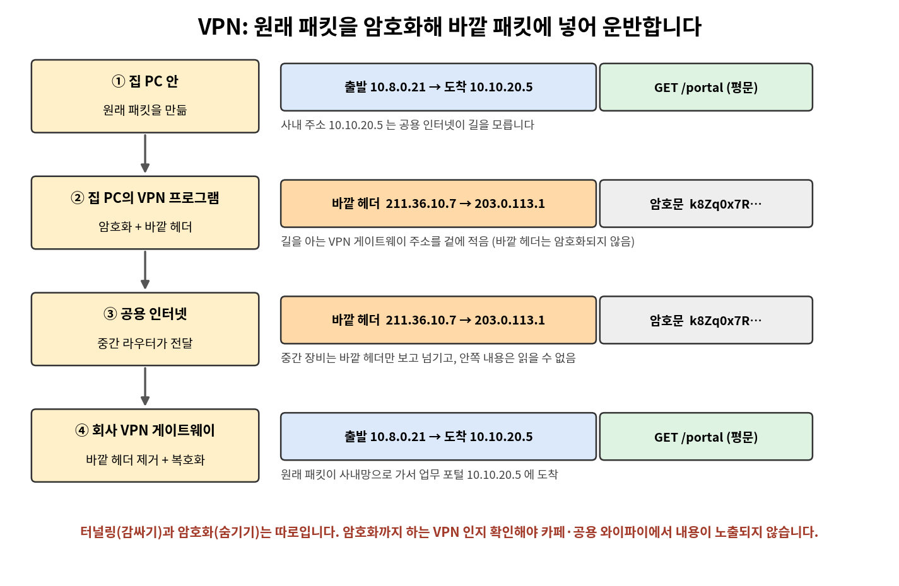
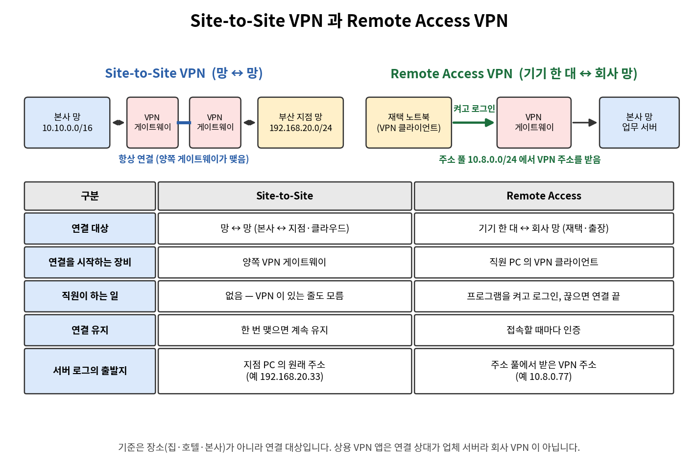
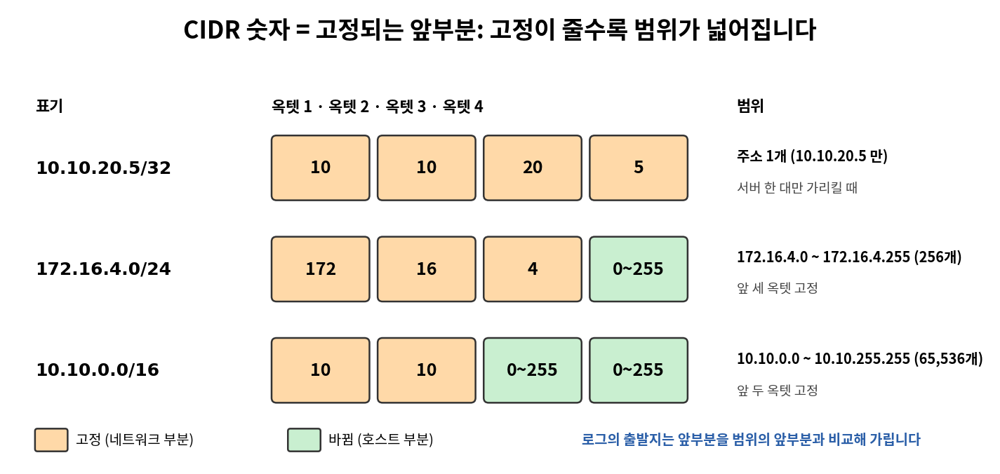
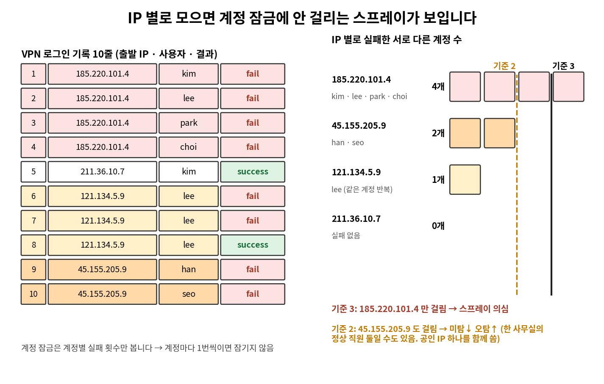
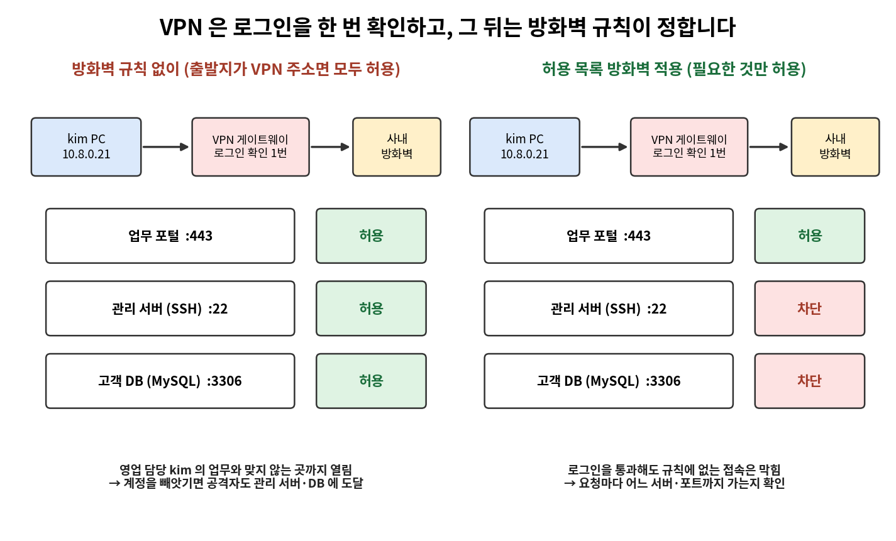
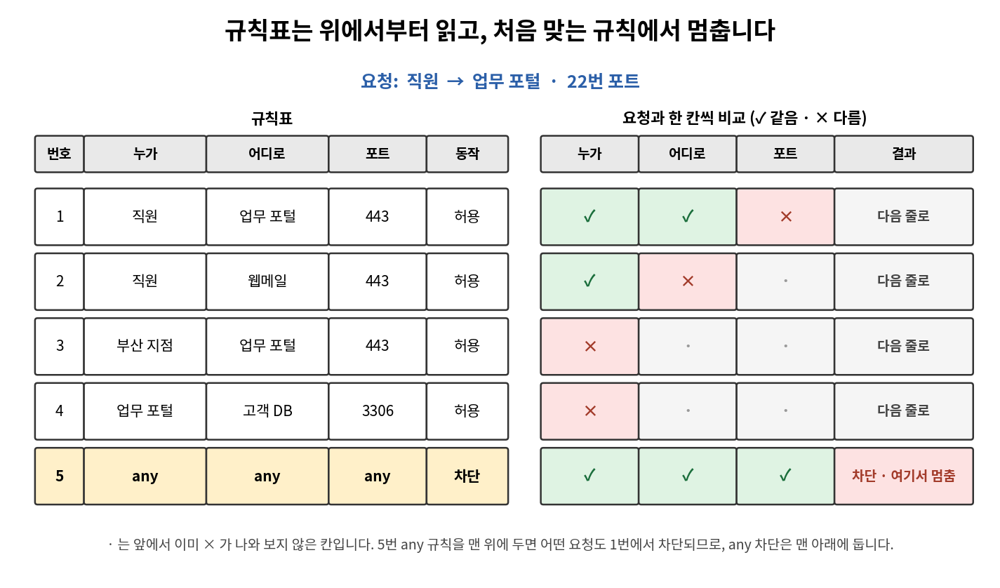
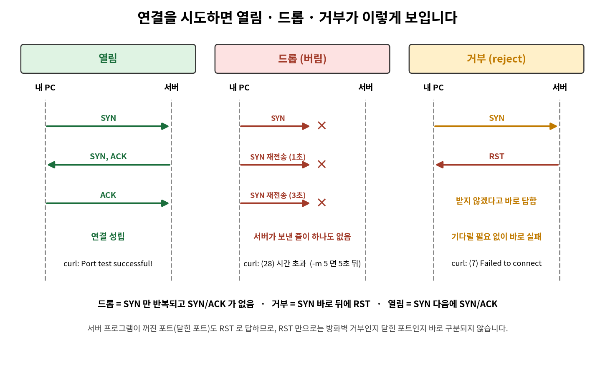
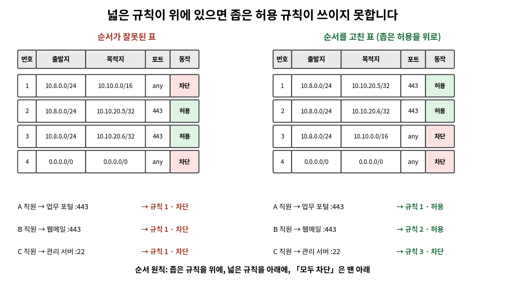

# 네트워크 4일차 정리 — VPN · 접속 로그 · 방화벽 규칙

> 2026-10-15 (목) · 네트워크·ZT(제로 트러스트) 운영 기초 4일차
> 오전: VPN(터널링·암호화), Site-to-Site·Remote Access, 출발지 주소 범위, 접속 로그와 비밀번호 스프레이, VPN의 한계 · 오후: 방화벽 규칙, 허용 목록, 드롭·거부, 규칙 순서, 규칙표 직접 쓰기

---

## 0. 오늘 배운 것 한눈에 보기

| 시간 | 주제 | 핵심 질문 | 쓰는 것 |
|---|---|---|---|
| 오전 2교시 | VPN이 필요한 이유 · 터널링 · 암호화 | 집·카페에서 회사 망에 어떻게 안전하게 연결하나? | `ipconfig`, 파이썬 딕셔너리 |
| 오전 3교시 | Site-to-Site · Remote Access · 출발지 주소 범위 | 로그의 출발지 주소로 어느 VPN인지 어떻게 가르나? | `/24` · `/16` · `/32` |
| 오전 4교시 | VPN 접속 로그 · VPN의 한계 | 비밀번호를 훔친 공격자는 로그에서 어떻게 보이나? | 파이썬 `get`·`not in` |
| 오후 5교시 | 방화벽 규칙 읽기 · 막힌 연결의 패킷 | 방화벽은 요청을 어떻게 허용·차단하고, 막히면 패킷은 어떻게 보이나? | `curl`, Wireshark |
| 오후 6교시 | 허용 목록·차단 목록 · 규칙 순서 | 규칙 순서가 바뀌면 결과가 왜 달라지나? | `portquiz.net`, 규칙표 |
| 오후 7교시 | 규칙표 직접 쓰기 · 규칙서 완성 | 요구사항을 규칙으로 옮기고 시험으로 채점하려면? | 파이썬 `ipaddress`, `git` |

**4일차의 큰 흐름**

1. **VPN**은 공용 인터넷 위에서 **원래 패킷을 암호화해 바깥 패킷에 넣어(터널링)** 회사 VPN 게이트웨이까지 운반하고, 회사 서버에는 **VPN 주소**를 출발지로 보이게 합니다.
2. 로그의 **출발지 주소가 어느 범위에 드는지**로 VPN 직원·지점·본사를 가립니다.
3. VPN은 **들어올 때 한 번만** 확인합니다. 계정 하나가 탈취되면 공격자도 사내망에 들어오므로, 로그인 뒤의 접속은 **방화벽 규칙**이 요청마다 정합니다.
4. 방화벽 규칙표는 **위에서부터 읽어 처음 맞는 규칙 하나**로 정하므로, **순서와 범위**가 결과를 바꿉니다. 맨 아래에 「모두 차단」을 두는 **허용 목록**이 최소 권한 원칙을 따릅니다.
5. 규칙표는 요구사항으로 **직접 쓰고, 시험 요청으로 채점**하며, 설계 근거와 한계를 **규칙서**로 남깁니다.

---

# Part 1. 오전 — VPN

## 1. VPN이 필요한 이유 (2교시)

### 1-1. 상황

재택 직원이 집이나 카페에서 사내 주소(`10.10.20.5`)의 **업무 포털**에 접속해야 합니다.

| | VPN 없이 | VPN 사용 |
|---|---|---|
| 접속 | 사내 주소는 공용 인터넷으로 접속할 수 없음 (회사망 밖) | 회사 안에 있을 때처럼 접속함 |
| 안전성 | 서버를 인터넷에 직접 공개하면 **누구나 접속을 시도**할 수 있음 | 회사 서버는 **VPN을 거친 사람에게만** 열 수 있음 |
| 중간 경로 | 패킷이 다른 회사의 장비 여러 대를 거치므로 중간 장비나 **같은 와이파이의 사람이 내용을 볼 수 있음** | 터널에 **암호화**를 함께 쓰면 내용을 읽을 수 없음 |

**VPN (Virtual Private Network, 브이피엔)** 은 집·카페에서 **공용 인터넷을 지나 회사 망에 연결**해 업무 포털·메일 서버를 쓰게 하는 기술입니다. 직원이 VPN을 켜는 이유는 **외부에서 회사 내부망에 들어가고, 요청 내용을 보호**하기 위해서입니다.

> 🔒 **관제 관점:** 방화벽 로그에서 VPN 트래픽은 **집 공인 IP → VPN 게이트웨이**로만 보입니다. 안쪽의 사내 주소와 내용은 게이트웨이가 복호화한 뒤 사내 방화벽 로그에서 봅니다.

---

## 2. 터널링과 암호화 (2교시)

### 2-1. 용어 정리

| 용어 | 뜻 | 예 |
|---|---|---|
| **터널링 (tunneling)** | **원래 패킷을 통째로 다른 패킷(바깥 패킷) 안에 넣어** VPN 게이트웨이까지 운반하는 방식. 10/12에 배운 캡슐화(헤더를 붙여 감싸기)를 한 번 더 하는 것입니다. 감싸기만 하므로 **터널만으로는 내용이 숨겨지지 않습니다.** | 바깥 패킷의 목적지 `203.0.113.1`(VPN 게이트웨이) |
| **암호화 (encryption)** | **평문**을 키로 **암호문**으로 바꿔서, 중간에서 가로채도 읽을 수 없게 하는 것 | `GET /portal` → `k8Zq0x7R…` |
| **평문 (plaintext)** | 암호화 전의 읽을 수 있는 데이터 (웹 요청·이메일·비밀번호 등) | `GET /portal` |
| **암호문 (ciphertext)** | 암호화한 뒤의 읽을 수 없는 글자 | `k8Zq0x7R…` |
| **복호화 (decryption)** | 암호문을 **키로 평문으로 되돌리는 것**. 키를 가진 쪽(게이트웨이)이 합니다. | `k8Zq0x7R…` → `GET /portal` |
| **VPN 게이트웨이** | **회사 쪽에서 VPN 연결을 받아 주는 장비·서버**. 바깥 헤더를 떼고 복호화해 원래 패킷을 사내망에 보냅니다. | `203.0.113.1` (게이트웨이의 공인 IP) |
| **VPN 주소** | VPN에 접속한 PC가 **VPN 게이트웨이에게서 받는 사내망 주소**. 원래 패킷의 출발지가 됩니다. | `10.8.0.21` |

### 2-2. 패킷이 지나가는 순서



| 순서 | 어디서 | 하는 일 |
|---|---|---|
| ① | 집 PC 안 | 원래 패킷을 만듦: 출발 `10.8.0.21`(VPN 주소) → 도착 `10.10.20.5`(업무 포털), 내용 `GET /portal` |
| ② | 집 PC의 VPN 프로그램 | 원래 패킷을 **암호화**하고, **바깥 헤더**를 씌움: 출발 `211.36.10.7`(집 공인 IP) → 도착 `203.0.113.1`(회사 VPN 게이트웨이) |
| ③ | 공용 인터넷 | 중간 라우터는 **바깥 헤더의 주소만 보고** 패킷을 넘김 |
| ④ | 회사 VPN 게이트웨이 | 바깥 헤더를 떼고 **복호화** → 원래 패킷이 사내망으로 가서 업무 포털에 도착 |

**왜 바깥 헤더의 도착지가 업무 포털이 아니라 VPN 게이트웨이인가:** 사내 주소 `10.10.20.5`는 사설 주소라 공용 인터넷의 라우터가 길을 모릅니다. 그래서 **길을 아는 VPN 게이트웨이의 공인 주소**를 겉에 적습니다.

| | VPN 없이 | VPN 사용 (터널링 + 암호화) |
|---|---|---|
| 중간 라우터가 보는 도착지 | 업무 포털 서버 주소 | **VPN 게이트웨이 주소** |
| 안쪽 내용·사내 주소 | 암호화하지 않았으면 보임 | 암호화되어 **보이지 않음** |
| 회사 서버가 보는 출발지 | 집 공인 IP | **VPN 주소**(사내망 주소) |
| 내 PC의 어댑터 | 랜·와이파이 | 랜·와이파이 **+ VPN 가상 어댑터** |

### 2-3. 암호화·복호화가 일어나는 곳

| 구간 | 내용 | 읽을 수 있나 |
|---|---|---|
| ① 집 PC 안 | `GET /portal` | **평문 — 읽힘** |
| ② 집 PC의 VPN 프로그램 ~ 회사 VPN 게이트웨이 (공용 인터넷) | `k8Zq0x7R…` | **암호문 — 읽을 수 없음** (바깥 헤더의 주소만 보임) |
| ③ 회사 사내망 | `GET /portal` | **평문 — 읽힘** |

- **암호화**는 집 PC(VPN 프로그램)에서, **복호화**는 회사 VPN 게이트웨이에서 일어납니다.
- 요청 내용을 **읽을 수 없는 구간은 집 PC의 VPN 프로그램 ~ 회사 VPN 게이트웨이 사이뿐**입니다. 집 PC 안과 사내망 안에서는 평문입니다.
- **바깥 헤더는 암호화되지 않습니다.** 집 공인 IP(`211.36.10.7`)와 VPN 게이트웨이 주소는 중간에서 보입니다.

### 2-4. 터널링과 암호화는 따로다

| VPN 종류 | 가로챈 사람에게 보이는 바깥 | 가로챈 사람에게 보이는 안쪽 |
|---|---|---|
| **터널링만** 한 VPN | 바깥 헤더가 씌워짐 | **안쪽이 그대로 보임** |
| **터널링 + 암호화** VPN | 바깥 헤더가 씌워짐 | **안쪽이 읽을 수 없는 글자** |

- **VPN이라는 이름만으로 내용이 숨겨졌다고 볼 수 없습니다.** 점검할 때 「VPN을 쓴다」가 아니라 **「암호화까지 한다」** 를 확인해야 합니다.
- 암호화하지 않은 VPN으로 카페 와이파이에 접속하면, 같은 와이파이의 공격자는 내가 회사 VPN 게이트웨이에 접속한다는 것뿐 아니라 **사내 서버 주소 `10.10.20.5`와 요청 내용 `GET /portal`까지** 읽을 수 있습니다.

### 2-5. 안쪽 도착지는 복호화 + 캡슐 제거 뒤에 확인한다

```text
바깥 헤더  출발 211.36.10.7 → 도착 203.0.113.1 (VPN 게이트웨이)
└ 암호화된 VPN 데이터
  └ 원래 패킷
    ├ 안쪽 출발지  10.8.0.21
    └ 안쪽 도착지  10.10.20.5
```

| 단계 | 하는 일 | 어디서 |
|---|---|---|
| ① 복호화 | 암호를 풀어 되돌림 — **키가 있어야** 함 | VPN 게이트웨이가 받은 직후 |
| ② 캡슐 제거 | 바깥 헤더를 벗겨 원래 패킷을 꺼냄 | VPN 게이트웨이가 복호화한 뒤 |

안쪽 도착지는 **복호화한 뒤 캡슐을 제거해야** 확인할 수 있습니다.

---

## 3. VPN 가상 어댑터와 `ipconfig` (2교시)

**네트워크 어댑터 (network adapter)** 는 PC가 망에 연결되는 **장치 또는 설정 하나**입니다. 랜 카드·와이파이 같은 실제 장치도 있고, VPN 프로그램이 소프트웨어로 만드는 **가상 어댑터**도 있습니다.

```text
내 PC 안의 네트워크 어댑터
 ├─ 이더넷 어댑터               ← 랜선        (연결 전에도 있음)
 ├─ Wi-Fi 어댑터                ← 공유기      (연결 전에도 있음)
 └─ PPP 어댑터 (VPN 프로그램 이름) ← 회사 VPN 게이트웨이   ← VPN 연결 후 새로 생김
```

- 가상 어댑터는 실제 부품을 추가하는 것이 아니라 **VPN 프로그램이 PC 안에 만든 연결 통로**입니다.
- Windows `ipconfig`에서는 VPN 연결이 `PPP 어댑터 이름:`으로 나오기도 합니다.

**연결 전·후 `ipconfig` 비교 (수업 예시 화면)**

```text
[연결 전]
이더넷 어댑터 이더넷:
   IPv4 주소 . . . . . . . . : 192.168.200.81
   서브넷 마스크 . . . . . . : 255.255.255.0
   기본 게이트웨이 . . . . . : 192.168.200.1
무선 LAN 어댑터 Wi-Fi:
   미디어 상태 . . . . . . . : 미디어 연결 끊김

[연결 후]  (위 내용 그대로 + 아래가 새로 생김)
PPP 어댑터 CompanyVPN:
   IPv4 주소 . . . . . . . . : 10.8.0.21
   서브넷 마스크 . . . . . . : 255.255.255.255
```

| 읽는 법 | 설명 |
|---|---|
| `… 어댑터 …:` 로 끝나는 줄 | **어댑터 이름 줄**. 이 줄 아래가 그 어댑터의 주소 |
| `미디어 연결 끊김` | 연결이 안 된 어댑터도 **어댑터 한 개로 셈** (연결 전 2개 → 연결 후 3개) |
| 새로 생긴 어댑터의 IPv4 주소 | **VPN 주소** `10.8.0.21` (회사 VPN 게이트웨이가 사내 범위에서 나눠 준 주소) |
| 이더넷 어댑터의 IPv4 주소 | 지금 PC가 연결된 집·학원 망에서 받은 주소 `192.168.200.81` → **VPN 주소와 다른 범위** |
| 새 어댑터의 서브넷 마스크 `255.255.255.255` | 주소 하나만 쓴다는 뜻 (`/32`) |

- 새 어댑터에는 **기본 게이트웨이 줄이 없습니다.** 회사로 가는 패킷은 기존(이더넷) 어댑터가 실제로 내보내고, 새 어댑터는 VPN 주소를 갖는 역할입니다.
- **어댑터 이름은 VPN 프로그램마다 다르므로 외울 수 없습니다.** 연결 전과 비교해 **새로 생긴 줄**을 찾는 법을 익힙니다.
- 서버 기록에는 집 공인 IP가 아니라 **VPN 주소**가 출발지로 남습니다. VPN 주소만으로는 **그 직원이 실제로 어느 공인 IP·어느 나라에서 접속했는지**, 또 같은 VPN 주소가 다음 날 다른 직원에게 갈 수도 있어 **누구인지 확정**할 수 없습니다. VPN 게이트웨이의 접속 로그(7장)에서 **시각으로 맞춰** 확인합니다.

> 🔒 **관제 관점:** 사고 PC를 점검할 때 `ipconfig`로 VPN 어댑터가 있는지, **회사가 모르는 VPN·가상 어댑터**가 있는지 먼저 봅니다. 회사가 모르는 가상 어댑터는 우회 통신 의심 대상입니다.

---

## 4. 파이썬: 딕셔너리 안의 딕셔너리 (2교시)

패킷의 겹친 구조(바깥 패킷 안에 안쪽 패킷)를 파이썬으로 표현합니다.

```python
inner = {"src": "10.8.0.21", "dst": "10.10.20.5", "data": "GET /portal"}   # 안쪽 패킷
outer = {"src": "211.36.10.7", "dst": "203.0.113.1", "data": inner}        # 바깥 패킷의 data 칸에 안쪽 패킷을 통째로 넣음

print("중간 라우터가 보는 도착지:", outer["dst"])      # 203.0.113.1
print("data 칸:", outer["data"])                        # {'src': '10.8.0.21', 'dst': '10.10.20.5', 'data': 'GET /portal'}
print("안쪽 도착지:", outer["data"]["dst"])             # 10.10.20.5
```

| 쓰는 것 | 뜻 |
|---|---|
| `d["data"]` | 바깥 딕셔너리에서 `data` 칸을 꺼냄 |
| `d["data"]["dst"]` | 꺼낸 값이 **딕셔너리일 때만** 그 안의 `dst`를 또 꺼낼 수 있음 |
| 꺼낸 값이 **글자**일 때 `["dst"]` | **`TypeError`** — 글자는 `["이름"]`으로 꺼낼 수 없음 |

**암호화한 경우:** `data` 칸에 안쪽 패킷 대신 암호문 글자를 넣으면

```python
outer = {"src": "211.36.10.7", "dst": "203.0.113.1", "data": "k8Zq0x7RmP2aWv9L"}   # data 에 암호문
print("중간 라우터가 보는 도착지:", outer["dst"])      # 203.0.113.1 (정상 출력)
print("data 칸:", outer["data"])                        # k8Zq0x7RmP2aWv9L
print("안쪽 도착지:", outer["data"]["dst"])             # TypeError: string indices must be integers
```

- 마지막 줄에서 `TypeError`로 멈춥니다. `data` 칸이 딕셔너리가 아니라 **글자**라서 안쪽 `dst`를 꺼낼 수 없기 때문입니다.
- **중간에서 가로챈 사람(도청자)도 마찬가지**입니다. 바깥 헤더(집 공인 IP → VPN 게이트웨이)만 보고, **안쪽의 사내 주소·접속한 페이지는 알 수 없습니다.** 파이썬 에러가 「암호화하면 안쪽을 꺼낼 수 없다」는 것을 보여 줍니다.

---

## 5. VPN의 종류 (3교시)

### 5-1. Site-to-Site VPN과 Remote Access VPN



| 용어 | 뜻 |
|---|---|
| **Site-to-Site VPN** | **망과 망**을 연결하는 VPN. 양쪽 VPN 게이트웨이가 서로 연결을 맺고 **계속 유지**합니다. 직원은 VPN이 있는 줄도 모르고 씁니다. |
| **Remote Access VPN** | **기기 한 대**를 회사 망에 연결하는 VPN. 직원이 PC에 **VPN 클라이언트**를 깔고 **직접 켜서 로그인**합니다. 끊으면 연결이 끝납니다. |
| **VPN 클라이언트 (client)** | Remote Access VPN에 접속하려고 직원 PC에 까는 프로그램 |
| **주소 풀 (address pool)** | VPN 게이트웨이가 접속한 PC에 **하나씩 나눠 주려고 모아 둔 사내 주소 범위**. 접속을 끊으면 주소를 돌려줘 다른 직원이 받을 수 있습니다. 예: `10.8.0.0/24` |

| | Site-to-Site VPN | Remote Access VPN |
|---|---|---|
| 연결 대상 | 망 ↔ 망 (본사 ↔ 지점, 본사 ↔ 클라우드) | 기기 한 대 ↔ 회사 망 |
| 연결을 시작하는 장비 | **양쪽 VPN 게이트웨이** | 직원 PC의 **VPN 클라이언트** |
| 직원이 하는 일 | **없음** (PC에 아무것도 깔지 않음) | 프로그램을 켜고 로그인 |
| 연결 유지 | 한 번 맺으면 **계속(24시간)** 유지 | 접속할 때마다 인증하고, 끊으면 끝 |
| VPN 연결 수 | 지점마다 1개 | 접속한 직원 PC마다 1개 |
| **서버 로그의 출발지** | **지점 PC의 원래 주소** (예: `192.168.20.33`) | **주소 풀에서 받은 VPN 주소** (예: `10.8.0.77`) |
| 맞는 곳 | 본사와 지점·클라우드 데이터센터 | 재택근무자·출장자 |

- 지점이 3곳에서 30곳으로 늘어도 Site-to-Site VPN은 **지점마다 게이트웨이 사이 연결 하나만** 관리하면 됩니다. 지점 직원 300명이 모두 Remote Access VPN을 쓰려면 각자 클라이언트를 깔고 매번 로그인해야 합니다.

### 5-2. 회사 VPN이 아닌 것: 개인용 VPN 앱

앱스토어에서 개인이 받아 쓰는 **상용 VPN 앱**도 터널과 암호화를 쓰지만, 연결 상대가 **회사 VPN 게이트웨이가 아니라 VPN 업체의 서버**입니다. 그래서 회사 망에는 연결되지 않고, PC의 인터넷 통신이 암호화된 채 업체 서버로 나갑니다.

| | 개인 VPN 없이 | 개인 VPN 사용 |
|---|---|---|
| 경로 | 회사 PC → 회사 방화벽·보안 장비 → 인터넷 | 회사 PC → 암호화된 터널 → **개인 VPN 업체 서버** → 인터넷 |
| 회사가 보는 것 | 접속 기록과 위험 여부를 확인함 | **업체와 연결한 사실만** 보이고, 터널 안의 접속 대상·내용은 확인하기 어려움 |

> 🔒 **관제 관점:** 회사 노트북에서 상용 VPN 앱이 켜져 있으면 (1) 패킷은 회사 방화벽을 지나가지만 목적지가 업체 서버로만 보이고 안은 암호화되어 있어 **실제 접속 대상을 볼 수 없고**, (2) 이름 질의(DNS)도 업체 서버로 가서 **회사 DNS의 차단·기록을 거치지 않으며**, (3) 위험한 사이트 차단도 적용되지 않고, (4) 회사 자료가 업체 서버로 나가도 알기 어렵습니다. 알려진 상용 VPN 업체 주소로 나가는 연결이 보이면 **보안 정책 위반**으로 확인합니다.

### 5-3. 상황 문장에서 어떤 VPN인지 가리는 법

장소(집·호텔·본사)가 아니라 **연결 대상이 망인지 기기 한 대인지**, 그리고 **VPN의 반대편이 회사 VPN 게이트웨이인지**를 봅니다.

| 상황 글에 이런 말이 있으면 | VPN | 까닭 |
|---|---|---|
| 「PC에 아무것도 깔지 않았다」 · 「항상 연결」 · 「본사 망과 지점 망」 | **Site-to-Site VPN** | 망과 망을 게이트웨이끼리 연결해 두어 직원은 할 일이 없음 |
| 「집에서」 · 「호텔 와이파이」 · 「노트북으로 접속」 | **Remote Access VPN** | 노트북 한 대를 직원이 켜고 로그인해서 연결, 끊으면 끝 |
| 「개인 돈으로 결제한」 · 「상용 VPN 앱」 | **회사 VPN 아님** | 연결 상대가 VPN 업체 서버라 회사 망에 연결 안 됨 |

**풀이 예제:** 「서울 본사와 부산 지점 직원이 같은 ERP 서버를 매일 쓴다. 직원 PC에는 아무것도 깔지 않았다」

| 1단계 · 문장에서 찾은 정보 | 2단계 · 해석 | 가리키는 VPN |
|---|---|---|
| 「본사 직원과 지점 직원」 · 「같은 ERP 서버」 | PC 한 대가 아니라 **망 전체** — 망과 망을 연결 | Site-to-Site |
| 「직원 PC에는 아무것도 깔지 않았다」 | 직원이 VPN을 켜지 않음 — 연결은 **양쪽 VPN 게이트웨이**가 맺음 | Site-to-Site |
| 「매일 쓴다」 | 필요할 때만이 아니라 **항상 연결**해 두어야 함 | Site-to-Site |

세 해석이 모두 같은 쪽을 가리키므로 **Site-to-Site VPN**입니다. (「서울」·「부산」이라는 장소가 아니라 연결 대상과 프로그램 유무를 봅니다.)

| 연습 상황 | 답 |
|---|---|
| 재택근무 직원이 집에서 노트북으로 사내 업무 포털에 접속한다 | Remote Access VPN |
| 출장 중인 직원이 호텔 와이파이에서 노트북으로 회사 메일 서버에 접속한다 | Remote Access VPN (호텔이라는 장소가 아니라 노트북 한 대) |
| 본사 망과 클라우드에 만든 회사 서버 망을 24시간 항상 연결해 둔다 | Site-to-Site VPN |
| 직원이 회사 노트북에 개인 돈으로 결제한 상용 VPN 앱을 깔고 켰다 | 회사 VPN 아님 |

---

## 6. 출발지 주소로 어느 VPN인지 가리기 (3교시)

회사 방화벽·서버 로그에는 **출발지 주소**만 남습니다. 그 주소가 **어느 범위에 들어 있는지**로 어디서 들어왔는지 가립니다.

### 6-1. `/24` · `/16` · `/32` 읽는 법 (10/13 복습)



| 용어 | 뜻 |
|---|---|
| **옥텟 (octet)** | IP 주소를 점으로 나눈 숫자 한 칸 (`172.16.4.0`은 옥텟 4개) |
| **네트워크 부분** | 같은 범위의 주소가 똑같이 갖는 **앞부분** (고정). `/24`는 옥텟 3개(24비트) |
| **호스트 부분** | 그 망 안에서 기기마다 다른 번호가 붙는 **나머지** (0~255로 바뀜) |

| 표기 | 고정되는 곳 | 바뀌는 곳 | 범위 (연습용 주소) |
|---|---|---|---|
| `/24` | 앞 세 옥텟 | 4번째 옥텟 0~255 | `172.16.4.0` ~ `172.16.4.255` (256개) |
| `/16` | 앞 두 옥텟 | 3·4번째 옥텟이 모두 바뀜 | `172.16.0.0` ~ `172.16.255.255` (65,536개) |
| `/32` | **네 옥텟 모두** | 없음 | 주소 **1개** (`10.10.20.5/32` = `10.10.20.5` 만) |

- 고정하는 옥텟이 하나 줄면 바뀌는 옥텟이 하나 늘어 범위가 **256배** 넓어집니다.
- 범위의 처음과 끝은 호스트 부분을 `0`과 `255`로 채운 값입니다.
- 서버 한 대만 가리킬 때는 `/32`를 붙입니다. 같은 망의 다른 서버는 그 범위에 들어오지 않습니다.

### 6-2. 오늘 쓰는 예시 회사의 범위 표

| 범위 | 주소가 들어 있는 곳 | 뜻 |
|---|---|---|
| `10.8.0.0/24` | `10.8.0.0` ~ `10.8.0.255` | **Remote Access VPN 주소 풀** — VPN으로 들어온 직원 |
| `192.168.20.0/24` | `192.168.20.0` ~ `192.168.20.255` | **Site-to-Site VPN**으로 연결된 부산 지점 망 |
| `10.10.0.0/16` | `10.10.0.0` ~ `10.10.255.255` | **본사** PC·서버 |

**판정 방법:** 출발지 주소의 앞부분(`/24`는 앞 세 옥텟, `/16`은 앞 두 옥텟)을 범위의 앞부분과 비교해 **같으면 그 범위**입니다.

| # | 출발지 주소 | 판정 | 근거 |
|---|---|---|---|
| ① | `10.8.0.21` | **VPN 직원** | 앞 세 옥텟 `10.8.0` 이 풀과 같음 |
| ② | `192.168.20.15` | **부산 지점 PC** | `192.168.20` 이 같음 |
| ③ | `10.10.20.5` | **본사** (PC·서버) | 앞 두 옥텟 `10.10` 이 같음 (`/16`) |
| ④ | `10.8.1.7` | **목록에 없는 주소** | `10.8` 로 시작하지만 앞 **세** 옥텟이 `10.8.1` ≠ `10.8.0` |
| ⑤ | `211.36.10.7` | **목록에 없는 주소** (집 공인 IP) | 세 범위 어디에도 안 들어감 |

> ⚠️ `10.8.1.7`도 `10.8`로 시작한다고 VPN 직원으로 적는 실수가 많습니다. **`/24`는 앞 두 옥텟이 아니라 앞 세 옥텟**이 같아야 합니다.

> 🔒 **관제 관점**
> - VPN 주소 풀·지점 망·본사 망 범위를 **표로 두고**, 로그의 출발지를 그 표로 가립니다.
> - 본사 서버 로그에 **세 범위 어디에도 없는 사내 주소**(예: `10.20.5.3`, 사설 주소라 인터넷에서 바로 온 것이 아님)가 보이면, ① 표에 올리지 않은 **새 지점·새 망**, ② 허락 없이 연결한 **관리되지 않는 장비**(개인 공유기 등), ③ 주소 설정이 잘못된 장비를 의심해 먼저 확인합니다.
> - 이 범위 표는 오후 방화벽 규칙표에 그대로 들어갑니다.

---

## 7. VPN 접속 로그와 공격의 흔적 (4교시)

### 7-1. 용어 정리

| 용어 | 뜻 | 예 |
|---|---|---|
| **접속 로그 (access log)** | VPN에 접속을 시도할 때마다 남는 **기록 한 줄**. 누가·언제·어느 주소에서·성공했는지 실패했는지가 적혀 이상한 접속을 찾는 기본 자료입니다. **비밀번호를 훔친 공격자도 이 로그에 남습니다.** | `han · 198.51.100.7 · fail` |
| **무차별 대입 (brute force)** | **한 계정**에 비밀번호를 바꿔 가며 계속 로그인을 시도하는 공격. 기록에는 같은 사용자의 실패가 짧은 시간에 이어집니다. 오타와 비슷해 보여 횟수와 간격으로 구별합니다. | `han` 계정이 연달아 `fail` |
| **계정 잠금 (account lockout)** | 한 계정이 **정해진 횟수만큼 실패하면 잠시 로그인을 막는** 기능. **계정별로 실패를 세므로** 무차별 대입은 막습니다. | 5번 실패 → 잠금 |
| **비밀번호 스프레이 (password spraying)** | **여러 계정**에 **흔한 비밀번호를 계정마다 한두 번씩만** 넣어 보는 공격. 계정마다 실패가 한두 번뿐이라 **계정 잠금에 안 걸립니다.** | 한 IP에서 서로 다른 계정 4개가 실패 |

| 공격 | 로그에서 보이는 모양 | 계정 잠금에 | 먼저 볼 것 |
|---|---|---|---|
| 무차별 대입 | **한 계정**의 실패가 이어짐 | 걸림 (실패 횟수가 쌓임) | 같은 사용자의 실패 횟수 |
| 비밀번호 스프레이 | **한 IP**에서 서로 다른 계정이 하나씩 실패 | **걸리지 않음** (계정마다 1번) | 한 IP의 **서로 다른 계정 수** |

### 7-2. 로그에서 먼저 찾는 세 가지 모양

로그 한 줄 = 출발 IP · 사용자 · 결과(`success` · `fail`)

| 확인하는 모양 | 로그에 이렇게 찍힘 (연습용) | 의심하는 까닭 | 보는 칸 |
|---|---|---|---|
| 한 계정의 실패가 이어짐 | `203.0.113.5 kim fail` 반복 | 무차별 대입이거나 **본인의 오타** | 같은 사용자의 결과 |
| **한 IP에서 서로 다른 계정이 여러 개 실패** | `198.51.100.8` 에서 `kim` · `lee` · `park` 가 각각 fail | **비밀번호 스프레이** — 계정 잠금으로는 못 막음 | 출발 IP + 사용자 |
| 실패 뒤 성공 | `192.0.2.30 han fail` → `han success` | 비밀번호를 **맞혔을 수 있음** | 결과 |

> 🔒 **관제 관점:** 같은 사용자의 실패 반복은 무차별 대입이거나 오타이므로 **해외 IP인지** 함께 봅니다. 한 IP에서 여러 계정이 실패하면 **그 IP를 먼저 차단**하고, 같은 시각 그 IP에서 **성공한 계정**이 있는지 확인합니다.

### 7-3. 파이썬으로 IP별 실패 계정 모으기

로그 10줄에서 **IP마다 실패한 서로 다른 계정**을 모읍니다. 계정 잠금은 계정별로 세지만, 여기서는 **IP 기준으로 모아야** 스프레이가 보입니다.



```python
LOG = [                                              # (출발 IP, 사용자, 결과) 튜플의 리스트
    ("185.220.101.4", "kim",  "fail"),
    ("185.220.101.4", "lee",  "fail"),
    ("185.220.101.4", "park", "fail"),
    ("185.220.101.4", "choi", "fail"),
    ("211.36.10.7",   "kim",  "success"),
    ("121.134.5.9",   "lee",  "fail"),
    ("121.134.5.9",   "lee",  "fail"),
    ("121.134.5.9",   "lee",  "success"),
    ("45.155.205.9",  "han",  "fail"),
    ("45.155.205.9",  "seo",  "fail"),
]
failed = {}                                          # IP 별 「실패한 계정 목록」을 담을 빈 딕셔너리
for ip, user, result in LOG:                         # 기록을 한 줄씩 꺼내 세 변수에 나눠 담음
    if result == "fail":                             # 실패한 줄만
        users = failed.get(ip, [])                   # 이 IP의 계정 목록 (처음 보는 IP면 빈 리스트 [])
        if user not in users:                        # 이 계정이 목록에 없으면
            users.append(user)                       # 목록 끝에 더함 (같은 계정이 또 실패해도 한 번만)
        failed[ip] = users                           # 바뀐 목록을 다시 담음
for ip in failed:
    if len(failed[ip]) >= 3:                         # 서로 다른 계정이 3개 이상이면
        print(ip, len(failed[ip]), failed[ip])
# 185.220.101.4 4 ['kim', 'lee', 'park', 'choi']
```

| 쓰는 것 | 뜻 |
|---|---|
| `d.get(키, [])` | 키가 있으면 그 값(리스트), 없으면 **빈 리스트 `[]`** |
| `값 not in 리스트` | 리스트에 값이 **없으면** `True` |
| `리스트.append(값)` | 리스트 끝에 값을 더함 |
| `len(리스트)` | 요소 수 — **중복 없이 모았으면 서로 다른 값의 수** |

**줄 따라가기**

| 읽은 줄 | 하는 일 | 읽은 뒤 IP별 실패 계정 |
|---|---|---|
| `185.220.101.4 · kim · fail` | 새 IP — 빈 목록에 kim을 더함 | `185.220.101.4: [kim]` |
| `185.220.101.4 · lee · fail` | 같은 IP 목록에 lee를 더함 | `185.220.101.4: [kim, lee]` |
| `211.36.10.7 · kim · success` | 실패가 아니라 건너뜀 | 그대로 |
| `121.134.5.9 · lee · fail` | 새 IP — lee를 더함 | `121.134.5.9: [lee]` |
| `121.134.5.9 · lee · fail` (두 번째) | 같은 계정 — **이미 있어서 더하지 않음** | `[lee]` 그대로 |

- `if user not in users:`를 빼면 같은 계정이 또 실패할 때마다 중복으로 들어가 `lee`가 3으로 잡힙니다. 그러면 **계정 수가 아니라 실패 횟수**를 센 것이 됩니다.

### 7-4. 판정 기준 3과 2: 미탐과 오탐

| 출발 IP | 실패한 계정 수 | 기준 3 이상 | 기준 2 이상 |
|---|---|---|---|
| `185.220.101.4` | 4개 | 걸림 | 걸림 — **스프레이 의심** |
| `45.155.205.9` | 2개 | 안 걸림 | **새로 걸림** — 정상 직원 둘일 수도 있음 |
| `121.134.5.9` | 1개 (`lee` 반복) | 안 걸림 | 안 걸림 |
| `211.36.10.7` | 0개 | 안 걸림 | 안 걸림 |

- 기준을 **낮추면 공격을 놓치는 일(미탐)은 줄고, 정상 사용자가 잘못 걸리는 일(오탐)은 늘어납니다.** (10/14 오탐·미탐을 VPN 로그에 적용한 것입니다.)
- 정상 직원이 걸리는 경우: 한 사무실·카페에서 여러 직원이 **공인 IP 하나를 함께 쓰면**(10/13 PAT), 직원 두 명이 각자 오타를 내도 「한 IP에서 서로 다른 계정 2개 실패」로 보입니다.
- `121.134.5.9`의 `lee`는 **실패 두 번 뒤 성공**했지만, 이 코드는 **서로 다른 계정 수**만 세므로(1개) 걸리지 않습니다. 하지만 7-2의 「실패 뒤 성공」 모양에 해당하므로 확인할 만합니다. 다만 **본인의 오타일 가능성**이 크므로 해외 IP인지, 평소 쓰던 IP인지 이전 기록과 비교합니다.

---

## 8. VPN의 한계: 들어올 때 한 번만 확인한다 (4교시)

### 8-1. 경계 기반 보안

| 용어 | 뜻 |
|---|---|
| **경계 기반 보안 (perimeter security)** | 회사 망 **안은 믿고 밖은 믿지 않는** 방식. **입구(VPN 로그인)에서 한 번만 확인**하고, 한 번 들어오면 안에서는 다시 묻지 않습니다. |

| 단계 | 무슨 일이 일어나나 | 결과 |
|---|---|---|
| 경계에서 | VPN 로그인 한 번 | 아이디·비밀번호가 맞으면 통과 |
| 사내망 안에서 | **다시 묻지 않음** | 업무에 필요한지 아무도 묻지 않음 |
| 계정이 빼앗기면 | 공격자도 같은 길로 통과 | 관리 서버·DB까지 모두 도달할 수 있음 |

VPN이 하는 확인은 **로그인 한 번**입니다. 사내망 안에서 무엇에 접속하는지는 VPN이 아니라 **방화벽 규칙**이 맡습니다.

### 8-2. 접속 기록에 나오는 포트

| 포트 | 쓰는 서비스 | 무엇을 하는 곳 |
|---|---|---|
| `443` | HTTPS | 웹 페이지 (업무 포털) |
| `22` | SSH | 서버에 원격으로 접속해 **명령을 내리는 관리용 접속** |
| `3306` | MySQL | **데이터베이스(DB) 서버** |

### 8-3. `kim`의 VPN 로그인 뒤 기록 읽기

영업 담당 `kim`의 업무는 업무 포털만 쓰는 것입니다.

```text
09:02  VPN 게이트웨이  kim 로그인 성공      출발 211.36.10.7 (KR)  → VPN 주소 10.8.0.21 받음
09:05  사내 방화벽     10.8.0.21 → 10.10.20.5:443    업무 포털       허용
09:40  사내 방화벽     10.8.0.21 → 10.10.20.9:22     관리 서버 SSH   허용
09:41  사내 방화벽     10.8.0.21 → 10.10.30.7:3306   고객 DB         허용
```

| 질문 | 답 |
|---|---|
| VPN 게이트웨이가 `kim`을 확인한 횟수 | 09:02에 **한 번** |
| 그 뒤 사내 접속의 목적지 포트 | `443` · `22` · `3306` |
| 영업 담당이 쓸 일이 없는 관리 서버·고객 DB까지 **허용**된 이유 | VPN은 한 번만 확인하고, 사내 방화벽은 **출발지가 VPN 주소이면 사내 PC처럼 모두 허용**했음. 「경계를 통과했으면 믿는다」는 경계 기반 보안이라 `kim`의 업무에 필요한지 아무도 확인하지 않았음 |
| 09:02 로그인이 비밀번호를 훔친 공격자였다면 | 업무 포털뿐 아니라 **관리 서버에 SSH로 접속**하고 **고객 DB에 접속**해 서버 설정을 바꾸거나 고객 정보를 빼낼 수 있었음 |

**접속 순서를 ASCII 아트(글자만으로 그린 그림)로 남기기** — 보고서·로그·메신저에 그대로 붙여 넣을 수 있습니다.

```text
kim PC --> VPN 게이트웨이 --> 사내 방화벽 --+--> 업무 포털 :443
                                            +--> 관리 서버 :22
                                            +--> 고객 DB   :3306
```

> 🔒 **관제 관점:** VPN 로그인 **성공 뒤에** 그 VPN 주소가 업무와 맞지 않는 서버(관리 서버·DB)에 접속하면 **계정 탈취를 의심**합니다. VPN 주소에서 DB로 가는 접속은 **방화벽에서 처음부터 막아 둡니다.** 이 한계는 오후의 방화벽 규칙과 10/19의 Zero Trust로 이어집니다.

---

# Part 2. 오후 — 방화벽

## 9. 방화벽이 하는 일 (5교시)

### 9-1. 용어 정리

| 용어 | 뜻 |
|---|---|
| **방화벽 (firewall)** | 망과 망 사이에서 **서버로 가는 접속 요청(누가·어느 서버의·어느 포트로)마다 허용할지 차단할지 규칙으로 정하는** 장비·프로그램. 결과는 **로그**로 남습니다. |
| **방화벽 규칙 (rule)** | 「출발지에서 목적지의 어느 포트로 가는 요청을 **허용 또는 차단**한다」를 적은 **한 줄**. 규칙 한 줄이 방화벽의 판단 기준입니다. |
| **`any`** | 어떤 값이든 맞는다는 뜻(「모든 곳」·「모든 포트」). 출발지·목적지·포트 칸 어디에나 씁니다. |
| **첫 번째 일치 (first match)** | 규칙표를 **위에서부터** 읽다가 **처음 맞는 규칙 하나**로 결정하고, 그 아래는 읽지 않는 방식. **같은 규칙도 위치가 바뀌면 결과가 달라질 수 있습니다.** |
| **맞는 규칙이 없을 때의 동작 (default action)** | 어느 줄에도 맞지 않는 요청을 어떻게 할지 정한 동작. **장비마다 허용일 수도, 차단일 수도** 있어서, 규칙표 **맨 아래에 「모두 차단」을 직접 적어 둡니다.** |

규칙 한 줄은 **출발지 · 목적지 · 포트 · 동작** 네 칸입니다. (실제 장비에는 프로토콜 TCP·UDP도 적지만, 오늘은 모두 TCP라 생략합니다.)

| 출발지 | 목적지 | 포트 | 동작 |
|---|---|---|---|
| 직원 | 업무 포털 | 443 | 허용 |

### 9-2. VPN과 방화벽은 역할이 다르다



| | VPN | 방화벽 |
|---|---|---|
| 확인하는 것 | 사내망에 들어와도 되는 **사람**인지 **로그인으로** | 들어온 뒤 **어느 서버의 어느 포트까지** 가도 되는지 |
| 확인 횟수 | **한 번** | **요청마다** |

VPN 로그인을 통과해도 **방화벽 규칙에 없는 접속 요청은 차단**됩니다. 예: 직원 PC가 업무 포털 `:443`은 허용, 고객 DB `:3306`은 차단.

> 🔒 **관제 관점:** 「접속이 안 돼요」 문의가 오면 **방화벽 로그에서 그 요청이 몇 번 규칙에 맞았는지** 먼저 봅니다.

---

## 10. 규칙표 읽기 (5교시)

### 10-1. 5교시 규칙표

| 번호 | 누가 (출발지) | 어디로 (목적지) | 포트 | 동작 |
|---|---|---|---|---|
| 1 | 직원 | 업무 포털 | 443 | 허용 |
| 2 | 직원 | 웹메일 | 443 | 허용 |
| 3 | 부산 지점 | 업무 포털 | 443 | 허용 |
| 4 | 업무 포털 | 고객 DB | 3306 | 허용 |
| 5 | any | any | any | 차단 |

**읽는 법:** 요청 하나를 규칙 1번부터 읽습니다. **「누가 · 어디로 · 포트」가 셋 다 같은 첫 줄**의 동작이 답이고, 그 아래 줄은 읽지 않습니다. 하나라도 다르면 다음 줄로 갑니다.

**풀이 예제:** 요청 `직원 → 웹메일 · 443`
- 1번 (직원 → 업무 포털 · 443): 「어디로」가 다릅니다 → 다음 줄
- 2번 (직원 → 웹메일 · 443): 셋 다 같습니다 → **답: 2번 · 허용.** 3번 이후는 읽지 않습니다.

### 10-2. 칸마다 ✓·× 표시해 멈추는 줄 찾기

요청: **직원 → 업무 포털의 22번 포트**



- 1번은 누가·어디로는 같지만 **포트가 443 ≠ 22**라서 다음 줄로 갑니다.
- 2번은 어디로(웹메일)가 다르고, 3·4번은 누가가 다릅니다. 앞에서 이미 다르면 **뒤 칸은 보지 않습니다.**
- 5번은 any라 세 칸이 모두 맞으므로 **차단**하고 멈춥니다.

**연습 요청 세 개**

| 요청 | 누가 | 어디로 | 포트 | 결과 | 이유 |
|---|---|---|---|---|---|
| A | 부산 지점 | 업무 포털 | 443 | **3번 · 허용** | 3번과 세 칸이 모두 같음 |
| B | 부산 지점 | 웹메일 | 443 | **5번 · 차단** | 「어디로」가 달라 1~4번을 지나 5번에서 차단. 부산 지점에게 웹메일을 열어 주는 규칙이 없음 |
| C | 직원 | 고객 DB | 3306 | **5번 · 차단** | 포트 `3306`이 4번과 같아도 4번은 **업무 포털이 출발**하는 규칙이라 직원에게는 안 맞음. **세 칸이 모두 같아야 함** |

- **5번 `any` 규칙을 맨 위(1번 자리)로 올리면** 어떤 요청이든 1번에서 차단되어 허용 규칙이 하나도 쓰이지 못합니다. 그래서 `any` 규칙은 **맨 아래**에 둡니다.

---

## 11. 막힌 연결은 패킷으로 어떻게 보이나 (5교시)

### 11-1. 3-way handshake 복습과 용어

| 단계 | 보내는 쪽 | 뜻 | Wireshark Info |
|---|---|---|---|
| ① SYN | 내 PC → 서버 | 「연결을 시작하고 싶다」 | `[SYN]` |
| ② SYN, ACK | 서버 → 내 PC | 「받았고, 나도 준비됐다」 | `[SYN, ACK]` |
| ③ ACK | 내 PC → 서버 | 「확인했다」 → 연결됨 | `[ACK]` |

| 용어 | 뜻 |
|---|---|
| **플래그** | 패킷의 SYN·ACK 같은 **표시**. 켜지면 `1`, 꺼지면 `0` — SYN은 `SYN 1 · ACK 0`, SYN/ACK는 `SYN 1 · ACK 1`, 그 뒤의 ACK와 데이터는 `SYN 0` |
| **재전송 (retransmission)** | 답이 없어서 **같은 패킷을 다시 보내는 것**. 다시 보낼수록 **기다리는 시간이 늘어납니다.** Wireshark에는 `[TCP Retransmission]` 표시가 붙습니다. |
| **RTT (Round Trip Time, 왕복 시간)** | 패킷이 갔다가 **답이 돌아오기까지 걸린 시간**. SYN과 SYN/ACK 사이의 시간이 곧 RTT. 예: `0.168초 − 0.120초 = 0.048초 = 48ms` |
| **RST (Reset)** | TCP 연결을 **즉시 거부하거나 강제로 종료**할 때 보내는 패킷 |
| **ECE · CWR** | 맥북이 SYN에 붙이는 혼잡 표시(`[SYN, ECE, CWR]`). **`SYN`이 들어 있으면 같은 줄**이며 무시해도 됩니다. |

### 11-2. 드롭과 거부



| 막는 방식 | 방화벽이 하는 일 | Wireshark에 보이는 것 | 내 PC 쪽 결과 |
|---|---|---|---|
| **드롭 (drop)** | 받은 SYN을 **알리지 않고 버림** | 내 SYN만 다시 나가고 **답이 없음** — `[TCP Retransmission]` | 기다리다가 **시간 초과** |
| **거부 (reject)** | 「연결 안 받는다」고 **RST를 보냄** | SYN 바로 뒤에 상대의 `RST` | **곧바로 실패** |

- 방화벽이 첫 메시지 **SYN을 드롭하면 handshake가 첫 단계에서 멈춥니다.** SYN/ACK가 오지 않아 두 번째 단계로 못 넘어가고, 내 PC는 이유를 모른 채 같은 SYN을 간격을 늘려 가며 다시 보냅니다.
- **판별 기준:** SYN만 반복되고 **SYN/ACK가 없으면 드롭 의심**, SYN 바로 뒤에 RST면 거부 또는 닫힌 포트입니다.
- 서버 프로그램이 꺼진 **닫힌 포트도 보통 RST로 답**합니다(10/12). 그래서 **RST만으로는 방화벽 거부인지 닫힌 포트인지 바로 구분되지 않고**, 답이 아예 없으면 중간 방화벽이 버렸을 가능성이 큽니다.
- 재전송 횟수는 운영체제·기다린 시간마다 달라서(2번이든 8번이든) **판정 기준이 아닙니다.** 기준은 **서버가 보낸 줄이 하나도 없다**는 것입니다.

**방화벽 로그의 「차단」 한 줄은 패킷으로 이렇게 보입니다.**

```text
방화벽 로그   14:05:03  차단  10.8.0.21:51710  →  10.10.20.9:22   규칙 5
내 PC 패킷    SYN → (응답 없음) → SYN 재전송 → (응답 없음) → …
```

- 첫 줄은 **방화벽이 남긴 기록**(`51710`은 PC가 이 연결에 임시로 쓴 번호), 둘째 줄은 **같은 접속을 그 PC에서 본 모습**입니다. 방화벽은 차단했다고 알려 주지 않고 버리기만 하므로, 로그에는 「차단」이, PC에서는 「SYN 반복」으로 보입니다.

### 11-3. 실습: 같은 서버의 80번과 81번

직원이 「회사 웹사이트(80번)는 열리는데 새 관리 화면(81번)은 안 열려요」라고 신고한 상황입니다. `example.com`을 회사 서버로 보고, **같은 PC·같은 서버·같은 `curl`에서 포트 번호만 바꿔** 비교합니다. 그래서 두 결과의 차이는 **방화벽 규칙** 때문이라고 판단할 수 있습니다.

| 포트 | 왜 고르나 | 규칙표로 보면 |
|---|---|---|
| 80 | 웹 서버가 받는 정해진 번호라 방화벽이 **허용**해 둔 포트 | 허용 규칙에 맞음 |
| 81 | 아무 서비스도 쓰지 않는 번호라 규칙에 **없는** 포트 | 맨 아래 「모두 차단」에 맞음 |

```bash
curl -m 15 http://example.com          # 포트를 안 적으면 웹 기본 포트 80번. HTML 글자가 나오면 연결 성공
curl -m 15 http://서버IP:81            # 주소 뒤 :81 이 81번 포트. 15초 뒤 curl: (28) 시간 초과
```

- `-m 15`: 최대 15초까지만 기다림. `http://` 주소에 포트를 안 적으면 80번입니다.
- **81번은 서버 IP로** 연결합니다. 이름(`example.com`)으로 접속하면 서버의 IP 여러 개를 번갈아 시도해 80번과 81번이 다른 서버로 가거나 Wireshark 줄이 섞이기 때문입니다.
- **서버 IP는 Wireshark의 `[SYN]` 줄(`내포트 → 80`)의 `Destination` 칸**에서 읽습니다. `[SYN]`은 내 PC가 서버로 보낸 연결 요청이라 받는 쪽(`Destination`)에 서버 IP가 있습니다. `[SYN, ACK]` 줄의 `Destination`은 내 PC 주소입니다.
- Wireshark 필터: `tcp.port == 80 || tcp.port == 81` (`||`는 「또는」, `tcp.port`는 출발지·목적지 포트를 모두 봐서 요청과 답이 함께 보임). 캡처를 시작한 직후에 목록이 비어 있는 것은 정상이고, `curl`을 치면 줄이 생깁니다.

**결과 읽기**

| | 80번 (허용) | 81번 (막힘) |
|---|---|---|
| 터미널 | HTML 글자가 나옴 | 15초 뒤 `curl: (28) Connection timed out` |
| Wireshark | `[SYN]` → `[SYN, ACK]` (RTT = 두 줄의 `Time` 차이, 예: 0.034 − 0.000 = **34 ms**) | `[SYN]` 뒤에 `[TCP Retransmission]`만 이어짐. **서버가 보낸 줄이 없음** |
| 해석 | SYN이 방화벽의 허용 규칙을 통과해 서버가 답함 | SYN이 서버에 닿지 못함 → handshake가 **첫 단계에서 멈춤** → **드롭** |

- 재전송 간격은 **처음에는 같다가 점점 늘어납니다**(예: 1초, 2초, 4초). 답이 없는 원인이 네트워크 혼잡일 수 있어서, 같은 간격으로 계속 보내면 상황이 더 나빠지기 때문입니다.
- 막힌 것은 **81번 포트로 보낸 연결 요청(SYN)** 이고, 같은 PC·같은 서버의 80번은 막히지 않았습니다. 그래서 **인터넷이 끊긴 것도, 서버가 꺼진 것도 아닙니다.**
- 이 패킷으로 알 수 있는 것은 「내 PC와 서버 사이 어딘가의 방화벽이 81번 SYN을 버렸다」까지이고, **어느 장비인지는 알 수 없습니다.**
- 81번에서 15초를 기다리지 않고 곧바로 `Failed to connect`(`curl: (7)`)가 나오면 RST가 온 것(**거부**)입니다.

**「회사 서버에 접속이 안 된다」는 문의를 패킷으로 나누기**

| 패킷에서 보이는 것 | 의심할 곳 |
|---|---|
| SYN만 반복, **응답이 전혀 없음** | 중간 **방화벽이 버렸을** 가능성 → 방화벽 규칙부터 |
| **RST가 옴** | 방화벽 거부일 수도, 서버에 닿았지만 그 포트를 받는 프로그램이 없는 것일 수도 → 서버의 포트·프로그램과 방화벽 거부 규칙을 **함께** 확인 |
| **SYN/ACK가 옴** | 연결은 되었음 → 방화벽·포트가 아니라 서버 프로그램의 응답이나 응용 계층 문제 |

### 11-4. 방화벽 로그 네 줄로 보는 포트 스캔

```text
14:05:03  차단  10.8.0.21:51710  →  10.10.20.9:22      규칙 5
14:05:04  차단  10.8.0.21:51711  →  10.10.20.9:443     규칙 5
14:05:05  차단  10.8.0.21:51712  →  10.10.30.7:3306    규칙 5
14:05:06  차단  10.8.0.21:51713  →  10.10.30.8:5432    규칙 5
```

(포트: `22` SSH, `443` HTTPS, `3306` MySQL, `5432` PostgreSQL DB)

- 같은 PC(`10.8.0.21`)가 **1초 간격으로 서로 다른 서버·포트**(관리용·DB 포트)에 연결을 시도했고 하나도 SYN/ACK를 받지 못한 모습입니다. 열린 곳을 찾는 **내부 포트 스캔**으로 보입니다.
- 다음에 확인할 기록은 **VPN 게이트웨이의 접속 로그**입니다. 그 시각에 이 VPN 주소를 받은 **사용자와 출발 공인 IP**를 찾습니다.
- 관제는 **차단이 몰린 출발지**와 **짧은 간격의 여러 목적지**를 먼저 봅니다.

---

## 12. 허용 목록과 차단 목록 (6교시)

### 12-1. 용어와 비교

| 용어 | 뜻 |
|---|---|
| **허용 목록 (allowlist, whitelist)** | **허용할 통신만** 규칙으로 적고, 맨 아래에서 나머지를 **모두 차단**하는 방식 |
| **차단 목록 (denylist, blacklist)** | **막을 통신만** 규칙으로 적고, 맨 아래에서 나머지를 **모두 허용**하는 방식 |
| **최소 권한 (least privilege)** | 업무에 **꼭 필요한 접근만** 주는 원칙. 방화벽에서는 허용 목록이 이 원칙을 따릅니다. (예: 직원 → 업무 포털 `443`만 허용) |

| | 허용 목록 | 차단 목록 |
|---|---|---|
| 규칙에 적는 것 | 허용할 통신 | 막을 통신 |
| 맨 아래 줄 | 모두 **차단** | 모두 **허용** |
| 규칙에 없는 새 서버·새 포트 | **막힌다** | **열린다** |

맨 아래가 「모두 차단」인 규칙표는 **허용 목록**이며, 새로 생긴 서버·포트가 저절로 막히므로 최소 권한 원칙을 따릅니다.

> 🔒 **관제 관점:** 규칙에 없는 새 서버·새 포트가 **열리는 방식인지 닫히는 방식인지** 규칙 방식부터 확인합니다.

### 12-2. 방화벽의 정책은 밖에서 시험해 짐작한다

고객사·학원 방화벽의 설정은 볼 수 없는 경우가 많지만, **포트를 하나씩 시험하면** 어떤 방식인지 짐작할 수 있습니다. 이번에는 내 PC에서 **밖으로 나가는** 연결(학원 방화벽)을 시험합니다.

| 용어 | 뜻 |
|---|---|
| **portquiz.net** | **어느 포트로 접속해도 응답하도록** 공개된 **시험용 사이트**. 여기에 접속이 안 되는 포트가 있으면 사이트 탓이 아니라 **중간(내 쪽) 방화벽이 막은 것**입니다. |

| 포트 | 쓰는 곳 | 시험하기 전의 예상 |
|---|---|---|
| 443 | 웹(HTTPS) | 열려 있을 것 — 수업에 필요. **기준점** |
| 445 | SMB (Windows 파일 공유) | 막혀 있을 수 있음 — 학원 밖으로 쓸 일이 없고 공격에 자주 쓰임 |
| 3389 | RDP (Windows 원격 데스크톱) | 막혀 있을 수 있음 — 관리용 |

```bash
curl -m 5 http://portquiz.net:443
curl -m 5 http://portquiz.net:445
curl -m 5 http://portquiz.net:3389
```

| 판정 | 터미널(curl) | Wireshark |
|---|---|---|
| **열림** | `Port test successful!` | `[SYN]` 다음에 서버의 `[SYN, ACK]` |
| **거부** | **바로** `curl: (7) Failed to connect` | `[SYN]` 다음에 서버의 `[RST, ACK]` |
| **드롭** | 5초 뒤 `curl: (28) Connection timed out` | `[SYN]`·`[TCP Retransmission]`만 반복, **서버 줄 없음** |

- `(28)`만으로는 서버가 꺼졌는지 방화벽이 버렸는지 알 수 없으므로, Wireshark에서 **서버 줄이 없는지** 확인합니다. portquiz는 모든 포트에 응답하게 만든 사이트라 응답이 없으면 내 쪽 어딘가의 방화벽이 막은 것입니다.
- `http://portquiz.net:443`은 HTTPS가 아니라서 글자가 이상하게 나올 수 있습니다. Wireshark에 SYN/ACK가 왔으면 「열림」입니다.

**학원 PC 실측 결과 (수업 예시)**

| 포트 | 결과 | 터미널 | Wireshark |
|---|---|---|---|
| 443 (웹) | **열림** | `Port test successful!` | `[SYN]` 다음 `[SYN, ACK]` |
| 445 (파일 공유) | **드롭** | 5초 뒤 `curl: (28)` | `[SYN]`·`[TCP Retransmission]`만 반복 |
| 3389 (원격 데스크톱) | **열림** | `Port test successful!` | `[SYN]` 다음 `[SYN, ACK]` |

- **해석:** 웹(443)과 원격 데스크톱(3389)이 열리고 파일 공유(445)만 막혀 있으므로 **차단 목록에 가까운 모양**입니다(대부분이 열리고 위험하다고 알려진 몇 개만 막음). 웹만 열리고 445·3389가 모두 막혔다면 허용 목록에 가깝습니다.
- 3389는 「막혀 있을 수 있음」이라는 **예상과 달랐고**, 학원 PC 한 대의 결과라 **날마다·PC마다 다를 수 있습니다.** 다른 PC(맥북)에서는 3389가 0.35초 만에 `curl: (7)`(거부 계열)로 끝났습니다. 결과가 달라도 틀린 것이 아니며, **터미널 줄과 Wireshark의 서버 줄**로 열림·거부·드롭을 판정합니다.
- **한계:** 포트 3개는 전체 65,535개 가운데 일부이고, 목적지가 portquiz.net 하나뿐이라 학원 방화벽이 목적지별로 다르게 막는지는 알 수 없습니다. 더 확실하려면 포트를 더 많이(25·53·8080·8443 등) 시험하고 다른 목적지에서도 비교합니다. portquiz.net 자체가 막혀 세 포트가 모두 드롭이면 「이 사이트를 막는다」는 뜻일 뿐 방식은 알 수 없습니다.

> ⚠️ **남의 서버에 여러 포트를 차례로 연결하는 것은 포트 스캔**이라 허락 없이 하면 안 됩니다. portquiz.net은 이런 시험을 하라고 공개된 곳이라 씁니다.

### 12-3. Wireshark 필터 정리

| 필터 | 보이는 것 | 쓰는 곳 |
|---|---|---|
| `tcp.port == 443 \|\| tcp.port == 445 \|\| tcp.port == 3389` | 세 포트로 오가는 패킷 (요청과 답 모두) | 포트 세 개 시험 전체 보기 |
| `tcp.port == 443 && (tcp.flags.syn == 1 \|\| tcp.flags.reset == 1)` | 그 포트의 `[SYN]`·`[SYN, ACK]`·`[RST]` 줄만 | 열림·거부·드롭 판정 (열린 포트는 세 번째 `[ACK]`가 걸리지 않아 **두 줄**이 정상) |
| `tcp.analysis.retransmission` | **답이 없어서 다시 보낸 패킷**만 (`[TCP Retransmission]`) | 남은 줄의 목적지 포트 = 「답이 없었던 포트」 |
| `tcp.flags.syn == 1 && tcp.flags.ack == 0` | **연결을 시작한 SYN**만 (SYN/ACK·RST·데이터는 사라짐) | 한 PC가 짧은 시간에 여러 포트로 SYN을 보내면 **포트 스캔 의심** |

- `||`는 「또는」, `&&`는 「그리고」입니다. 필터를 바꿀 때는 이전 필터를 `X`로 지우고 입력하며, 칸이 초록이면 문법이 맞습니다.
- 재전송 필터에 줄이 하나도 없으면 다시 보낸 패킷이 없다는 뜻입니다(모두 답이 왔거나 RST로 바로 거부됨).
- 「접속이 느리다·안 된다」 신고가 오면 **재전송이 있는지** 먼저 봅니다. 재전송이 계속되면 중간에서 패킷이 버려지는 것(방화벽 드롭·망 문제)을 의심합니다.

---

## 13. 규칙 순서: 넓은 규칙과 좁은 규칙 (6교시)

### 13-1. 규칙표에 이름 대신 주소를 적는다

5교시 표의 「누가」 칸은 **출발지**, 「어디로」 칸은 **목적지**라고 부릅니다. 실제 방화벽 규칙에는 이름 대신 **주소**를 적습니다.

| 5교시의 이름 | 방화벽에 쓰는 주소 | 들어 있는 주소 |
|---|---|---|
| 직원 (VPN) | `10.8.0.0/24` | `10.8.0.0` ~ `10.8.0.255` |
| 부산 지점 | `192.168.20.0/24` | `192.168.20.0` ~ `192.168.20.255` |
| 업무 포털 | `10.10.20.5/32` | 이 주소 하나 |
| 웹메일 | `10.10.20.6/32` | 이 주소 하나 |
| 관리 서버 | `10.10.20.9/32` | 이 주소 하나 |
| 고객 DB | `10.10.30.7/32` | 이 주소 하나 |
| 보안팀 관리자 PC | `10.10.40.10/32` | 이 주소 하나 |
| 모든 곳 (`any`) | `0.0.0.0/0` | **어떤 주소든** |

| 표기 | 뜻 | 범위 크기 |
|---|---|---|
| `/32` | IP 주소 **1개만** | 1개 |
| `/24` | 앞 세 자리 고정, 마지막 자리가 달라지는 네트워크 범위 | 256개 |
| `/16` | 앞 두 자리 고정 (예: 본사 전체 `10.10.0.0/16`) | 65,536개 |
| `/0` | 범위를 전혀 제한하지 않는 **모든 IPv4 주소** (`0.0.0.0/0`) | 전부 |

- `/숫자`가 **클수록 범위가 좁고, 작을수록 넓습니다.**
- `0.0.0.0/0`과 `any`는 **실제 패킷에 보이는 값이 아니라 규칙표에 적는 표현**입니다. `0.0.0.0/0`은 모든 **주소**(출발지·목적지 칸), `any`는 모든 **포트**(포트 칸)를 뜻합니다. 포트 번호를 하나만 적으면 그 포트만 맞습니다.
- **요청의 출발지도 주소**입니다. 직원이 VPN을 켜면 PC가 `10.8.0.x`를 받아 「직원」에 해당하고, VPN을 끄면 집 인터넷 주소(예: `211.36.10.7`)를 써서 `any`(`0.0.0.0/0`)에만 해당합니다.

### 13-2. 넓은 규칙과 좁은 규칙

- **넓은 규칙:** 많은 주소·포트에 맞는 규칙. 예: 목적지 `10.10.0.0/16` · 포트 `any`
- **좁은 규칙:** 적은 주소·포트에만 맞는 규칙. 예: 목적지 `10.10.20.5/32` · 포트 `443`

넓은 규칙이 좁은 규칙보다 **위에** 있으면, 좁은 규칙에 맞을 요청이 넓은 규칙에 먼저 맞아 **좁은 규칙까지 내려가지 못합니다.**

### 13-3. 「허용했는데 왜 막힐까」 — 규칙 순서 고치기



관리 서버·DB를 막으려고 「직원 → 본사 전체 차단」을 맨 위에 넣은 표입니다.

| 요청 | 순서가 잘못된 표 | 2·3번을 위로 올린 표 |
|---|---|---|
| A: `10.8.0.21` → 업무 포털 `10.10.20.5` · 443 | 규칙 1 · **차단** | 규칙 1 · **허용** |
| B: `10.8.0.21` → 웹메일 `10.10.20.6` · 443 | 규칙 1 · **차단** | 규칙 2 · **허용** |
| C: `10.8.0.21` → 관리 서버 `10.10.20.9` · 22 | 규칙 1 · 차단 | 규칙 3 · **차단** |

- **원인:** 처음 표의 1번(직원 → `10.10.0.0/16` · `any` 차단)의 목적지 범위 `10.10.0.0` ~ `10.10.255.255`에 업무 포털 `10.10.20.5`가 들어 있고 포트도 `any`라서, 요청이 1번에 먼저 맞아 차단되고 2번까지 내려가지 못했습니다.
- **반대 사고:** 「부산 지점 → 본사 전체 `10.10.0.0/16` · `any` · **허용**」이 「부산 지점 → 고객 DB `10.10.30.7/32` · `3306` · **차단**」보다 **위에** 있으면, 지점에서 고객 DB로 가는 요청이 위의 넓은 허용 규칙에 먼저 맞아 **허용**됩니다. 막으려고 적은 차단 규칙은 한 번도 쓰이지 않고, **고객 DB가 지점 전체에 열립니다.**

| 하려는 일 | 방법 |
|---|---|
| 규칙에 없는 것을 막기 | 허용 목록 — 맨 아래 「모두 차단」 |
| 허용 규칙이 안 먹을 때 | **그 위의 넓은 규칙부터** 찾는다 |
| 순서 정하기 | **좁은 규칙을 위에, 넓은 규칙을 아래에**, 「모두 차단」은 맨 아래 |

> 🔒 **관제 관점:** 「규칙을 넣었는데 안 된다」는 요청이 오면, 그 요청이 실제로 **몇 번 규칙에 맞았는지** 로그에서 찾고 **그 위의 넓은 규칙**을 확인합니다.

---

## 14. 규칙표 직접 쓰고 채점하기 (7교시)

### 14-1. 요구사항을 규칙 한 줄로 옮기기

예: 「개발팀(`172.16.9.0/24`)만 테스트 서버(`172.16.60.4`)의 8080번을 쓴다」

```python
(1, "172.16.9.0/24", "172.16.60.4/32", 8080, "허용")
#  번호  출발지 망       목적지 망         포트   동작
```

| 요구사항의 말 | 규칙의 칸 |
|---|---|
| 「개발팀」 | 출발지 망 — 여러 대는 **망(`/24`)** 으로 적음 |
| 「테스트 서버 한 대」 | 목적지 망 — 서버 하나는 **`/32`** |
| 「8080번」 | 포트 — **숫자는 따옴표 없이**, 모든 포트만 `"any"` |
| 「쓴다」 | 동작 — `"허용"` 또는 `"차단"` |

### 14-2. 요구사항 다섯 개와 규칙표

| # | 요구사항 |
|---|---|
| ① | VPN 직원(`10.8.0.0/24`)은 업무 포털과 웹메일의 HTTPS(`443`)**만** 쓴다 |
| ② | 부산 지점(`192.168.20.0/24`)은 업무 포털과 웹메일의 HTTPS(`443`)**만** 쓴다 |
| ③ | 고객 DB(`10.10.30.7` · `3306`)에는 업무 포털 서버(`10.10.20.5`)**만** 접속한다 |
| ④ | 관리 서버(`10.10.20.9`)의 SSH(`22`)는 보안팀 관리자 PC(`10.10.40.10`)**만** 쓴다 |
| ⑤ | 위에 없는 통신은 모두 막는다 — 규칙표 **맨 아래 줄**로 적는다 |

```python
RULES = [
    (1, "10.8.0.0/24",     "10.10.20.5/32", 443,   "허용"),   # ① VPN 직원 → 업무 포털
    (2, "10.8.0.0/24",     "10.10.20.6/32", 443,   "허용"),   # ① VPN 직원 → 웹메일
    (3, "192.168.20.0/24", "10.10.20.5/32", 443,   "허용"),   # ② 부산 지점 → 업무 포털
    (4, "192.168.20.0/24", "10.10.20.6/32", 443,   "허용"),   # ② 부산 지점 → 웹메일
    (5, "10.10.20.5/32",   "10.10.30.7/32", 3306,  "허용"),   # ③ 업무 포털 서버 → 고객 DB
    (6, "10.10.40.10/32",  "10.10.20.9/32", 22,    "허용"),   # ④ 보안팀 관리자 PC → 관리 서버 SSH
    (7, "0.0.0.0/0",       "0.0.0.0/0",     "any", "차단"),   # ⑤ 위에 없는 통신은 모두 차단
]
```

**시험 요청 8개 (출발지, 목적지, 포트, 기대 결과)**

| # | 시험 | 기대 |
|---|---|---|
| 1 | VPN 직원 `10.8.0.21` → 업무 포털 `10.10.20.5` · 443 | 허용 |
| 2 | VPN 직원 → 웹메일 `10.10.20.6` · 443 | 허용 |
| 3 | VPN 직원 → 고객 DB `10.10.30.7` · 3306 | 차단 |
| 4 | 부산 지점 `192.168.20.15` → 업무 포털 · 443 | 허용 |
| 5 | 부산 지점 → **관리 서버** `10.10.20.9` · 443 (웹 관리 화면) | 차단 |
| 6 | 업무 포털 서버 `10.10.20.5` → 고객 DB · 3306 | 허용 |
| 7 | 보안팀 관리자 PC `10.10.40.10` → 관리 서버 · 22 | 허용 |
| 8 | 집 `211.36.10.7` (VPN 없이) → 업무 포털 · 443 | 차단 |

### 14-3. 채점 코드가 하는 일

손으로 한 「위에서부터 읽어 처음 맞는 규칙에서 멈춘다」를 그대로 코드로 옮긴 것입니다.

```python
import ipaddress

score = 0
for src, dst, port, expect in TESTS:                       # 바깥 for: 시험 요청을 하나씩
    result = "맞는 규칙 없음"
    found = False                                          # 시험마다 「아직 못 찾음」으로 다시 시작
    for no, rsrc, rdst, rport, action in RULES:            # 안쪽 for: 규칙을 위에서부터 하나씩
        if found == False:                                 # 아직 못 찾았을 때만 확인 (첫 번째 일치)
            src_ok  = ipaddress.ip_address(src) in ipaddress.ip_network(rsrc)   # 출발지가 규칙의 망에 들어 있나
            dst_ok  = ipaddress.ip_address(dst) in ipaddress.ip_network(rdst)   # 목적지가 규칙의 망에 들어 있나
            port_ok = rport == "any" or rport == port      # 규칙의 포트가 any 이거나 같나
            if src_ok and dst_ok and port_ok:              # 세 칸이 모두 True 일 때만
                result = action                            # 그 규칙의 동작이 결과
                found = True                               # 아래 규칙은 더 보지 않음
    if result == expect:
        score = score + 1
print("점수:", score, "/", len(TESTS))
```

| 쓰는 것 | 뜻 |
|---|---|
| 바깥 `for` 안의 `found = False` | 요청이 바뀔 때마다 「못 찾음」으로 되돌림. 바깥 `for` **위에** 두면 둘째 요청부터는 아무 규칙도 확인하지 않음 |
| `for no, rsrc, rdst, rport, action in RULES` | 튜플 하나를 다섯 변수에 나눠 담음 |
| `ipaddress.ip_address(주소) in ipaddress.ip_network(망)` | 주소가 그 망에 들어 있으면 `True` (10/13) |
| `src_ok and dst_ok and port_ok` | 세 값이 **모두** `True`일 때만 `True` |
| `rport == "any" or rport == port` | 규칙 포트가 `any`(모든 포트)이거나 요청 포트와 같으면 `True` |

**한 줄 따라가기:** 시험 1(`10.8.0.21` → `10.10.20.5` · 443)

| 칸 | 비교 | 결과 |
|---|---|---|
| 출발지 | `10.8.0.21`이 `10.8.0.0/24` 안 | True |
| 목적지 | `10.10.20.5`가 `10.10.20.5/32` 안 | True |
| 포트 | `443 == 443` | True |

세 칸이 모두 True → 규칙 1의 허용이 결과이고 기대와 같으므로 **점수 +1**. 시험 2(`10.8.0.21` → `10.10.20.6`)는 규칙 1의 **목적지 칸이 False**(`10.10.20.6`은 `10.10.20.5/32` 밖)라 한 칸이라도 False면 그 규칙이 아님 → 다음 규칙으로 갑니다.

### 14-4. 규칙을 쓸 때 자주 나는 실수

| 실수 | 결과 |
|---|---|
| 규칙 ⑤(맨 아래 「모두 차단」)를 빠뜨림 | 막혀야 할 시험 3·5·8이 `맞는 규칙 없음`으로 틀림 (`점수: 5 / 8`). 맞는 규칙이 없을 때의 동작은 장비마다 다르므로, 규칙서에는 **맨 아래 줄로 적어야** 로그에 규칙 번호가 남고 읽는 사람이 바로 압니다. |
| 부산 지점 규칙의 목적지를 같은 서버 범위 `10.10.20.0/24`로 넓게 적음 | 시험 5가 **허용**으로 틀려 `점수: 7 / 8`. `/24`에는 업무 포털·웹메일뿐 아니라 **관리 서버**도 들어 있어 요구사항 ②의 「**만**」보다 넓게 열림 |
| 포트를 `"443"`처럼 따옴표로 씀 | 에러 없이 `틀림`만 나옴 (포트는 숫자, `"any"`만 문자) |
| 서버 주소에 `/24`를 붙임 | `ValueError: … has host bits set` |
| 규칙 줄 끝의 쉼표를 빠뜨림 | `SyntaxError` |

- 요구사항의 「**만**」을 지키려면 목적지를 망(`/24`)이 아니라 **서버 하나(`/32`)** 로 적어야 하는 곳이 있습니다.
- **고객 DB 노출 점검:** 위 규칙표에서 고객 DB(`10.10.30.7`)로 가는 허용 규칙은 **5번 한 줄**이고, **업무 포털 서버 한 대에서 `3306`으로만** 열려 있습니다. VPN 직원·지점·인터넷은 7번 「모두 차단」에 맞아 DB에 닿지 못하므로, 업무 포털 서버를 거치지 않고는 DB에 접근할 수 없습니다.

### 14-5. 요구사항이 바뀌면: 새 규칙의 범위와 위치

| # | 새 요구사항 |
|---|---|
| ⑥ | 보안팀 관리자 한 명이 재택근무 중 VPN으로 관리 서버 SSH(`22`)를 써야 한다. 이 관리자 **계정**으로 VPN에 접속하면 어느 PC에서든 항상 `10.8.0.50`을 받는다. **다른 VPN 직원은 여전히 SSH를 쓸 수 없다** |

```python
    (7, "10.8.0.50/32",    "10.10.20.9/32", 22,    "허용"),   # ⑥ 재택 관리자 VPN 주소 → 관리 서버 SSH
    (8, "0.0.0.0/0",       "0.0.0.0/0",     "any", "차단"),   # ⑤ 위에 없는 통신은 모두 차단 (번호가 8로 밀림)
```

새 규칙은 **「모두 차단」 바로 위(7번째)** 에 넣고, **출발지를 `/32`** 로 적습니다. 시험 두 개(9: 재택 관리자 `10.8.0.50` → 관리 서버 SSH = 허용, 10: 다른 VPN 직원 `10.8.0.21` → 관리 서버 SSH = 차단)를 더해 `점수: 10 / 10`이 나옵니다.

| 잘못 넣은 경우 | 어느 시험이 틀리나 | 실제로 생기는 일 |
|---|---|---|
| 출발지를 `10.8.0.50/32`가 아니라 `10.8.0.0/24`로 적음 | 시험 10 (다른 VPN 직원 → SSH)이 **허용**으로 틀림 (`9 / 10`) | 관리자 한 명에게만 허용하려던 SSH가 **VPN 직원 전체**에게 열려, 계정 하나만 탈취돼도 공격자가 관리 서버에 접속을 시도할 수 있음 |
| 새 규칙을 「모두 차단」 **아래**에 넣음 | 시험 9 (관리자 → SSH)가 **차단**으로 틀림 (`9 / 10`) | 요청이 「모두 차단」에 먼저 맞아, 그 아래 새 규칙까지 내려가지 못함 |

- **새 줄을 규칙표 맨 끝(「모두 차단」 아래)에 붙이는 것**이 가장 흔한 실수입니다.
- 한 사람에게 연 **예외 규칙은 규칙서에 누가·왜·언제까지**를 적고, 기한이 지나면 지웁니다. 방화벽 규칙을 바꿀 때마다 이런 **시험 요청 목록을 다시 돌려** 새 규칙이 다른 곳을 열지 않았는지 확인합니다.

### 14-6. 방화벽 규칙만으로는 막을 수 없는 것

규칙표의 칸은 **출발지·목적지·포트·동작**뿐이고, **사람·계정 칸이 없습니다.** 방화벽은 출발지 주소가 `10.8.0.50`인지만 보고, 그 주소를 쓰는 사람이 진짜 관리자인지는 보지 않습니다. 비밀번호를 훔친 공격자가 관리자 계정으로 VPN에 접속하면 같은 `10.8.0.50`을 받아 관리 서버 SSH까지 허용됩니다. VPN이 들어올 때 한 번만 확인하기 때문이며, **접속할 때마다 사람·기기·상황을 다시 확인하는 방식**은 10/19 **Zero Trust**에서 배웁니다.

---

## 15. 방화벽 규칙서와 git 업로드 (7교시)

### 15-1. 규칙서에 남기는 것

규칙표만 있으면 왜 그렇게 썼는지 다음 사람이 모르므로, **설계 근거와 한계**를 함께 적어야 다른 사람이 점검하고 고칠 수 있습니다.

| 절 | 내용 | 예 |
|---|---|---|
| 1. 규칙표 | 규칙 8줄과 채점 결과 | `점수: 10 / 10` |
| 2. 허용 목록 원칙 | 맨 아래 8번 `any` 차단 줄이 나머지를 모두 막음. 요구사항의 「만」을 지키려고 부산 지점 규칙(3·4번)의 목적지를 `/32`로 좁힘 | |
| 3. 규칙 순서 | 좁은 허용 규칙을 위에, `any` 차단을 맨 아래에 둠. 새 규칙은 「모두 차단」 바로 위(7번째) | |
| 4. 고객 DB 노출 | DB로 가는 허용 규칙은 5번 한 줄(업무 포털 서버 → 고객 DB · 3306), 그 밖의 출발지는 8번에서 막힘 | |
| 5. 한계 | 계정을 빼앗긴 VPN 직원은 방화벽이 출발지 주소(`10.8.0.x`)만 보기 때문에 정상 직원과 구분되지 않음 → Zero Trust 필요 | |
| 6. 오늘 정리 | **VPN: 들어올 때 로그인으로 누구인지 한 번 확인 / 방화벽: 들어온 뒤 요청마다 출발지·목적지·포트를 규칙으로 확인** | |

### 15-2. git으로 올리기

```bash
cd ..                 # security-agent-toolkit 폴더로 한 칸 올라가서
pwd                   # 위치 확인 — …/security-agent-toolkit 으로 끝나야 함
git status            # 무엇이 올라가는지 먼저 봄 — .env · .venv 가 보이면 멈춤
git add .
git commit -m "Add day 4 firewall ruleset report"
git push
```

- `.env`가 보이면 `.gitignore`에 `.env` 한 줄이 있는지 확인하고, `.venv`가 보이면 `.gitignore` 맨 아래에 `.venv` 한 줄을 적고 저장한 뒤 `git status`를 다시 합니다. **`.env`가 깃허브에 올라가면 API 키가 공개**되므로 올리기 전에 반드시 확인합니다.
- 커밋 메시지는 `update`처럼 쓰지 않고 **무엇을 했는지** 적습니다. 깃허브 커밋 목록에는 **메시지 한 줄만** 보이므로, `update`로 쓰면 어느 커밋에서 무엇이 바뀌었는지 하나씩 열어 봐야 합니다.
- `git push`가 거절(`rejected`)되면 `git pull`로 받아 온 뒤 다시 `git push`합니다.
- 올린 뒤 브라우저로 저장소를 새로 고쳐 `network_zt` 폴더에 보고서 두 개가 있고 빈칸이 없는지 확인합니다.

---

# 16. 핵심 개념 한 번에 정리

## 16-1. 개념 비교표

| 구분 | 핵심 | 한 줄 정리 |
|---|---|---|
| VPN | 공용 인터넷으로 회사 망에 연결 | **터널링(감싸기) + 암호화(숨기기)** 가 함께 있어야 내용이 안전하다 |
| 터널링 | 원래 패킷을 바깥 패킷에 넣음 | 중간 라우터는 **바깥 헤더(VPN 게이트웨이 주소)** 만 본다 |
| 암호화·복호화 | 집 PC의 VPN 프로그램에서 암호화, VPN 게이트웨이에서 복호화 | 읽을 수 없는 구간은 **집 PC ~ VPN 게이트웨이 사이뿐** |
| VPN 주소 | 게이트웨이가 나눠 주는 사내 주소 | 서버 로그의 출발지로 남는다. 가상 어댑터에 붙는다 |
| Site-to-Site | 망 ↔ 망, 항상 연결 | 직원은 할 일 없음. 로그 출발지 = 지점 PC의 원래 주소 |
| Remote Access | 기기 한 대, 켜고 로그인 | 로그 출발지 = 주소 풀의 VPN 주소 |
| 개인용 VPN 앱 | 연결 상대가 VPN 업체 서버 | 회사 VPN이 아니고, 회사가 접속 대상을 볼 수 없다 |
| 비밀번호 스프레이 | 한 IP가 여러 계정을 1~2번씩 | 계정 잠금에 안 걸림 → **IP 기준**으로 서로 다른 계정 수를 센다 |
| 경계 기반 보안 | 들어올 때 한 번만 확인 | 계정이 탈취되면 공격자도 사내망 안으로 들어온다 |
| 방화벽 규칙 | 출발지·목적지·포트·동작 | 위에서부터 **처음 맞는 규칙 하나**로 정한다 |
| 드롭 / 거부 | 버림 / RST로 거절 | 드롭 = SYN 반복·응답 없음 → 시간 초과, 거부 = SYN 뒤 RST → 바로 실패 |
| 허용 목록 | 허용만 적고 맨 아래 모두 차단 | 새 서버·포트가 **저절로 막힌다**(최소 권한). 차단 목록은 열린다 |
| 규칙 순서 | 좁은 규칙 위, 넓은 규칙 아래 | 허용 규칙이 안 먹으면 **그 위의 넓은 규칙**부터 찾는다 |
| `/32` · `/24` · `/0` | 주소 1개 · 256개 · 전부 | 「만」을 지키려면 `/32`, `any` 차단은 `0.0.0.0/0` |

## 16-2. 오늘 쓴 명령어·코드 모음

| 하려는 일 | 명령·코드 |
|---|---|
| VPN 연결 전·후 어댑터 비교 | `ipconfig` (새로 생긴 어댑터 아래 IPv4 = VPN 주소) |
| 딕셔너리 안의 딕셔너리 꺼내기 | `outer["data"]["dst"]` (글자면 `TypeError`) |
| IP별 실패 계정 모으기 | `d.get(ip, [])` · `not in` · `.append()` · `len()` |
| 80번 연결 / 81번 연결 | `curl -m 15 http://example.com` / `curl -m 15 http://서버IP:81` |
| 포트 시험 | `curl -m 5 http://portquiz.net:445` |
| 열림·거부·드롭 판정 필터 | `tcp.port == 445 && (tcp.flags.syn == 1 \|\| tcp.flags.reset == 1)` |
| 다시 보낸 패킷만 보기 | `tcp.analysis.retransmission` |
| 연결 시작 SYN만 보기 | `tcp.flags.syn == 1 && tcp.flags.ack == 0` |
| 주소가 망에 들어 있는지 | `ipaddress.ip_address(주소) in ipaddress.ip_network(망)` |
| 규칙의 포트가 맞는지 | `rport == "any" or rport == port` |
| 세 칸이 모두 맞는지 | `src_ok and dst_ok and port_ok` |

## 16-3. 자주 하는 실수

| 실수 | 올바른 방법 |
|---|---|
| 「VPN이면 무조건 암호화된다」고 적음 | 터널링과 암호화는 **따로**. 암호화까지 하는지 확인 |
| 바깥 헤더의 출발지까지 숨겨진다고 적음 | 바깥 헤더(집 공인 IP → VPN 게이트웨이)는 **암호화되지 않고 보임** |
| `미디어 연결 끊김` 어댑터를 빼고 셈 | 그것도 어댑터 한 개 |
| `서브넷 마스크`의 `255.…`를 IPv4 주소로 적음 | `IPv4 주소` 줄이 주소 |
| 호텔 와이파이라서 Site-to-Site라고 함 | 장소가 아니라 **연결 대상**(노트북 한 대 = Remote Access) |
| 상용 VPN 앱을 Remote Access라고 함 | VPN의 반대편이 회사 게이트웨이가 아니므로 **회사 VPN 아님** |
| `10.8.1.7`을 VPN 직원으로 판정 | `/24`는 앞 **세** 옥텟 비교 → 목록에 없는 주소 |
| `if user not in users`를 빼먹음 | 같은 계정 반복이 중복으로 들어가 **실패 횟수**를 센 것이 됨 |
| 「VPN이 사내망 안에서도 매번 확인한다」고 적음 | VPN의 확인은 **로그인 한 번**. 그 뒤는 방화벽 규칙 |
| 규칙표 C를 「포트 3306이 4번과 같으니 허용」으로 적음 | **세 칸 모두** 같아야 함 (4번은 업무 포털이 출발) |
| 시간 초과를 「인터넷이 끊겼다·서버가 꺼졌다」로 적음 | 같은 서버의 80번은 연결됐으므로 **그 포트만** 막힌 것 |
| 81번 연결에 이름(`example.com`)을 씀 | 서버 IP로 연결해야 줄이 섞이지 않음 |
| 연결 시작 SYN 필터로 열림·거부를 판정하려 함 | 판정은 **SYN·SYN/ACK·RST가 모두 보이는** 필터에서 |
| 재전송 횟수로 드롭을 판정 | 기준은 **서버가 보낸 줄이 없음** |
| 허용 규칙을 넣었는데 안 먹는 이유를 규칙 자체에서만 찾음 | **그 위의 넓은 규칙**을 먼저 확인 |
| 새 규칙을 「모두 차단」 아래에 붙임 | 「모두 차단」 **바로 위**에 넣음 |
| 한 명에게만 허용하려고 출발지를 `/24`로 적음 | `/32`로 적음 |
| 포트를 `"443"`으로 씀 | 숫자는 따옴표 없이, `"any"`만 문자 |
| `git status` 없이 `git add .` | `.env`·`.venv`가 없는지 먼저 확인 |

## 16-4. 보안·관제 관점 요약

| 관찰 | 의심하거나 할 일 |
|---|---|
| 방화벽 로그에 집 공인 IP → VPN 게이트웨이만 보임 | 정상적인 VPN 모습. 안쪽 내용은 게이트웨이가 복호화한 뒤 사내 방화벽 로그에서 확인 |
| PC에 **회사가 모르는 가상 어댑터**·상용 VPN 앱 | 우회 통신. 접속 대상·DNS 기록이 회사에서 보이지 않음 |
| 서버 로그의 출발지가 **범위 표에 없는 사내 주소** | 새 지점·새 망, 허락 없이 연결된 장비, 설정 오류를 확인 |
| 같은 사용자의 실패 반복 | 무차별 대입 또는 오타 → 해외 IP인지 함께 확인 |
| 한 IP에서 서로 다른 계정이 여러 개 실패 | **비밀번호 스프레이** → IP를 먼저 차단, 같은 시각 그 IP의 성공 계정 확인 |
| 실패 뒤 성공 | 비밀번호를 맞혔을 수 있음 → 평소 IP와 비교 |
| VPN 로그인 성공 뒤 **업무와 맞지 않는 서버**(관리 서버·DB) 접속 | 계정 탈취 의심. VPN 주소에서 DB로 가는 접속은 방화벽에서 처음부터 차단 |
| 같은 PC가 짧은 간격으로 **여러 서버·포트**에 차단 | 내부 포트 스캔 → VPN 접속 로그에서 그 시각의 사용자·공인 IP 확인 |
| SYN만 반복되고 응답이 없음 | 중간 방화벽 드롭 → 방화벽 로그에서 몇 번 규칙에 맞았는지 |
| 규칙에 없는 새 서버·포트 | 허용 목록이면 막히고 차단 목록이면 열림 → 규칙 방식부터 확인 |
| 「규칙을 넣었는데 안 된다」 | 로그에서 맞은 규칙 번호를 찾고 그 위의 넓은 규칙 확인 |
| 넓은 **허용** 규칙이 위에 있음 | 아래의 차단 규칙이 쓰이지 못해 DB 같은 민감 자원이 노출됨 |
| 새 서비스를 열기 전 | 밖에서 포트를 시험해 열려 있으면 안 되는 포트(DB·관리용)가 열려 있는지 보고 |
| 예외 규칙 | 규칙서에 누가·왜·언제까지를 적고, 기한이 지나면 삭제 |

---

## 다음 수업 예고

내일 10/16(금)은 **클라우드 · 망 구성도 · 품질 지표**를 배웁니다. 오늘 쓴 규칙표의 「막는 통신」을 망 구성도에 함께 그립니다.
